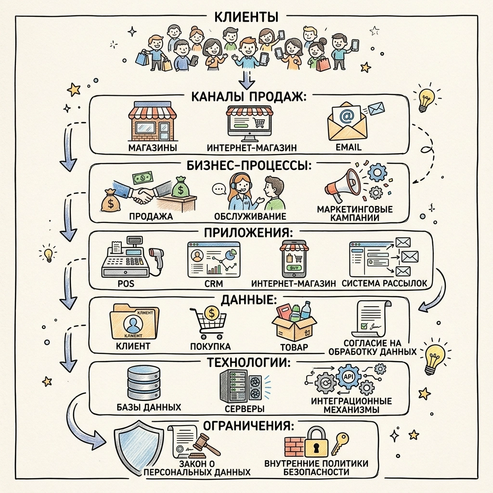
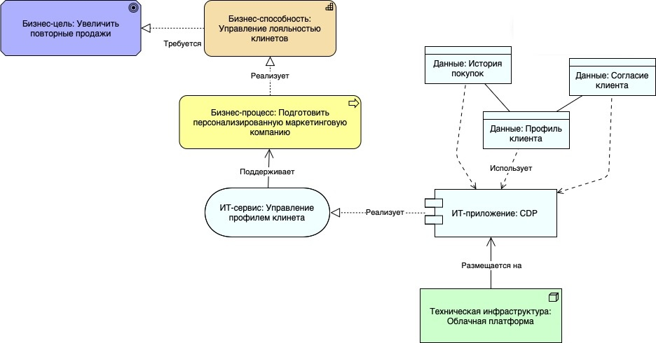
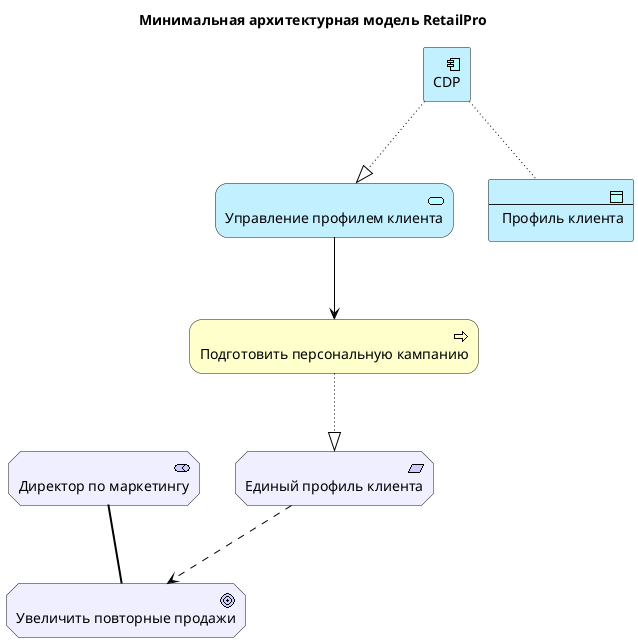
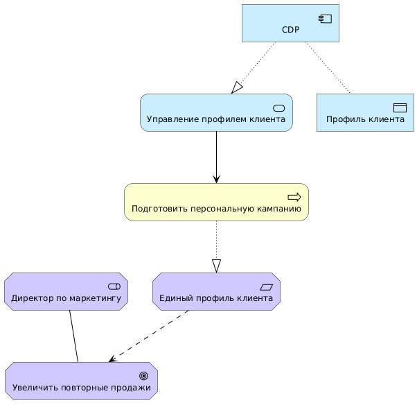
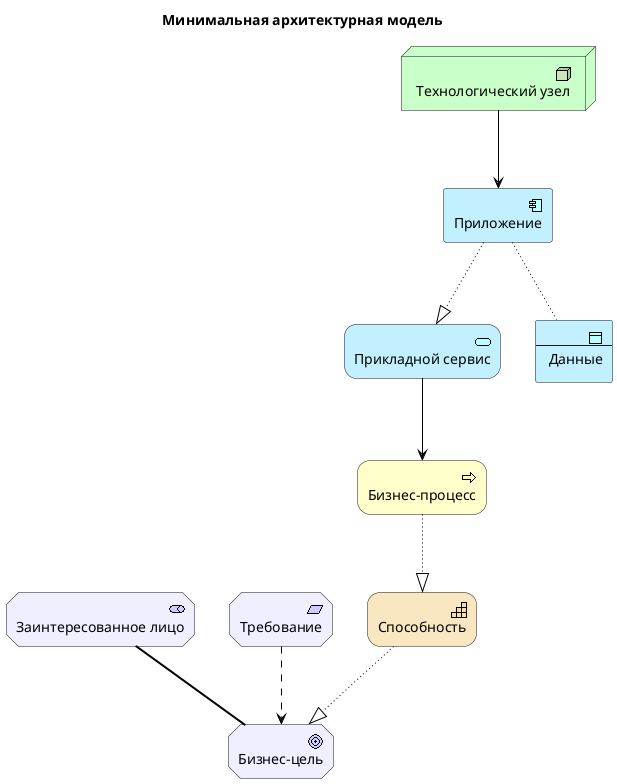

# Глава 1. Зачем нужна архитектура предприятия

[К оглавлению](../README.md) · [Следующая глава →](../02-architecture-layers/README.md)

**После изучения этой главы студент должен уметь:**

1. объяснять, что такое архитектура предприятия и зачем она нужна;
2. отличать архитектурный взгляд от локального бизнес- или ИТ-взгляда;
3. описывать предприятие как социотехническую систему;
4. выявлять типовые проблемы, возникающие при отсутствии архитектурного подхода;
5. объяснять связь между стратегией, бизнес-процессами, данными, приложениями и технологиями;
6. различать текущую, целевую и переходную архитектуру на базовом уровне;
7. понимать роль архитектуры предприятия в управлении изменениями.

## 1.1. Учебная ситуация: RetailPro хочет увеличить повторные продажи

Рассмотрим компанию **RetailPro**, это средняя розничная сеть, продающая бытовую электронику. У компании есть:

- физические магазины;
- интернет-магазин;
- программа лояльности;
- CRM-система;
- кассовая POS-система;
- ERP-система;
- система email-рассылок;
- набор Excel-отчетов, которые сотрудники готовят вручную.

**Руководство компании ставит стратегическую цель:** 

```text
увеличить повторные продажи и повысить лояльность клиентов за счет персонализированных предложений во всех каналах продаж.
```

На первый взгляд задача кажется маркетинговой. Нужно просто лучше понимать клиентов и отправлять им более подходящие предложения.

Однако при более внимательном рассмотрении выясняется, что проблема затрагивает почти все предприятие.

Чтобы отправить клиенту персональное предложение, RetailPro должна ответить на несколько вопросов, которые представлены в Таблице 1.1

**Таблица 1.1.** Что нужно для персонального предложения

| Вопрос | Что требуется |
|---|---|
| Кто этот клиент? | Единый профиль клиента |
| Что он покупал раньше? | История покупок |
| В каком канале он взаимодействует с компанией? | Данные из магазина, сайта, email, мобильного приложения |
| Разрешил ли он обработку персональных данных? | Учет согласий |
| Какие товары ему интересны? | Аналитика и сегментация |
| Как доставить предложение? | Интеграция с email, сайтом, CRM или кассой |
| Как измерить эффект? | Отчетность и аналитика |

Оказывается, что для простой на вид бизнес-задачи нужны изменения в разных областях:

- в бизнес-процессах маркетинга;
- в управлении клиентскими данными;
- в интеграции приложений;
- в технологической инфраструктуре;
- в правилах информационной безопасности;
- в ответственности подразделений.

Именно такие ситуации являются типичными для архитектуры предприятия.

## 1.2. Предприятие как сложная социотехническая система

Предприятие — это не только юридическое лицо или совокупность подразделений. С точки зрения архитектуры предприятие рассматривается как **сложная социотехническая система**.

Это означает, что предприятие включает не только людей и организационную структуру, но и технологии, данные, процессы, правила, продукты, услуги и внешних участников.

В архитектурном смысле предприятие можно рассматривать как систему, включающую элементы, представленные в Таблице 1.2.

**Таблица 1.2.** Элементы архитектуры предприятия

| Область | Примеры |
|---|---|
| Стратегия | цели, инициативы, показатели эффективности |
| Бизнес-модель | продукты, услуги, клиенты, каналы, источники дохода |
| Организация | подразделения, роли, ответственность |
| Процессы | продажи, закупки, маркетинг, обслуживание клиентов |
| Данные | клиенты, товары, заказы, платежи, согласия |
| Приложения | CRM, ERP, интернет-магазин, мобильное приложение |
| Технологии | серверы, облако, сети, базы данных, API Gateway |
| Правила и ограничения | регуляторные требования, политики безопасности |
| Внешняя среда | клиенты, партнеры, поставщики, государственные органы |

**Пример.** Если RetailPro хочет улучшить клиентский опыт, недостаточно изменить только сайт или только CRM. Нужно учитывать все объекты, представленные на Рис. 1.1, а также связи между ними



**Рис. 1.1.** Элементы архитектуры предприятия

Если изменить один элемент, например внедрить новую CRM, это повлияет на:

- работу маркетологов;
- работу продавцов;
- интеграцию с интернет-магазином;
- клиентские данные;
- отчетность;
- требования безопасности;
- бюджет ИТ-поддержки.

Поэтому предприятие нельзя понимать только как набор отделов или набор информационных систем. Его нужно рассматривать как взаимосвязанную систему.

## 1.3. Типовые проблемы без архитектурного подхода

Архитектура предприятия особенно важна там, где организация сталкивается с большим количеством взаимосвязанных изменений. Если архитектурный подход отсутствует, изменения часто реализуются локально: каждый отдел или проект решает свою задачу отдельно. Это приводит к накоплению архитектурных проблем.

### 1.3.1. Разрозненные информационные системы

Одна из самых распространенных проблем — отсутствие согласованного ИТ-ландшафта. Например, в RetailPro данные о клиенте хранятся в трех разных системах:

| Система | Как представлен клиент |
|---|---|
| CRM | Иван Петров, email: `ivan.petrov@example.com` |
| Интернет-магазин | I. Petrov, телефон: `+7 900 123-45-67` |
| POS-система | карта лояльности: `LP-009872` |

Формально это один и тот же человек. Но для систем это три разные записи.

Последствия:

- невозможно точно посчитать историю покупок клиента;
- персональные предложения могут быть неправильными;
- один клиент может получать несколько одинаковых рассылок;
- аналитика по клиентам становится недостоверной;
- повышаются риски нарушения правил обработки персональных данных.

**Архитектурный вопрос здесь звучит так:** Как должна быть устроена архитектура данных и приложений, чтобы у компании был единый профиль клиента?

### 1.3.2. Локальная автоматизация вместо целостного решения

Часто подразделения внедряют системы для своих локальных задач, не учитывая интересы всей организации.

**Пример.** Отдел маркетинга RetailPro самостоятельно приобрел облачный сервис email-рассылок. Сначала это решило локальную проблему: маркетологи стали быстрее запускать кампании. Но позже появились новые сложности:

- списки клиентов выгружаются из CRM вручную;
- данные о результатах рассылок не возвращаются в CRM;
- нет связи с историей покупок;
- невозможно автоматически исключать клиентов, отозвавших согласие;
- ИТ-директор не контролирует безопасность интеграции.

Локальное улучшение создало новые архитектурные риски.

**Архитектурный вопрос:** 

```text
Как новые приложения должны подключаться к корпоративному ИТ-ландшафту, чтобы не создавать хаос?
```

### 1.3.3. Дублирование данных и функций

Если нет архитектурного управления, разные системы начинают выполнять похожие функции и хранить одинаковые данные.

**Пример.** В RetailPro сегмент, к которому относится клиент, может рассчитываться:

- в CRM;
- в системе email-рассылок;
- в аналитической платформе;
- вручную в Excel.

В результате один и тот же клиент может быть:

- «премиальным» в CRM;
- «спящим» в системе рассылок;
- «перспективным» в аналитическом отчете;
- «неактивным» в Excel-файле маркетолога.

**Проблема здесь не только в данных, а в архитектуре ответственности:**

- Какая система является владельцем клиентского сегмента?
- Где рассчитывается сегмент?
- Кто отвечает за качество этой информации?
- Какие процессы используют этот сегмент?

### 1.3.4. Слабая связь между стратегией и ИТ

Еще одна типовая проблема — ИТ-проекты реализуются без явной связи с бизнес-целями.

**Пример.** RetailPro рассматривает проект внедрения новой CRM. Поставщик обещает удобный интерфейс, красивые отчеты и современные функции. Но архитектурный анализ выявляет вопросы:

- поможет ли новая CRM увеличить повторные продажи?
- поддерживает ли она единый профиль клиента?
- сможет ли она интегрироваться с POS и интернет-магазином?
- как она будет учитывать согласия клиентов?
- какие бизнес-процессы изменятся?
- какие legacy-системы нужно вывести из эксплуатации?
- какие данные нужно мигрировать?

Без архитектурного подхода проект может быть успешен технически, но бесполезен стратегически.

### 1.3.5. Высокая стоимость изменений

Когда системы связаны хаотично, любое изменение становится дорогим.

**Пример.** Изменение правила расчета скидки. Руководство RetailPro решило изменить правило лояльности: *если клиент совершил покупки более чем на 100 000 рублей за год, он получает персональную скидку 10%.*

Оказалось, что правило скидки реализовано в нескольких местах:

- в CRM;
- в POS-системе;
- в интернет-магазине;
- в Excel-макросе для отчетов;
- в инструкции для продавцов.

Теперь изменение требует участия нескольких команд. Нужно найти все места, где это правило применяется, синхронизировать изменения и протестировать их.

**Архитектурный вопрос:** 

```text
Где должны находиться бизнес-правила, чтобы их можно было изменять управляемо?
```
## 1.4. Что такое архитектура предприятия

Теперь можно дать первое рабочее определение.

> **Архитектура предприятия** — это структурированное описание предприятия, включающее его стратегические цели, бизнес-возможности, процессы, организационные роли, данные, приложения, технологии и связи между ними, используемое для анализа текущего состояния и проектирования изменений.

Это определение важно разобрать по частям.

**Архитектура как структурированное описание**

Архитектура предприятия — это не просто набор схем. Это согласованное описание ключевых элементов предприятия и их взаимосвязей.

Например, для RetailPro важно не только знать, что существуют CRM и POS-система. Важно понимать:

- какие бизнес-процессы они поддерживают;
- какие данные они хранят;
- какие интерфейсы используют;
- какие подразделения зависят от них;
- какие цели бизнеса они помогают достигать;
- какие проблемы создают.

**Пример.** Фрагмент архитектуры, представленный на Рис. 1.2 показывает не только отдельные элементы, но и смысловые связи между ними.



**Рис. 1.2**. Архитектурная диаграмма

**Архитектура как средство согласования бизнеса и ИТ**

Одна из главных функций архитектуры предприятия — создать общий язык для бизнеса и ИТ. Бизнес обычно формулирует свои ожидания в виде целей:

```text
Нам нужно увеличить повторные продажи.
Нам нужны персональные предложения.
Нам нужно быстрее запускать акции.
```

ИТ-специалисты обычно рассуждают в терминах систем:

```text
Нужна интеграция CRM и POS.
Нужно API.
Нужно хранилище данных.
Нужно качество мастер-данных.
```

Архитектура связывает эти два языка.

**Пример.** Перевод бизнес-требования в архитектурные элементы

| Бизнес-формулировка                 | Архитектурная интерпретация                 |
| ----------------------------------- | ------------------------------------------- |
| Хотим знать клиента во всех каналах | Нужен единый профиль клиента                |
| Хотим персональные предложения      | Нужна клиентская аналитика и сегментация    |
| Хотим быстро запускать кампании     | Нужна автоматизация маркетингового процесса |
| Хотим видеть эффект кампаний        | Нужна интеграция данных продаж и маркетинга |
| Хотим соблюдать закон               | Нужно управление согласиями и доступами     |

Архитектор предприятия помогает показать, что за каждым бизнес-желанием стоят изменения в процессах, данных, приложениях и технологиях.

## 1.5. Архитектурный взгляд: что он добавляет

Архитектурный взгляд отличается от локального взгляда тем, что рассматривает предприятие как систему взаимосвязанных элементов.

**Локальный взгляд** фокусируется на отдельной задаче. Например:

- маркетинг хочет новую систему рассылок;
- продажи хотят видеть историю клиента на кассе;
- ИТ хочет заменить устаревший сервер;
- аналитики хотят получать данные быстрее;
- юридический отдел хочет контролировать согласия клиентов.

Каждая задача сама по себе разумна. Но если решать их отдельно, можно получить набор несовместимых решений.

**Архитектурный взгляд** порождает другие вопросы:

1. Какая бизнес-цель стоит за изменением?
2. Какие заинтересованные лица участвуют?
3. Какие бизнес-возможности нужно развить?
4. Какие процессы изменятся?
5. Какие данные являются ключевыми?
6. Какие приложения должны быть интегрированы?
7. Какие технологии нужны?
8. Какие ограничения и риски есть?
9. Как перейти от текущего состояния к целевому?
10. Как проверить, что решение соответствует архитектурным принципам?

**Пример.** Руководство RetailPro хочет мобильное приложение для клиентов.

Локальная реакция:

```text
Нужно заказать разработку мобильного приложения.
```

Архитектурная реакция:

```text
Зачем нужно мобильное приложение?
Какие клиентские сценарии оно поддерживает?
Будет ли оно использовать единый профиль клиента?
Как оно подключится к программе лояльности?
Какие данные будет собирать?
Как будут учитываться согласия?
Какие API нужны?
Как изменятся процессы маркетинга и поддержки?
Какие системы будут затронуты?
```

Архитектура не отменяет разработку мобильного приложения, но помогает встроить его в целостную систему предприятия.

## 1.6. Основные слои архитектуры предприятия

В дальнейшем учебнике архитектура предприятия будет рассматриваться через несколько взаимосвязанных слоев.

На базовом уровне удобно выделить четыре основных слоя:

1. бизнес-архитектура;
2. архитектура данных;
3. архитектура приложений;
4. технологическая архитектура.

Дополнительно важно рассматривать мотивационный и стратегический контекст: цели, драйверы, требования и принципы.

### 1.6.1. Мотивационный и стратегический контекст

Этот слой отвечает на вопрос: зачем нужны изменения? Он включает:

- заинтересованных лиц (stakeholders);
- драйверы изменений (drivers);
- оценки проблем и возможностей (assessments);
- цели (goals);
- ожидаемые результаты (outputs);
- требования (requirements);
- архитектурные принципы (principles).

Примечание: в скобках указаны названия объектов языка ArchiMate, который будет использоваться в дальнейшем для моделирования архитектуры предприятия.

**Пример.** Мотивация RetailPro

| Элемент | Пример |
|---|---|
| Stakeholder | Директор по маркетингу |
| Driver | Рост конкуренции в онлайн-продажах |
| Assessment | Низкая персонализация предложений |
| Goal | Увеличить повторные продажи |
| Outcome | Рост LTV клиента |
| Requirement | Единый профиль клиента |
| Principle | Privacy by design |

### 1.6.2. Бизнес-архитектура

Бизнес-архитектура отвечает на вопрос: как предприятие создает ценность? Она описывает:

- продукты и услуги (product / service);
- способности (capabilities);
- бизнес-процессы (business process);
- организационные роли (role);
- бизнес-объекты (business object);
- каналы взаимодействия с клиентами.

**Пример.** Бизнес-архитектура RetailPro. Для цели «увеличить повторные продажи» RetailPro нужна способность:

```text
Управление клиентской лояльностью
```

Она реализуется через процессы:

```text
Сегментировать клиентов
Подготовить персональную кампанию
Отправить предложение
Измерить результат кампании
```

В этих процессах участвуют:

```text
Маркетолог кампаний
Аналитик клиентских данных
Менеджер продаж
```

### 1.6.3. Архитектура данных

Архитектура данных отвечает на вопрос: какие данные нужны предприятию и как они должны управляться? Она описывает:

- ключевые сущности данных;
- источники данных;
- мастер-данные;
- потоки данных;
- качество данных;
- владельцев данных;
- правила доступа и защиты.

**Пример.** Для разработки персонализированных предложений RetailPro нужны следующие данные:

| Данные | Для чего нужны |
|---|---|
| Профиль клиента | идентификация клиента |
| История покупок | анализ интересов |
| Товарные категории | рекомендации |
| Канал взаимодействия | выбор способа коммуникации |
| Согласие клиента | юридически корректная коммуникация |
| Реакция на кампанию | измерение эффективности |

Если эти данные неполные или противоречивые, персонализация будет работать плохо.

### 1.6.4. Архитектура приложений

Архитектура приложений отвечает на вопрос: Какие информационные системы поддерживают бизнес и данные? Она описывает:

- прикладные компоненты (Application Component);
- прикладные сервисы (Application Service);
- интерфейсы (Application Interface);
- интеграции (Application Integration);
- ответственность приложений;
- жизненный цикл приложений.

**Пример.** Приложения RetailPro

| Приложение              | Роль                            |
| ----------------------- | ------------------------------- |
| CRM                     | работа с клиентами и кампаниями |
| POS-система             | продажи в магазинах             |
| Интернет-магазин        | онлайн-продажи                  |
| CDP                     | единый профиль клиента          |
| Система рассылок        | доставка предложений            |
| Аналитическая платформа | сегментация и прогнозирование   |
_Примечание: CDP - Customer Data Platform_ 

**Архитектурный вопрос:** 
```text
Какая система является источником истины по клиентскому профилю?
```

### 1.6.5. Технологическая архитектура

Технологическая архитектура отвечает на вопрос: На какой инфраструктуре работают приложения и данные? Она описывает:

- серверы;
- облачные платформы;
- базы данных;
- сети;
- контейнерные платформы;
- интеграционные платформы;
- средства мониторинга;
- средства защиты информации.

**Пример.** Целевая технологическая архитектура Reatil Pro может включать:

```text
Cloud Platform
API Gateway
Message Broker
Cloud Data Warehouse
Kubernetes
Monitoring Platform
Identity Provider
```

Эти технологии нужны не сами по себе, а потому что они поддерживают бизнес-цель:

```text
персональные предложения во всех каналах продаж
```

## 1.7. Архитектура предприятия как модель связей

Главная ценность архитектуры предприятия состоит не в перечислении элементов, а в описании связей между ними.

Почему связи важнее списков? Можно составить список систем RetailPro:

```text
CRM
POS
ERP
Интернет-магазин
Система рассылок
Excel
```

Такой список полезен, но он не отвечает на ключевые вопросы:

- какие процессы поддерживает CRM?
- какие данные передает POS?
- почему Excel используется для отчетности?
- какая система влияет на персональные предложения?
- что изменится, если заменить CRM?
- какие системы затронет новое требование по согласиям клиентов?

Архитектурная модель должна показывать связи, например:

```text
POS-система → передает данные о покупках в CDP

CDP → формирует единый профиль клиента и используется аналитической платформой

Аналитическая платформа → формирует клиентские сегменты и передает их в систему рассылок

Система рассылок → доставляет персональное предложение клиенту
```

Теперь видно, как данные проходят через архитектуру и создают бизнес-ценность.

## 1.8. Текущая, целевая и переходная архитектура

Архитектура предприятия применяется для управления изменениями. Поэтому важно различать три типа архитектурного состояния:

1. текущая архитектура;
2. целевая архитектура;
3. переходная архитектура.

**Текущая архитектура** описывает то, как предприятие устроено сейчас. Она может включать:

- существующие процессы;
- существующие приложения;
- текущие данные;
- текущую инфраструктуру;
- текущие проблемы и ограничения.

Например, текущую архитектуру RetailPro можно описать так:

```text
CRM хранит данные клиентов.
Интернет-магазин хранит собственные учетные записи клиентов.
POS-система хранит данные по картам лояльности.
Excel используется для отчетов.
Система рассылок получает списки клиентов вручную.
Нет единого клиентского профиля.
```

Это не «плохая» архитектура. Это реальное состояние, от которого нужно отталкиваться.

**Целевая архитектура** описывает желаемое будущее состояние предприятия. Пример целевой архитектуры ReatailPro:

```text
CDP ведет единый профиль клиента.
CRM, POS и интернет-магазин передают данные в CDP через API.
Аналитическая платформа использует данные CDP для сегментации.
Система рассылок получает готовые сегменты.
Согласия клиентов учитываются централизованно.
Отчеты формируются автоматически.
```

Целевая архитектура должна быть связана с бизнес-целями. Иначе она превращается в набор технических пожеланий.

**Переходная архитектура** описывает промежуточное состояние между текущей и целевой архитектурой. Организация редко может перейти к целевому состоянию сразу. Обычно изменения выполняются поэтапно.

Например, RetailPro может переходить к целевой архитектуре за несколько шагов:

| Этап | Содержание |
|---|---|
| Переходная архитектура 1 | создан реестр клиентских данных, выбран владелец клиентского профиля |
| Переходная архитектура 2 | внедрена CDP, интегрированы CRM и интернет-магазин |
| Переходная архитектура 3 | подключена POS-система, запущена потоковая передача покупок |
| Целевая архитектура | работает персонализация предложений во всех каналах |

Переходная архитектура помогает сделать изменения управляемыми и реалистичными.

## 1.9. Минимальная архитектурная модель на ArchiMate

В следующих главах будет подробно изучаться графический язык ArchiMate, предназначенный для моделирования архитектуры предприятия. Этот язык включает набор графических элементов, представляющих разные архитектурные объекты и несколько типов связей.

Кроме того, мы будем использовать язык PlantUML, который позволяет представить архитектурную модель в виде программного кода. Этот язык нам нужен для взаимодействия с ИИ-агентами, которые не могут работать с изображениями, но очень хорошо пишут и отлаживают код.

Сейчас достаточно увидеть, как архитектурная идея может быть выражена в виде простой модели.

Для RetailPro можно построить простую цепочку:

```text
Директор по маркетингу связан с целью Увеличить повторные продажи

Требование Единый профиль клиента влияет на достижение цели

Бизнес-процесс Подготовить персональную кампанию реализует требование Единый профиль клиента

Бизнес-процесс Подготовить персональную кампанию поддерживается прикладным сервисом Управление профилем клиента

Прикладной сервис Управление профилем клиента реализуется приложением CDP

CDP использует данные Профиль клиента
```

Данная модель связывает бизнес-мотивацию, процесс, приложение и данные.

Этой цепочке соответствует PlantUML-код:



Этот код может быть выполнен с помощью бесплатного он-лайн сервиса на сайте [https://plantuml.com](https://plantuml.com). Построенная диаграмма представлена на Рис. 1.3.



Рис. 1.3. Минимальная архитектурная модель RetailPro

Как читать эту модель:

1. директор по маркетингу заинтересован в росте повторных продаж;
2. требование единого профиля клиента помогает достичь этой цели;
3. бизнес-процесс по подготовке персональных компаний реализует это требование:
4. бизнес-процесс подготовки кампании использует сервис управления профилем клиента;
5. сервис реализуется приложением CDP;
6. CDP работает с данными клиентского профиля.

Важно отметить, что даже такая маленькая модель уже дает архитектурную трассируемость:

```text
Цель → Требование → Процесс → Сервис → Приложение → Данные
```

## 1.10. Архитектура предприятия и управление изменениями

Архитектура предприятия нужна не только для описания текущего состояния. Ее основная практическая ценность — управление изменениями.

**Архитектура как карта изменений.** Когда организация реализует цифровую трансформацию, ей нужно понимать:

- что изменить;
- зачем изменить;
- в какой последовательности изменить;
- какие системы затронуты;
- какие данные нужно привести в порядок;
- какие процессы должны измениться;
- какие риски существуют;
- какие проекты нужны.

Архитектура предприятия помогает ответить на эти вопросы. Например, для перехода к персональным предложениям RetailPro должна сформировать программу согласованных изменений различных элементов организации:

| Направление | Изменение |
|---|---|
| Бизнес | изменить процесс подготовки кампаний |
| Данные | создать единый профиль клиента |
| Приложения | внедрить CDP и интегрировать CRM, POS, интернет-магазин |
| Технологии | использовать API Gateway и облачное хранилище данных |
| Управление | назначить владельца клиентских данных |
| Безопасность | реализовать учет согласий и управление доступом |

**Архитектура как средство принятия решений.** Пусть RetailPro рассматривает три варианта реализации цели.

1. развивать CRM как центральную клиентскую платформу;
2. внедрить специализированную CDP;
3. построить собственное хранилище клиентских данных.

Без архитектуры сравнение может свестись к стоимости лицензий. Но архитектурный анализ добавляет другие критерии:

| Критерий | Вопрос |
|---|---|
| Соответствие цели | помогает ли вариант увеличить повторные продажи? |
| Данные | обеспечивает ли единый профиль клиента? |
| Интеграция | можно ли подключить POS и интернет-магазин? |
| Скорость | как быстро можно запустить первый результат? |
| Риски | есть ли vendor lock-in? |
| Безопасность | как учитываются персональные данные? |
| Развитие | можно ли масштабировать решение? |

Архитектура предприятия делает выбор прозрачным и объяснимым.

## 1.11. Что делает архитектор предприятия

Архитектор предприятия не просто рисует схемы. Его задача — помогать организации принимать согласованные решения об изменениях:

- выявлять заинтересованных лиц;
- формулировать архитектурные цели и требования;
- описывать текущую архитектуру;
- проектировать целевую архитектуру;
- анализировать разрывы между текущим и целевым состоянием;
- согласовывать бизнес- и ИТ-представления;
- определять архитектурные принципы;
- оценивать варианты решений;
- участвовать в планировании миграции;
- контролировать соответствие проектов целевой архитектуре.

Из этого вытекает, что на проекте внедрения единого профиля клиента RetailPro архитектор должен выполнить следующие функции:

1. понять стратегическую цель маркетинга;
2. выявить существующие источники клиентских данных;
3. определить, какие процессы используют эти данные;
4. описать текущие приложения и интеграции;
5. предложить целевую схему;
6. выявить архитектурные разрывы;
7. предложить этапы перехода;
8. проверить, что решение соответствует принципам безопасности и API-first.

## 1.12. Типичные заблуждения об архитектуре предприятия

**Заблуждение 1. Архитектура — это красивые схемы**

Схемы важны, но архитектура не сводится к визуализации. Архитектура — это:

- структура;
- связи;
- принципы;
- решения;
- требования;
- ограничения;
- обоснование изменений.

Диаграмма без архитектурной логики — это просто рисунок.

**Заблуждение 2. Архитектура нужна только ИТ**

Архитектура предприятия включает ИТ, но не ограничивается ИТ. Если бизнес-процесс плохо организован, новая система не решит проблему. Если нет владельца данных, новая база данных не обеспечит качество информации. Если нет согласованных целей, ИТ-проект может не принести ценности.

**Заблуждение 3. Архитектура нужна только крупным корпорациям**

Даже средние и малые компании могут столкнуться с архитектурными проблемами:

- несколько систем;
- дубли данных;
- интеграции;
- регуляторные требования;
- цифровые каналы;
- аналитика;
- рост стоимости изменений.

Чем быстрее развивается организация, тем важнее архитектурное мышление.

**Заблуждение 4. Архитектура должна быть максимально детальной**

Архитектура должна быть достаточно детальной для решения конкретной задачи. Если цель — объяснить руководству необходимость CDP, не нужно моделировать все серверы. Если цель — спроектировать интеграцию POS и CDP, нужна более техническая детализация.

Уровень детализации зависит от аудитории и цели представления.

**Заблуждение 5. Архитектор заменяет проектную команду**

Архитектор не заменяет аналитиков, разработчиков, менеджеров проектов или владельцев продуктов. Он обеспечивает целостность:

```text
стратегия → бизнес → данные → приложения → технологии → проекты
```

## 1.13. Мини-кейс для самостоятельного разбора

**Ситуация:** RetailPro решила запустить мобильное приложение для клиентов.

Ожидаемые функции:

- просмотр бонусного баланса;
- персональные предложения;
- история покупок;
- электронные чеки;
- push-уведомления;
- управление согласием на коммуникации.

Маркетинг считает, что приложение повысит лояльность клиентов. ИТ-директор предупреждает, что текущие системы не готовы к такой интеграции. Юридический отдел требует, чтобы согласия клиентов обрабатывались корректно.

**Задание 1.** Выделите минимум пять заинтересованных лиц.

Пример:

```text
Директор по маркетингу
ИТ-директор
Юридический отдел
Клиент
Руководитель розничных продаж
```

**Задание 2.** Сформулируйте минимум три бизнес-цели.

Пример:

```text
Увеличить повторные продажи
Повысить вовлеченность клиентов
Снизить долю бумажных чеков
```

**Задание 3.** Сформулируйте минимум пять требований.

Пример:

```text
Мобильное приложение должно использовать единый профиль клиента.
Система должна отображать актуальный бонусный баланс.
Система должна учитывать согласия клиента на push-уведомления.
История покупок должна быть доступна клиенту в приложении.
Интеграция должна выполняться через API.
```

**Задание 4.** Определите затронутые архитектурные слои

| Слой | Что изменяется |
|---|---|
| Бизнес | |
| Данные | |
| Приложения | |
| Технологии | |
| Безопасность и ограничения | |

## 1.14. Типичные ошибки студентов при изучении темы

**Ошибка 1. Сразу переходить к ИТ-решению**

Плохо:

```text
Нужно внедрить мобильное приложение.
```

Лучше:

```text
Нужно повысить лояльность клиентов.
Для этого требуется цифровой канал взаимодействия.
Мобильное приложение — один из возможных вариантов реализации.
```

**Ошибка 2. Называть систему бизнес-процессом**

Плохо:

```text
CRM обрабатывает клиентов.
```

Лучше:

```text
Бизнес-процесс: обработать обращение клиента.
Приложение: CRM.
CRM поддерживает процесс обработки обращения.
```

**Ошибка 3. Игнорировать данные**

Плохо:

```text
Нужно интегрировать CRM и интернет-магазин.
```

Лучше:

```text
Нужно понять, какие данные передаются: профиль клиента, история покупок, согласия, бонусный баланс.
```

**Ошибка 4. Не указывать заинтересованных лиц**

Плохо:

```text
Компания хочет персонализацию.
```

Лучше:

```text
Директор по маркетингу хочет повысить эффективность кампаний.
Клиент ожидает релевантных предложений.
Юридический отдел требует соблюдения правил обработки персональных данных.
```

**Ошибка 5. Смешивать текущее и целевое состояние**

Плохо:

```text
У компании есть CDP.
```

Если CDP только планируется, правильно:

```text
В текущей архитектуре CDP отсутствует.
В целевой архитектуре CDP должна обеспечивать единый профиль клиента.
```

## 1.15. Контрольные вопросы

1. Почему предприятие можно рассматривать как социотехническую систему?
2. Чем архитектурный взгляд отличается от локального взгляда отдела или проекта?
3. Какие проблемы возникают при отсутствии архитектурного подхода?
4. Что такое архитектура предприятия?
5. Почему архитектура предприятия не сводится к ИТ-архитектуре?
6. Какие основные слои архитектуры предприятия можно выделить?
7. Как связаны бизнес-цель, бизнес-процесс, приложение и данные?
8. Что такое текущая архитектура?
9. Что такое целевая архитектура?
10. Что такое переходная архитектура?
11. Почему архитектура предприятия важна для управления изменениями?
12. Какие задачи выполняет архитектор предприятия?
13. Почему единый профиль клиента является не только технической, но и архитектурной задачей?
14. В чем опасность локальной автоматизации?
15. Почему список приложений еще не является архитектурной моделью?

## 1.16. Практическое задание

**Задание:** Используя описание RetailPro, выполните первичный архитектурный анализ.

**Часть 1.** Кратко опишите, какую бизнес-проблему решает RetailPro.

Формат:

```text
Компания RetailPro сталкивается с проблемой ...
Это мешает ...
Основная бизнес-цель состоит в ...
```

**Часть 2.** Выделите архитектурные элементы и заполните таблицу.

| Тип элемента | Пример из кейса |
|---|---|
| Stakeholder | |
| Driver | |
| Goal | |
| Requirement | |
| Business Process | |
| Business Object | |
| Application Component | |
| Data Object | |
| Technology Element | |
| Constraint | |

**Часть 3**. Постройте текстовую цепочку связей вида:

```text
Бизнес-цель
↓
Требование
↓
Бизнес-процесс
↓
Прикладной сервис
↓
Приложение
↓
Данные
↓
Технология
```

Пример:

```text
Увеличить повторные продажи
↓
Единый профиль клиента
↓
Подготовить персональную кампанию
↓
Управление профилем клиента
↓
CDP
↓
Профиль клиента
↓
Облачное хранилище данных
```

**Часть 4.** Постройте минимальную PlantUML-диаграмму. Используйте шаблон:



**Часть 5.** Объясните модель. Напишите 5–7 предложений:

- что показывает модель;
- зачем нужны изменения;
- какие бизнес- и ИТ-элементы связаны;
- какие риски или ограничения нужно учитывать.

## 1.17. Краткие выводы главы

1. Архитектура предприятия нужна для понимания и управления сложными изменениями в организации.
2. Предприятие следует рассматривать как социотехническую систему, включающую людей, процессы, данные, приложения, технологии и правила.
3. Основная ценность архитектурного подхода — выявление связей между бизнес-целями, процессами, данными, приложениями и технологиями.
4. Без архитектуры организация сталкивается с дублированием данных, хаотичной автоматизацией, высокой стоимостью изменений и слабой связью между ИТ-проектами и стратегией.
5. Архитектура предприятия помогает согласовать бизнес и ИТ на общем языке.
6. В архитектуре важно различать текущее, целевое и переходное состояние.
7. Даже простая ArchiMate-модель может показать трассируемость от бизнес-цели до приложения и данных.
8. Архитектор предприятия помогает не просто проектировать системы, а управлять развитием предприятия как целостной системы.


---

[К оглавлению](../README.md) · [Следующая глава →](../02-architecture-layers/README.md)
