# Глава 2. Основные слои архитектуры предприятия

[← Предыдущая глава](../01-why-enterprise-architecture/README.md) · [К оглавлению](../README.md) · [Следующая глава →](../03-togaf-framework/README.md)

**После изучения этой главы студент должен уметь:**

1. объяснять, зачем архитектуру предприятия разделяют на слои;
2. различать мотивационный, стратегический, бизнес-, информационный, прикладной и технологический слои;
3. приводить примеры элементов каждого слоя;
4. объяснять связь между бизнес-целями, бизнес-возможностями, процессами, данными, приложениями и технологиями;
5. выявлять архитектурные элементы разных слоев в описании организации;
6. строить простую многослойную архитектурную цепочку;
7. понимать типичные ошибки при смешении элементов разных слоев.

## 2.1. Учебная ситуация: почему одного списка систем недостаточно

В предыдущей главе мы рассмотрели компанию **RetailPro** — розничную сеть, которая хочет увеличить повторные продажи за счет персонализированных предложений во всех каналах.

ИТ-директор RetailPro подготовил список используемых систем:

```text
CRM
ERP
POS-система
Интернет-магазин
Система email-рассылок
Excel-отчеты
```

На первый взгляд список полезен. Он показывает, какие приложения есть в компании. Но для архитектурного анализа этого недостаточно. Этот список не отвечает на вопросы:

- какие бизнес-цели поддерживают эти системы;
- какие процессы они автоматизируют;
- какие данные в них хранятся;
- какие подразделения используют эти системы;
- какие системы являются источниками мастер-данных;
- какие технологии обеспечивают их работу;
- какие изменения нужны для перехода к персонализации.

Архитектура предприятия должна показывать не только **что есть**, но и **как связано**.

Как мы разбирали в предыдущей главе, возможны две точки зрения на ситуацию. Первая – локальный ИТ-взгляд:

```text
У компании есть CRM, POS, интернет-магазин и система рассылок.
Нужно интегрировать их между собой.
```

Альтернатива - архитектурный взгляд, которые богаче, потому что связывает бизнес, данные, приложения и технологии:

```text
Цель бизнеса — увеличить повторные продажи.
Для этого нужна способность персонализировать предложения.
Эта способность требует процесса сегментации клиентов.
Процесс использует данные о клиентах и покупках.
Данные сейчас хранятся в CRM, POS и интернет-магазине.
Для объединения данных требуется CDP.
CDP должна быть интегрирована через API и поддерживаться облачной платформой данных.
```

**Таблица 2.1.** Слои архитектуры предприятия

| Слой | Главный вопрос | Примеры элементов |
|---|---|---|
| Мотивационный | Зачем нужны изменения? | stakeholder, driver, goal, requirement |
| Стратегический | Какие способности нужны предприятию? | capability, resource, course of action |
| Бизнес | Как работает бизнес? | actor, role, process, business service |
| Информационный | Какие данные нужны и как они устроены? | customer, order, product, consent |
| Приложения | Какие приложения поддерживают бизнес? | CRM, ERP, CDP, application service |
| Технологии | На чем работают приложения? | cloud, database, server, API Gateway |

## 2.2. Зачем архитектуру предприятия разделяют на слои

Предприятие слишком сложно, чтобы описывать его одной диаграммой или одним списком. Поэтому архитектуру делят на слои.

**Слой архитектуры** — это область описания предприятия, объединяющая элементы одного типа и отвечающая на определенный вопрос.

Подход на основе выделения слоев позволяет рассматривать предприятие с разных уровней / точек зрения:

```text
Зачем нужны изменения?
          ↓
Какие способности нужны бизнесу для этих изменений?
          ↓
Какие процессы и роли реализуют эти способности?
          ↓
Какие данные нужны?
          ↓
Какие приложения работают с данными и поддерживают процессы?
          ↓
Какие технологии обеспечивают работу приложений?
```

Каждый слой помогает ответить на свой набор вопросов.

В учебнике мы будем использовать базовую структуру, представленную в Таблице 2.1.

В языке ArchiMate эти слои представлены формализованно. Позже мы будем изучать их как элементы языка. Сейчас важно понять управленческий смысл каждого слоя.

## 2.3. Мотивационный слой: зачем нужны изменения

Мотивационный слой описывает причины, цели и ограничения архитектурных изменений. Он отвечает на вопрос

*Почему организация должна измениться*?

**Таблица 2.2.** Основные элементы мотивационного слоя

| Элемент | Смысл | Пример RetailPro |
|---|---|---|
| Stakeholder | заинтересованное лицо | директор по маркетингу |
| Driver | фактор, вызывающий изменения | рост конкуренции |
| Assessment | оценка ситуации | низкая персонализация |
| Goal | цель | увеличить повторные продажи |
| Outcome | ожидаемый результат | рост LTV клиента |
| Requirement | требование | единый профиль клиента |
| Constraint | ограничение | требования закона о персональных данных |
| Principle | принцип | Privacy by design |

**Пример.** В RetailPro мотивационная логика может выглядеть так:

```text
Директор по маркетингу заинтересован в реакции на
          ↓
Рост конкуренции в онлайн-канале, который приводит к оценке:
          ↓
Низкая персонализация предложений.
          ↓
Это формирует цель: Увеличить повторные продажи.
          ↓
Для достижения цели требуется: Единый профиль клиента.
          ↓
При реализации нужно соблюдать принцип: Privacy by design.
```

Эта цепочка важна, потому что она показывает, что требование «единый профиль клиента» не является технической прихотью. Оно продиктовано с бизнес-целью.

Мини-модель на языке PlantUML, описывающая эту цепочку и соответствующая диаграмма:

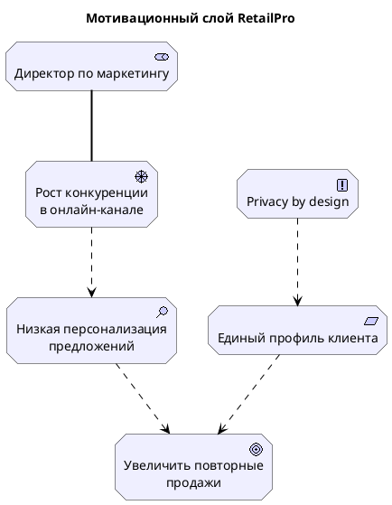

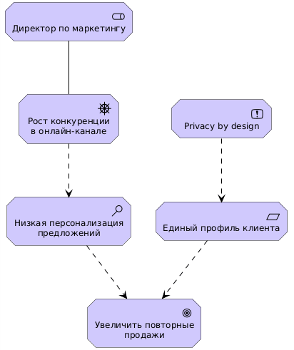

**Рис. 2.1**. Мотивационный слой RetailPro

**Типичные ошибки.** Очень часто цель формулируют как «Внедрить систему». Это следствие локального взгляда, архитектурный подход должен давать более целостное преставление о связях ИТ-решений с бизнес-целями:

```text
Цель: увеличить повторные продажи
Требование: обеспечить единый профиль клиента
Возможное решение: внедрить CDP
```

Еще одна ошибка - не указывать stakeholder. Если не указано заинтересованное лицо, непонятно, для кого важна цель.

## 2.4. Стратегический слой: какие способности нужны предприятию

Стратегический слой связывает цели организации с устойчивыми способностями, ресурсами и направлениями действий. Он отвечает на вопрос:

*Какими способностями должно обладать предприятие, чтобы достигать целей?*

**Способность** или **capability** — это способность предприятия выполнять определенный вид деятельности и достигать результата. Более подробно моделирование и анализ способностей рассмотрены в Приложении G.

**Важно:** capability — это не процесс и не приложение, разница между ними представлена в Таблице 2.3.

**Таблица 2.3.** Capability, process и application

| Тип | Пример | Комментарий |
|---|---|---|
| Capability | Управление клиентской лояльностью | Отвечает на вопрос: *что организация должна уметь делать*? |
| Business Process | Начислить бонусы клиенту | Конкретная последовательность действий, отвечает на вопрос: *как это выполняется*? |
| Application Component | CRM | Приложение, поддерживающее процесс, отвечает на вопрос: *с помощью какой системы это автоматизируется*? |

**Пример.** Для достижения цели «увеличить повторные продажи» RetailPro нужны следующие способности:

```text
Управление клиентскими данными
Управление клиентской лояльностью
Управление маркетинговыми кампаниями
Клиентская аналитика
Омниканальные продажи
Управление согласиями клиентов
```

Эти способности могут быть реализованы разными процессами, ролями, приложениями и технологиями.

**Карта бизнес-возможностей** помогает увидеть, какие области предприятия важны для стратегии. Пример для RetailPro:

```text
Клиентское взаимодействие
├── Управление клиентскими данными
├── Управление лояльностью
├── Клиентская аналитика
├── Управление кампаниями
└── Омниканальные продажи
```

Соответствующая модель PlantUML:

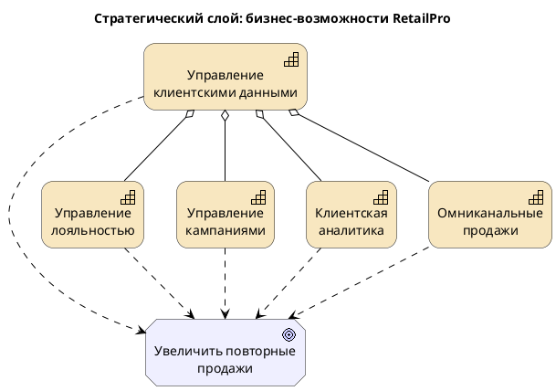

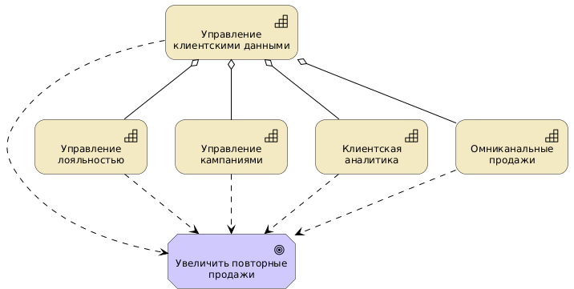

**Рис. 2.2**. Стратегический слой: бизнес-возможности RetailPro

**Типичными ошибками** при моделировании способностей являются:

- Формулировать способность как действие / использовать глагол. Неудачный вариант: «Сегментировать клиентов», лучше: «Сегментация клиентов». Такой подход подчеркивает, что способность не является процессом, а описывает то, что организация может делать.

- Называть приложение бизнес-возможностью. Согласно ресурсной теории фирмы (Resource Based View - RBV), способность – это комбинация ресурсов, дающих компании конкурентное преимущество (более подробно см. приложение G). С этой точки зрения, приложение лишь один из ресурсов, формирующих способность, наряду с персоналом, данными и другими элементами архитектуры предприятия.

- Слишком детализировать карту capabilities. Карта возможностей — стратегический инструмент. Она не должна превращаться в список всех операций.

## 2.5. Бизнес-слой: как работает бизнес

Бизнес-слой описывает деятельность предприятия, роли участников, процессы, события, бизнес-объекты и услуги. Он отвечает на вопрос:

*Как предприятие создает ценность для клиентов и других заинтересованных лиц*?

**Таблица 2.4.** Основные элементы бизнес-слоя

| Элемент | Смысл | Пример RetailPro |
|---|---|---|
| Business Actor | организационная единица или внешний участник | отдел маркетинга |
| Business Role | роль, выполняемая участником | маркетолог кампаний |
| Business Process | последовательность действий | подготовить маркетинговую кампанию |
| Business Function | область деятельности | маркетинг |
| Business Event | событие, запускающее поведение | начало сезонной акции |
| Business Object | бизнес-понятие | клиент, кампания, предложение |
| Business Service | услуга, предоставляемая бизнесом | персональное предложение клиенту |
| Product | продукт или пакет услуг | программа лояльности |

**Пример.** Бизнес-процесс подготовки персональной маркетинговой компании RetailPro запускается событием, отмечающим начало сезона акций, и включает следующие шаги:

```text
1. Наступает сезонная акция.
2. Маркетолог определяет цель кампании.
3. Аналитик формирует клиентские сегменты.
4. Маркетолог создает персональные предложения.
5. Предложения доставляются клиентам.
6. Результаты кампании анализируются.
```

Мини-модель PlantUML:

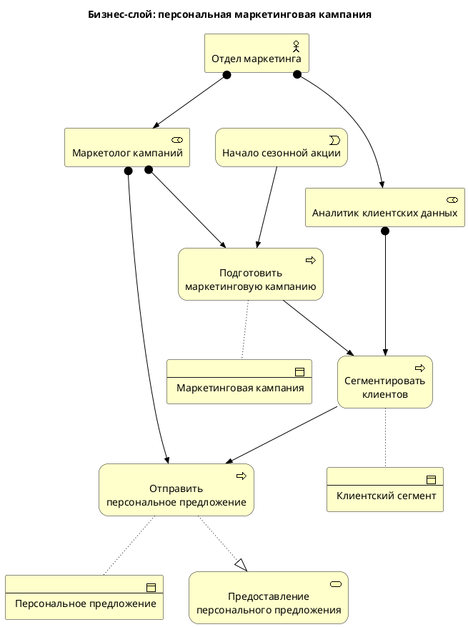

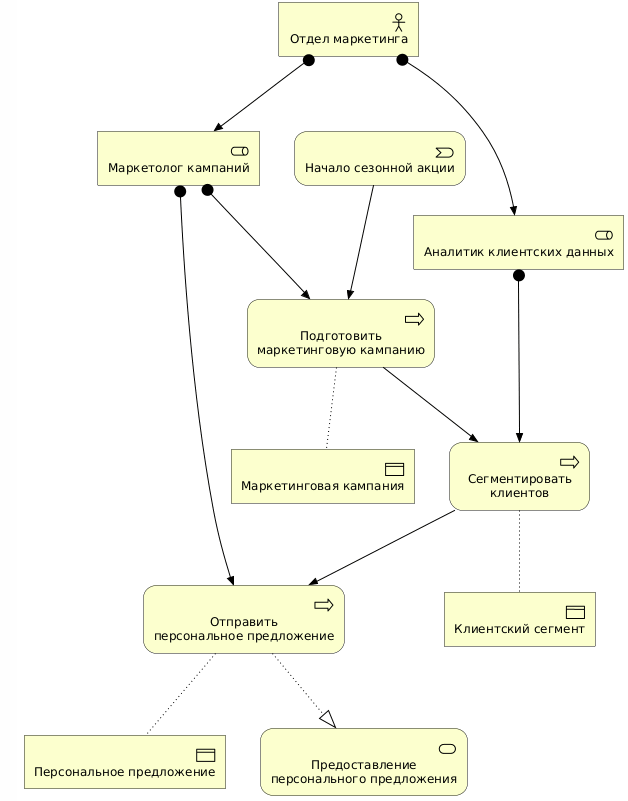

**Рис. 2.3.** Бизнес-слой: персональная маркетинговая компания

**Как отличить процесс от функции.** В практике архитектурного моделирования наибольшую сложность для аналитиков представляет концептуальное разделение элементов Process и Function. Формально, оба этих элемента описывают внутреннее поведение системы. Однако они представляют принципиально разные проекции (ортогональные взгляды) на операционную деятельность организации (Рис. 2.4).

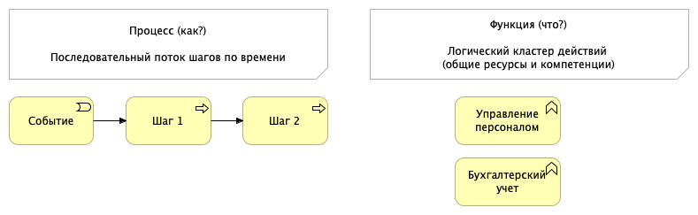

**Рис. 2.4.** Ортогональность поведенческих взглядов

В спецификации языка ArchiMate даются такие определения:

- Процесс – это поведенческий элемент, который группирует последовательности действий (шагов), направленных на достижение определенного результата. Процесс жестко привязан к временной шкале и причинно-следственным связям.

- Функция – это поведенческий элемент, который группирует действия на основе общего набора ресурсов, компетенций, знаний или используемых инструментов. Функция представляет собой обособленный кластер корпоративных возможностей, не имеющий явной временной шкалы.

**Таблица 2.5.** Критерии дифференциации процессов и функций

| Критерий | Процесс | Функция |
|---|---|---|
| Доминирующий вопрос | **Как** создается ценность? В каком порядке выполняются действия? | **Что** умеет делать организация/система? Какими компетенциями она обладает? |
| Временной фактор | **Динамическая структура**. Имеет четко выраженную хронологию, начало (триггер, событие) и завершение. | **Статическая структура**. Существует непрерывно, описывает постоянную способность организации. |
| Упорядоченность | Действия связаны **отношениями следования** (Triggering) или **потока** (Flow). | Действия связаны внутренним **концептуальным сходством или общим ресурсом**, порядок не важен. |
| Критерии группировки | Ориентация на **сквозной результат** или продукт для конкретного клиента (внешнего/внутреннего) | Ориентация на **экспертизу**, профессиональные роли или ИТ-модули (например, ERP-модуль "Финансы"). |
| Стабильность | **Меняется** при оптимизации скорости, затрат или качества цепочки. | Обладает **высокой стабильностью**. Учет или маркетинг остаются функциями даже при изменении процессов. |
| Типы связей | **Динамические связи:** Triggering – для указания причинно-следственного перехода от шага к шагу, и Flow– для передачи информации или объектов между этапами. | **Структурные связи:** Composition / Aggregation для детализации крупных функций на подфункции, а также связи Assignment, связывающие бизнес-роли или ИТ-компоненты с выполняемыми ими функциями. |

Архитектурный смысл дуализма процессов и функций заключается в управлении сложностью:

- Функциональный взгляд позволяет архитектору оценить архитектурный ландшафт с точки зрения владения ресурсами и дублирования возможностей. Если две разные функции в модели выполняют аналогичные действия, это явный сигнал о неэффективности архитектуры и избыточности затрат.

- Процессный взгляд позволяет смоделировать цепочки создания ценности (Value Streams). Процесс может «прошивать» несколько функций насквозь. Например, сквозной процесс «От заказа до оплаты» (Order-to-Cash) поочередно задействует шаги, которые семантически относятся к разным функциям: «Продажи», «Логистика» и «Управление финансами».

**Таблица 2.6.** Примеры процессов и функций

| Business Function | Business Process |
|---|---|
| Маркетинг | Подготовить кампанию |
| Продажи | Оформить продажу |
| Клиентская поддержка | Обработать обращение |
| Управление данными | Обновить профиль клиента |

**Типичные ошибки** при моделировании бизнес-слоя:

- Называть процесс существительным, лучше использовать глагольные формы, например, «Подготовить маркетинговую компанию», а не «Маркетинговая компания».

- Путать роль и подразделение

```text
Business Actor: Отдел маркетинга
Business Role: Маркетолог кампаний
```

- Забывать бизнес-объекты. Процесс без объектов неполон. Важно показать, с чем работает процесс: кампания, клиентский сегмент, персональное предложение.

## 2.6. Слой данных: какие данные нужны предприятию

В структуре ArchiMate различные представления данных используются в разных слоях

- **Business Object** — бизнес-понятие, бизнес-слой;
- **Data Object** — данные, используемые приложениями, слой приложений;
- **Artifact** — физическая реализация данных, технический слой.

В реальной жизни сотрудники для выполнения своих задач (бизнес-слой) используют различные данные (информационный слой), которые в основном обрабатываются в ИТ-системах (слой приложений) и реализуются с помощью технологий хранения (технический слой).

В ArchiMate информационный слой отсутствует, но в учебных целях удобно выделять слой данных отдельно, потому что данные являются центральным объектом цифровой трансформации. Слой данных отвечает на вопрос:

*Какие данные нужны предприятию, где они возникают, как используются и кто за них отвечает?*

**Таблица 2.6**. Представление данных в разных слоях.

| Тип | Смысл | Пример |
|---|---|---|
| Business Object | понятие предметной области | Клиент |
| Data Object | цифровое представление в системе | Профиль клиента |
| Artifact | физический файл, таблица, схема | customer_profile_table.sql |

**Пример.** Клиент как бизнес-объект и данные. В бизнесе клиент – это человек или организация, покупающая товары RetailPro.

В информационных системах клиент представлен разными объектами данных:

```text
Customer Profile в CDP
Customer Account в интернет-магазине
Loyalty Card Record в POS
CRM Contact в CRM
```

Архитектурная задача — согласовать эти представления.

При моделировании архитектуры данных необходимо задать следующие вопросы:

1. Какие данные являются критически важными?
2. Где эти данные создаются?
3. Где они изменяются?
4. Какая система является источником истины?
5. Кто владелец данных?
6. Как обеспечивается качество данных?
7. Как данные передаются между системами?
8. Какие ограничения действуют на использование данных?

**Таблица 2.7**. Пример данных RetailPro

| Данные | Источник | Использование | Проблема |
|---|---|---|---|
| Профиль клиента | CRM, сайт, POS | персонализация | дубли |
| История покупок | POS, интернет-магазин | аналитика | нет единого формата |
| Согласия клиента | сайт, CRM | коммуникации | не синхронизированы |
| Товар | ERP | рекомендации | неполные атрибуты |
| Клиентский сегмент | аналитика | кампании | рассчитывается вручную |

Пример модели архитектуры данных на языке PlantUML

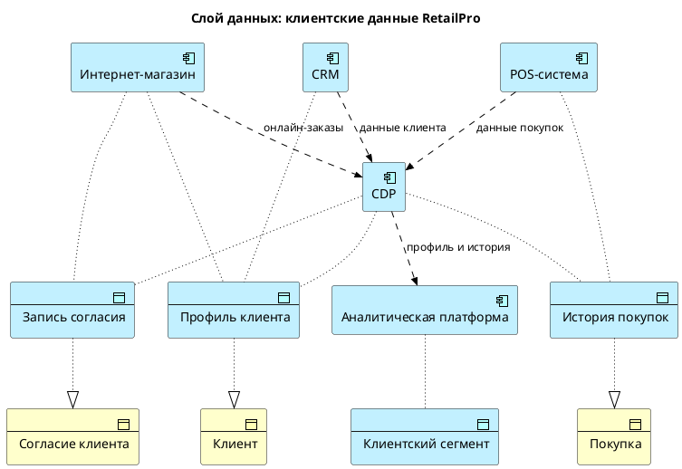

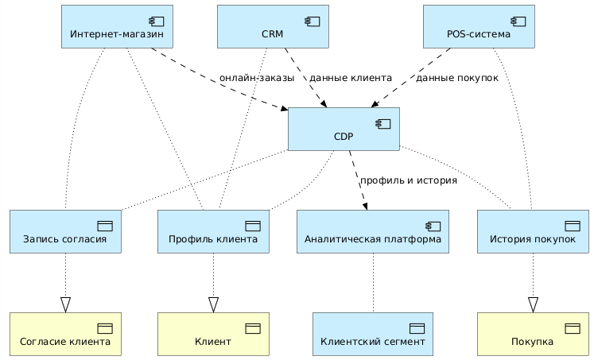

**Рис. 2.5.** Слой данных: клиентские данные RetailPro

Диаграмма на Рис. 2.5 показывает, как бизнес-объекты (Клиент, Покупка, Согласие клиента) реализуются в слое приложений с помощью элементов Data Object, и какие прикладные системы (Application Components) имеют доступ к этим данным. Также показана передача данных между приложениями с помощью связей типа Flow.

**Типичные ошибки** при моделировании данных:

- Не различать бизнес-объект и объект данных

```text
Клиент — бизнес-объект.
Профиль клиента — объект данных.
Таблица customer — физический артефакт.
```

- Не указывать источник истины. Если не определено, какая система является единственным источником данных (т.е. объекты данных могут создаваться и модифицироваться только в этой системе), может возникнуть дублирование и появление несогласованных версий одного и того же объекта.

- Игнорировать качество и владение данными. Архитектура данных – это не только структура таблиц, но и ответственность, качество, жизненный цикл и правила использования.

## 2.7. Прикладной слой: какие приложения поддерживают бизнес

Прикладной слой описывает информационные системы, их функции, интерфейсы и взаимодействия. Он отвечает на вопрос:

*Какие приложения и прикладные сервисы нужны для поддержки бизнес-процессов и данных?*

**Таблица 2.7.** Основные элементы прикладного слоя

| Элемент | Смысл | Пример RetailPro |
|---|---|---|
| Application Component | приложение или его часть | CRM, CDP |
| Application Service | функциональность, предоставляемая приложением | управление профилем клиента |
| Application Function | внутренняя функция приложения | расчет сегмента |
| Application Interface | точка доступа к сервису | Customer API |
| Data Object | объект данных | профиль клиента |
| Application Process | прикладной процесс | обновление профиля клиента |

**Пример.** Для персонализации RetailPro может использовать:

```text
CRM — работа с клиентами и кампаниями
CDP — единый профиль клиента
POS — данные о покупках в магазинах
Интернет-магазин — онлайн-заказы
Аналитическая платформа — сегментация клиентов
Система рассылок — доставка предложений
```

**Важный архитектурный вопрос:** Как эти приложения взаимодействуют и какие сервисы они предоставляют бизнесу?

**Таблица 2.8.** Различия между Application Component и Application Service

| Application Component | Application Service |
|---|---|
| CDP | управление профилем клиента |
| Аналитическая платформа | сегментация клиентов |
| Система рассылок | доставка email-предложений |
| POS | регистрация покупки |

Компонент реализует сервис. Сервис используется бизнес-процессом или другим приложением.

Модель прикладной архитектуры PlantUML

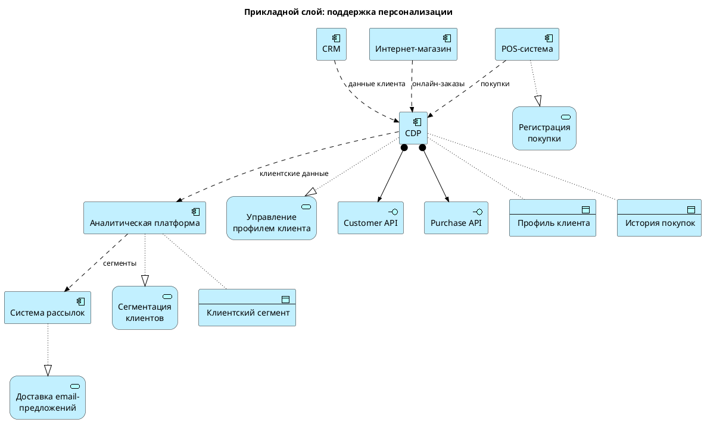

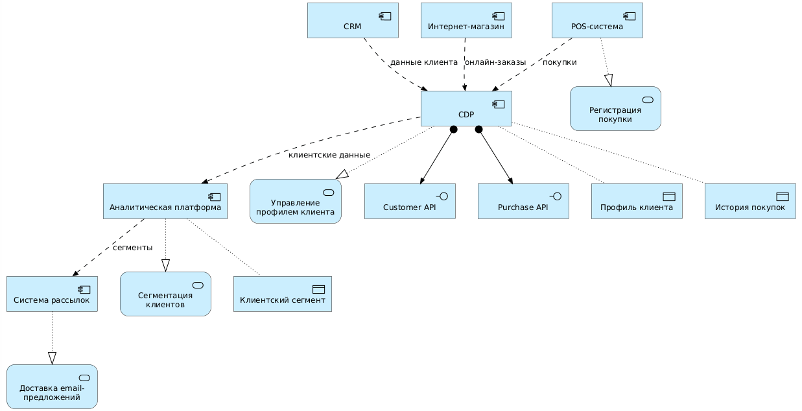

**Рис. 2.6.** Прикладной слой RetailPro: поддержка персонализации

Данная архитектурная диаграмма показывает приложения (Application Components), прикладные сервисы (Application Services), которые они реализуют, и данные (Data Objects), к которым они имею доступ. Для CPM показаны API интерфейсы (Applicatipn Interfaces), которые она реализует.

**Типичные ошибки,** которые возникают при моделировании прикладной архитектуры:

- Называть приложение бизнес-ролью или процессом
- Показывать только приложения без сервисов. Если диаграмма содержит только CRM, POS и CDP, непонятно, какую функциональность они предоставляют.
- Не показывать интеграции. Если цель диаграммы — понять ИТ-ландшафт, важно показывать потоки данных или сервисные зависимости.

## 2.8. Технологический слой: на чем работают приложения

Технологический слой описывает инфраструктуру, платформы и технологические сервисы, которые поддерживают прикладной слой. Он отвечает на вопрос:

*На какой технологической основе работают приложения и данные?*

**Таблица 2.9.** Основные элементы технологического слоя

| Элемент | Смысл | Пример RetailPro |
|---|---|---|
| Node | вычислительный или инфраструктурный узел | Cloud Platform |
| Device | физическое устройство | POS-терминал |
| System Software | системное или платформенное ПО | PostgreSQL, Kubernetes |
| Technology Service | технологическая услуга | Database Hosting |
| Technology Interface | технологический интерфейс | HTTPS endpoint |
| Artifact | физический файл или развертываемый компонент | customer-service.jar |
| Communication Network | сеть | корпоративная сеть |

**Пример.** Целевая технологическая архитектура RetailPro может включать:

```text
Cloud Platform
API Gateway
Message Broker
Cloud Data Warehouse
Kubernetes
PostgreSQL
Identity Provider
Monitoring Platform
```

Но важно помнить: технологии выбираются не сами по себе. Они должны поддерживать прикладные сервисы и бизнес-цели.

Модель технологической архитектуры на PlantUML

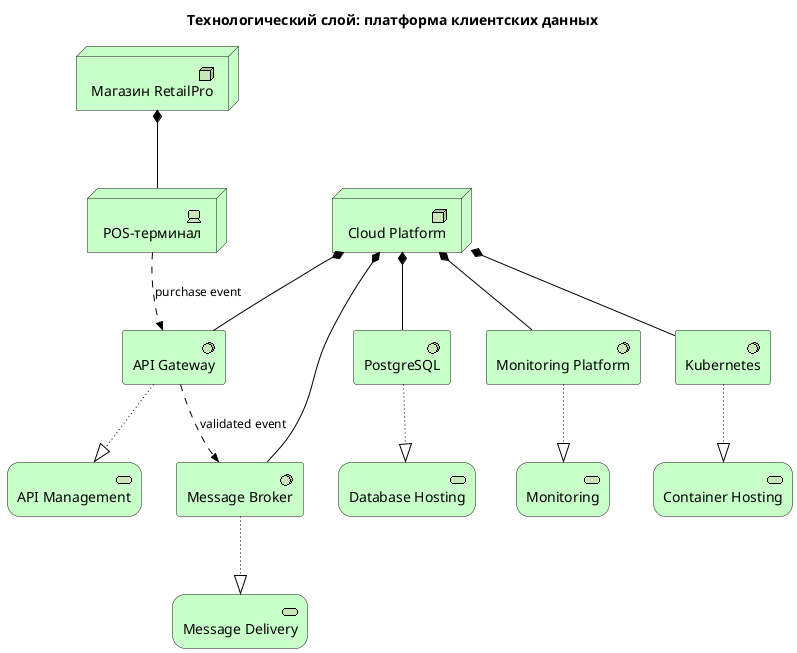

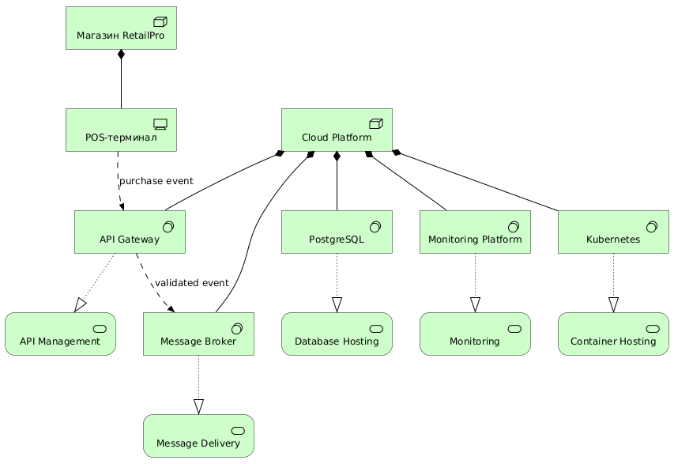

**Рис. 2.7.** Технологический слой RetailPro: платформа клиентских данных

Этот код на PlantUML и соответствующая диаграмма на Рис. 2.7 описывают **технологическую архитектуру платформы клиентских данных (CDP)**, которая собирает информацию о покупках из розничных магазинов. Говоря простыми словами, здесь показано «железо» и системные программы, а также то, как данные о покупке передаются с кассы в облачную систему. Давайте разберем эту схему по кирпичикам.

**1. Где всё физически находится (Узлы и Устройства)**

Архитектура разделена на две основные локации (в коде они называются `Node` и `Device`):

- Магазин RetailPro (`node_store`) – это обычный физический магазин. Внутри него стоит POS-терминал (`dev_pos_terminal`) – привычная нам компьютерная касса, на которой продавец сканирует товары.
- Cloud Platform (`node_cloud`) – это удаленное облако (серверы в дата-центре), где развернута и работает вся основная ИТ-платформа.

**2. Что внутри облака (Системный софт и Сервисы)**

Внутри облака крутятся 5 важных программных модулей. Каждый из них реализует свою ИТ-службу (в коде связь `Rel_Realization` – «реализует сервис»):

1. API Gateway (Шлюз ИТ-интерфейсов) – «входная дверь» для данных в облако. Он обеспечивает сервис API Management (управляет подключениями, проверяет безопасность).
2. Message Broker (Брокер сообщений) – цифровая почта. Он реализует сервис Message Delivery(гарантирует, что ни одно уведомление о покупке не потеряется, даже если система нагружена).
3. Kubernetes – оркестратор контейнеров. Он реализует сервис Container Hosting (автоматически управляет работой микросервисов, выделяет им память и запускает новые копии программ при наплыве покупателей).
4. PostgreSQL – база данных. Она предоставляет сервис Database Hosting (надежно хранит информацию о клиентах и их покупках на жестких дисках).
5. Monitoring Platform – система слежения. Она реализует сервис Monitoring (следит за здоровьем серверов, чтобы вовремя заметить сбои или перегрев).

**3. Как движутся данные (Потоки)**

Самая интересная часть — это жизнь одного чека (связи `Rel_Flow`):

1. Шаг 1: Покупатель оплачивает товар на кассе. POS-терминал отправляет событие покупки (`purchase event`) в облако, и его первым встречает API Gateway.
2. Шаг 2: API Gateway проверяет, правильный ли пришел запрос (валидирует его). Если всё ок, он пересылает это проверенное событие (`validated event`) дальше в Message Broker.
3. Что происходит за кадром: Брокер сообщений передает чек программам в Kubernetes для обработки, а они записывают финальные данные в базу PostgreSQL.

**Типичные ошибки,** которые возникают при моделировании технологического слоя:

- Показывать приложение как технологический узел.

- Не различать системное ПО и бизнес-приложение

```text
Kubernetes — System Software
CRM — Application Component
```

- Описывать технологии без связи с приложениями. Если технологический слой не связан с прикладным, непонятно, зачем нужны конкретные технологии.

## 2.9. Связи между слоями

Главная идея архитектуры предприятия — не в том, чтобы нарисовать отдельные слои, а в том, чтобы показать связи между ними.

Минимальная архитектурная цепочка выглядит так:

```text
Driver
↓
Goal
↓
Capability
↓
Business Process
↓
Application Service
↓
Application Component
↓
Data Object
↓
Technology Service
↓
Technology Node
```

Эта цепочка показывает, как внешняя или внутренняя причина изменений приводит к изменениям в технологиях. Для отображения таких глобальных связей используют архитектурные диаграммы, которые отображают одновременно несколько слоев.

**Пример.** Многослойная PlantUML-модель для RetailPro.

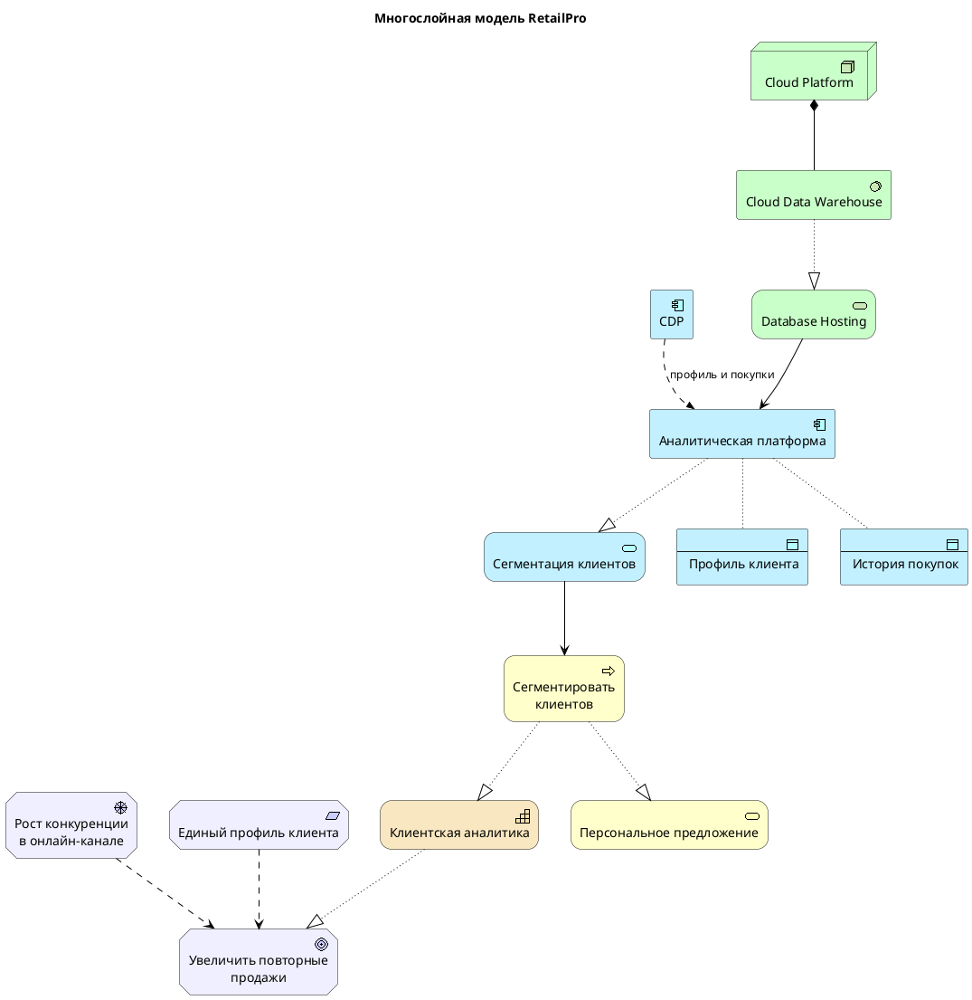

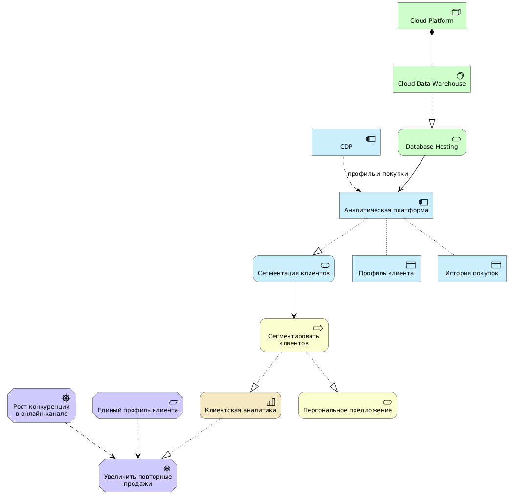

**Рис. 2.8**. Многослойная модель RetailPro.

Этот код на PlantUML описывает **сквозную многослойную архитектуру RetailPro** в стандарте ArchiMate. Схема связывает бизнес-цели компании с конкретными технологиями, показывая полную цепочку: от абстрактной мотивации бизнеса («зачем») до серверов в облаке («на чем»). Разберем эту модель по слоям – сверху вниз (на диаграмме размещение слоев противоположное – снизу вверх, это особенность онлайн интерпретатора PlantUML).

**1. Слой мотивации (Motivation) — ЗАЧЕМ это делается?**

Это стратегический фундамент проекта, объясняющий причины изменений:

- Драйвер (`drv_competition`): На компанию давит рост конкуренции в онлайн-продажах.
- Цель (`goal_repeat_sales`): Чтобы выжить и расти, бизнес ставит цель — увеличить повторные продажи.
- Требование (`req_single_profile`): Чтобы цель стала возможной, необходимо создать единый (сквозной) профиль клиента.

**2. Слой стратегии (Strategy) — ЧТО нужно уметь делать?**

- Способность (`cap_customer_analytics`): Для достижения цели бизнесу необходима новая компетенция — «Клиентская аналитика». Именно она помогает реализовать (`Rel_Realization`) главную цель.

**3. Бизнес-слой (Business) — КАК это работает на уровне людей и процессов?**

- Процесс (`bp_segment_customers`): Аналитики выполняют бизнес-процесс «Сегментировать клиентов» (делят их на группы по интересам, чеку и т.д.). Этот процесс развивает способность компании к аналитике.
- Сервис (`bs_personal_offer`): Результатом процесса становится бизнес-служба «Персональное предложение» — то, что в итоге видит конечный покупатель в виде скидок и акций.

**4. Слой приложений (Application) — КАКИЕ программы помогают бизнесу?**

Бизнес-процесс автоматизирован с помощью ИТ-систем:

- ИТ-сервис (`as_segmentation`): Программа предоставляет сервис «Сегментация клиентов», который обслуживает (`Rel_Serving`) ручной бизнес-процесс.
- Компоненты (`app_analytics` и `app_cdp`): Сервис сегментации работает внутри Аналитической платформы. Данные в нее перетекают (`Rel_Flow`) из CDP (платформы клиентских данных, которую мы разбирали на прошлой схеме).
- Данные (`data_customer_profile` и `data_purchase_history`): Аналитическая платформа имеет доступ к двум ключевым объектам данных — «Профилю клиента» и «Истории покупок».

**5. Технологический слой (Technology) — НА КАКОМ «железе» всё крутится?**

Нижний уровень инфраструктуры, обеспечивающий работу программ:

- Cloud Platform (`node_cloud`): Физическое или виртуальное облако.
- Cloud Data Warehouse (`sw_dwh`): Внутри облака развернуто мощное облачное хранилище данных (DWH) для тяжелой аналитики.
- Database Hosting (`ts_database_hosting`): Хранилище предоставляет ИТ-сервис хостинга баз данных, который и обслуживает (`Rel_Serving`) Аналитическую платформу из слоя приложений.

**Главная ценность этой схемы для архитектора предприятия**

Схема идеально демонстрирует **трассируемость (traceability)** или **прослеживаемость**. Если на защите проекта будет задан вопрос: *«Зачем нам тратить деньги на облачное хранилище Cloud Data Warehouse?»*, архитектор может пройти по цепочке связей вверх и ответить:

*«Оно нужно для работы Аналитической платформы, которая сегментирует клиентов, чтобы мы могли делать Персональные предложения, развивая Клиентскую аналитику для Увеличения повторных продаж в условиях Жесткой онлайн-конкуренции»*.

**Важное замечание о корректности связей**

На вводном уровне допустимо использовать упрощенные связи, чтобы показать смысл. Однако в профессиональной модели ArchiMate важно строго соблюдать правила отношений между типами элементов. Каждая связь имеет строго определенную семантику, это позволяет описывать отношения между элементами, так чтобы архитектурные модели одинаков интерпретировались различными заинтересованными лицами.

Например, связь между `Driver` и `Goal` может моделироваться через `Influence`, а для связи между `Business Process` и `Capability` здесь использована `Realization`.

В этом учебнике сначала важнее понять архитектурную логику, а затем мы будем погружаться в язык ArchiMate.

## 2.10. Архитектурные представления: зачем нужны разные диаграммы

Одну и ту же архитектуру нельзя эффективно показать одной диаграммой для всех аудиторий. Разным заинтересованным лицам нужны разные представления.

**Viewpoint** — это точка зрения, определяющая, какие элементы и связи следует показать для определенной аудитории и цели.

**View** — конкретная диаграмма или представление, построенное по этой точке зрения.

**Таблица 2.10.** Примеры представлений для RetailPro

| Аудитория | Что важно | Подходящее представление |
|---|---|---|
| Генеральный директор | цели, ценность, инвестиции | Strategy View |
| Директор по маркетингу | кампании, клиенты, персонализация | Business View |
| ИТ-директор | приложения и интеграции | Application Cooperation View |
| Архитектор | связь всех слоев | Layered View |
| Руководитель проекта | этапы перехода | Migration View |
| Юридический отдел | согласия и персональные данные | Data / Requirement View |

**Пример выбора представления.**

Если нужно убедить руководство инвестировать в CDP, лучше показать:

```text
Цель → проблемы → требования → ожидаемые результаты → инициативы
```

Если нужно проектировать интеграцию, лучше показать:

```text
CRM → API Gateway → CDP → Analytics → Email
```

Если нужно объяснить влияние на бизнес-процессы, лучше показать:

```text
Маркетолог → подготовить кампанию → сегментировать клиентов → отправить предложение
```

## 2.11. Как выделять слои из текстового описания

В практической работе архитектор часто начинает не с готовой модели, а с текстового описания, интервью или презентации. Нужно уметь извлекать архитектурные элементы.

**Исходный фрагмент:**

```text
Директор по маркетингу RetailPro хочет увеличить повторные продажи. Он считает, что текущие кампании плохо персонализированы, потому что данные о клиентах разрознены между CRM, POS и интернет-магазином.

Для решения проблемы компания планирует внедрить CDP, которая будет формировать единый профиль клиента и передавать клиентские сегменты в систему рассылок.

ИТ-директор требует, чтобы интеграция выполнялась через API Gateway.

Юридический отдел настаивает на соблюдении требований по персональным данным.
```

**Таблица 2.11.** Выделение элементов по слоям

| Фрагмент текста | Тип элемента | Слой |
|---|---|---|
| Директор по маркетингу | Stakeholder | Motivation |
| увеличить повторные продажи | Goal | Motivation |
| кампании плохо персонализированы | Assessment | Motivation |
| данные о клиентах разрознены | Assessment | Motivation / Data |
| CRM | Application Component | Application |
| POS | Application Component | Application |
| интернет-магазин | Application Component | Application |
| CDP | Application Component | Application |
| единый профиль клиента | Requirement / Data Object | Motivation / Application |
| клиентские сегменты | Data Object | Application / Data |
| система рассылок | Application Component | Application |
| API Gateway | System Software / Application Component в зависимости от модели | Technology / Application |
| требования по персональным данным | Constraint | Motivation |

**Как выбирать тип элемента, если выражения неоднозначны.**

Пример:

```text
Единый профиль клиента
```

Он может быть:

- `Requirement`, если это требование;
- `Data Object`, если речь идет о данных;
- часть `Capability`, если речь о способности управлять клиентскими данными.

Поэтому нужно смотреть на контекст.

| Контекст | Тип |
|---|---|
| «Нужно обеспечить единый профиль клиента» | Requirement |
| «CDP хранит единый профиль клиента» | Data Object |
| «Компания развивает управление клиентскими данными» | Capability |

## 2.12. Сквозной пример: от цели до технологии

Рассмотрим полный пример связи слоев для RetailPro.

**Описание ситуации**:

RetailPro хочет увеличить повторные продажи. Для этого компания должна персонализировать предложения. Персонализация требует клиентской аналитики, которая использует единый профиль клиента и историю покупок. Единый профиль клиента будет формироваться в CDP на основе данных из CRM, POS и интернет-магазина. CDP и аналитическая платформа размещаются в облаке и используют облачное хранилище данных.

**Архитектурная интерпретация**

| Слой | Элемент |
|---|---|
| Motivation | Goal: увеличить повторные продажи |
| Motivation | Requirement: единый профиль клиента |
| Strategy | Capability: клиентская аналитика |
| Business | Process: сегментировать клиентов |
| Application | Service: сегментация клиентов |
| Application | Component: аналитическая платформа |
| Application | Component: CDP |
| Data | Data Object: профиль клиента |
| Data | Data Object: история покупок |
| Technology | Node: Cloud Platform |
| Technology | System Software: Cloud Data Warehouse |

**Сквозная PlantUML-модель**

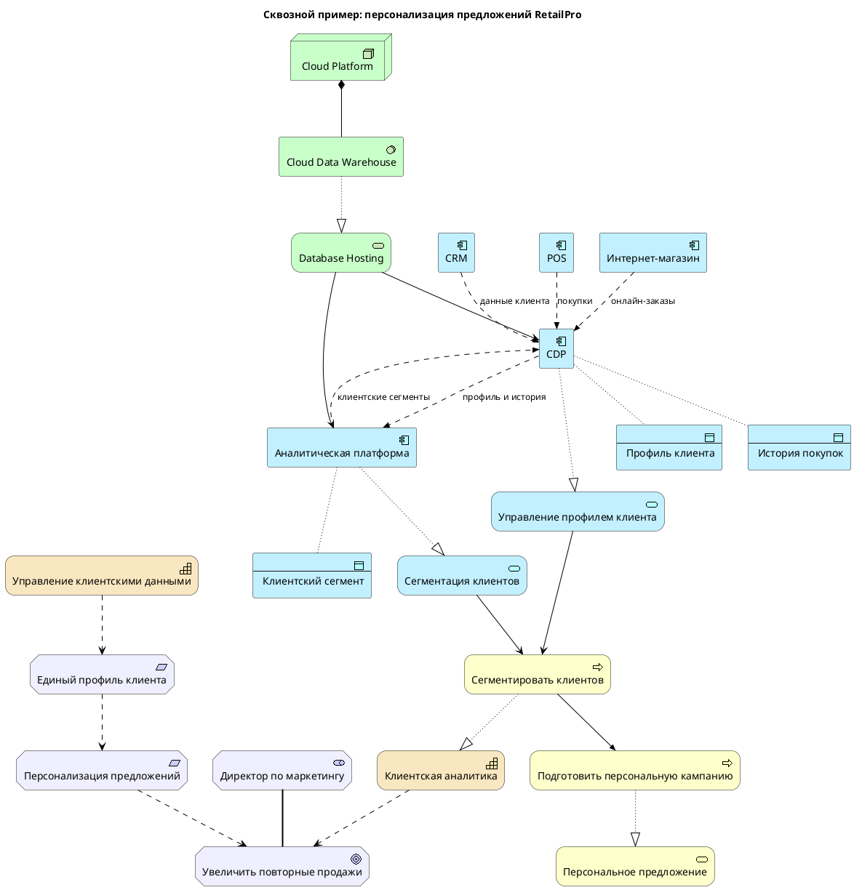

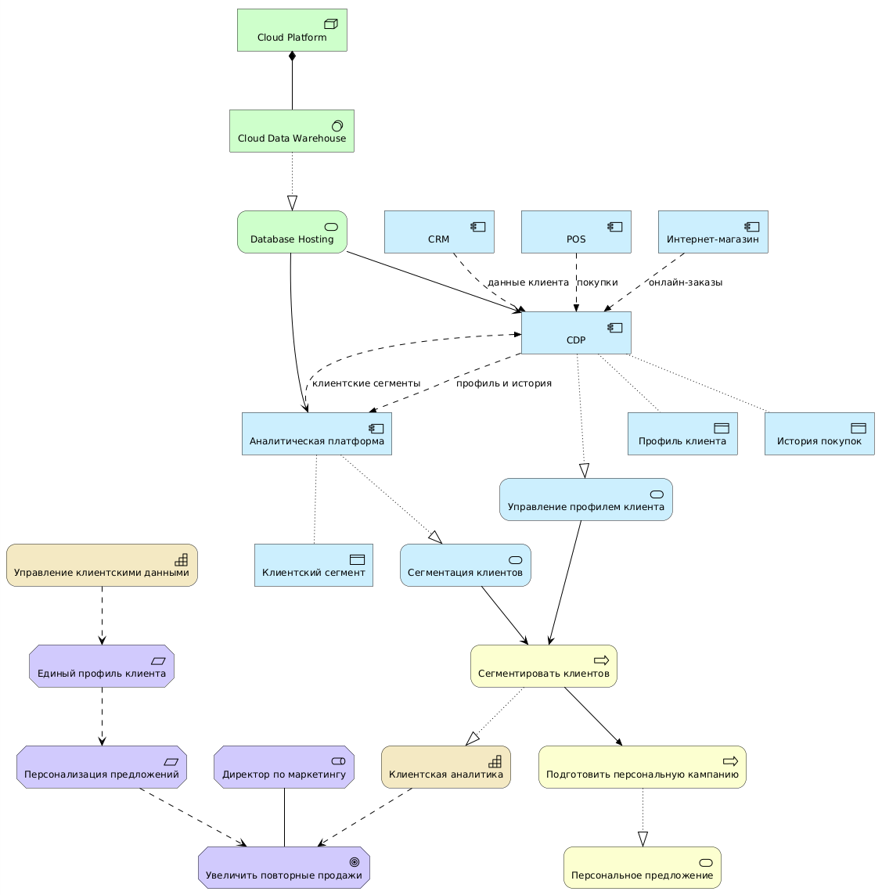

**Рис. 2.9.** Сквозной пример: персонализация предложений RetailPro

## 2.13. Проверка качества многослойной модели

После построения модели важно проверить, не является ли она просто набором элементов. Для этого может пригодиться данный чек-лист.

**Таблица 2.12.** Чек-лист качества архитектурной модели

| Вопрос | Да/нет |
|---|---|
| Есть ли бизнес-цель? | |
| Есть ли заинтересованное лицо? | |
| Есть ли требование? | |
| Есть ли бизнес-возможность или процесс? | |
| Есть ли данные? | |
| Есть ли приложения? | |
| Есть ли технологии? | |
| Показаны ли связи между слоями? | |
| Понятно ли, зачем нужны приложения? | |
| Понятно ли, какие данные являются ключевыми? | |
| Не смешаны ли процессы и приложения? | |
| Не смешаны ли бизнес-объекты и объекты данных? | |

## 2.14. Практикум: выделение слоев из кейса

**Исходная ситуация**

Компания **EduSmart** — онлайн-школа дополнительного образования. Она хочет снизить отток студентов и повысить завершение курсов.

Сейчас данные о студентах хранятся в LMS, CRM и платежной системе. Преподаватели ведут дополнительные таблицы с информацией об активности студентов. Руководство хочет внедрить систему раннего выявления риска отчисления. Для этого нужна аналитическая модель, использующая данные об активности в LMS, платежах, посещаемости вебинаров и обращениях в поддержку. ИТ-директор предлагает создать единый профиль студента и интегрировать системы через API. Юридический отдел требует соблюдать правила обработки персональных данных.

**Задание 1. Выделите элементы мотивационного слоя**

Заполните таблицу.

| Тип элемента | Пример из кейса EduSmart |
|---|---|
| Stakeholder | |
| Driver | |
| Assessment | |
| Goal | |
| Requirement | |
| Constraint | |

**Задание 2. Выделите элементы бизнес-слоя**

| Тип элемента | Пример |
|---|---|
| Business Actor | |
| Business Role | |
| Business Process | |
| Business Object | |
| Business Service | |

**Задание 3. Выделите данные**

| Данные | Возможный источник | Для чего используются |
|---|---|---|
| Профиль студента | | |
| Активность в LMS | | |
| Платежи | | |
| Посещаемость вебинаров | | |
| Обращения в поддержку | | |

**Задание 4. Выделите приложения и технологии**

| Слой | Элементы |
|---|---|
| Application | |
| Technology | |

**Задание 5. Постройте цепочку**

**Составьте цепочку:**

```text
Goal
↓
Requirement
↓
Capability
↓
Business Process
↓
Application Component
↓
Data Object
↓
Technology Element
```

## 2.15. Практическое задание с PlantUML

Постройте минимальную многослойную диаграмму для кейса EduSmart.

**Используйте шаблон:**

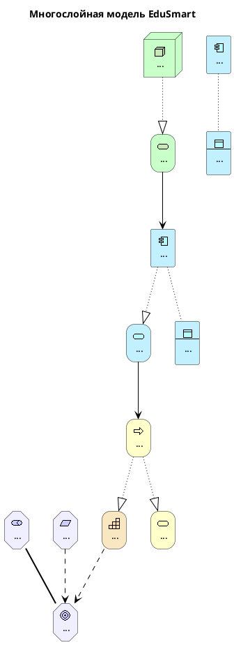

## 2.16. Контрольные вопросы

1. Зачем архитектуру предприятия разделяют на слои?
2. Какие вопросы задает мотивационный слой?
3. Чем goal отличается от requirement?
4. Что такое бизнес-возможность?
5. Чем capability отличается от business process?
6. Что описывает бизнес-слой?
7. Чем Business Actor отличается от Business Role?
8. Чем Business Object отличается от Data Object?
9. Что описывает прикладной слой?
10. Чем Application Component отличается от Application Service?
11. Что описывает технологический слой?
12. Почему важно показывать связи между слоями?
13. Что такое архитектурное представление?
14. Почему одной диаграммы недостаточно для всех заинтересованных лиц?
15. Какие ошибки чаще всего возникают при построении многослойной модели?

## 2.17. Краткие выводы главы

1. Архитектура предприятия делится на слои, потому что предприятие является сложной системой.
2. Мотивационный слой объясняет причины, цели, требования и ограничения изменений.
3. Стратегический слой показывает, какие способности нужны организации для достижения целей.
4. Бизнес-слой описывает процессы, роли, события, бизнес-объекты и услуги.
5. Слой данных показывает ключевые данные, их источники, использование и проблемы качества.
6. Прикладной слой описывает приложения, прикладные сервисы, интерфейсы и потоки данных.
7. Технологический слой описывает инфраструктуру, платформы и технологические сервисы.
8. Главная ценность архитектуры — в связях между слоями.
9. Многослойная модель позволяет проследить путь от бизнес-цели до технологического решения.
10. Для разных аудиторий нужны разные архитектурные представления.

---

[← Предыдущая глава](../01-why-enterprise-architecture/README.md) · [К оглавлению](../README.md) · [Следующая глава →](../03-togaf-framework/README.md)
