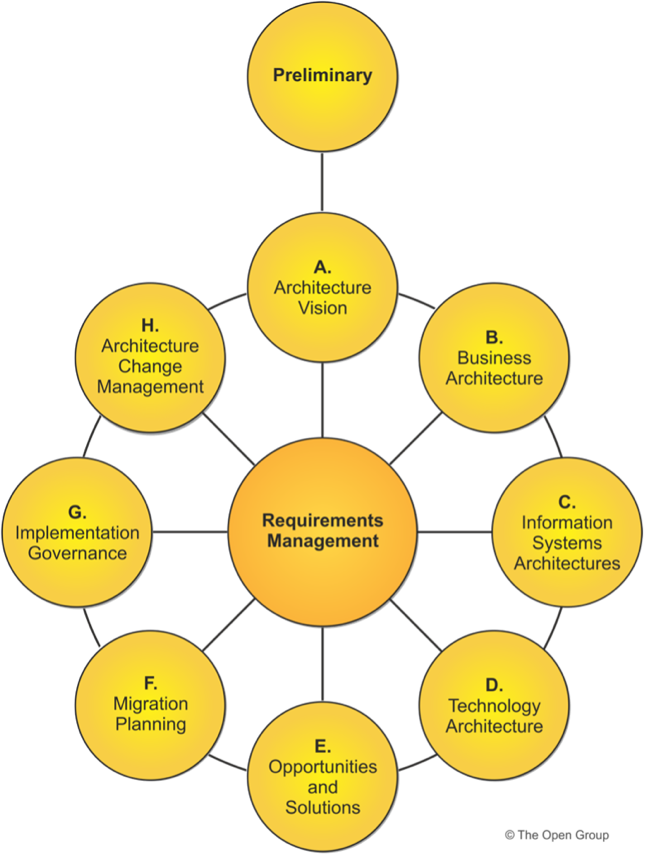
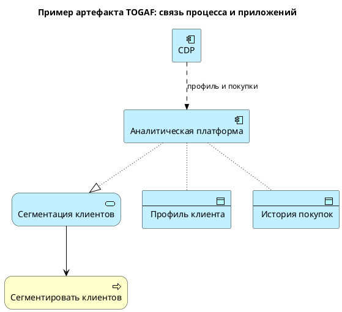
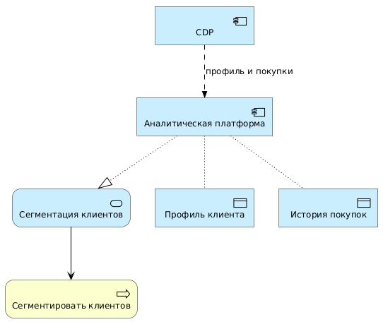
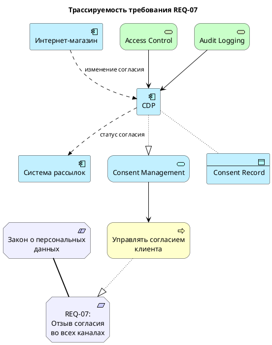
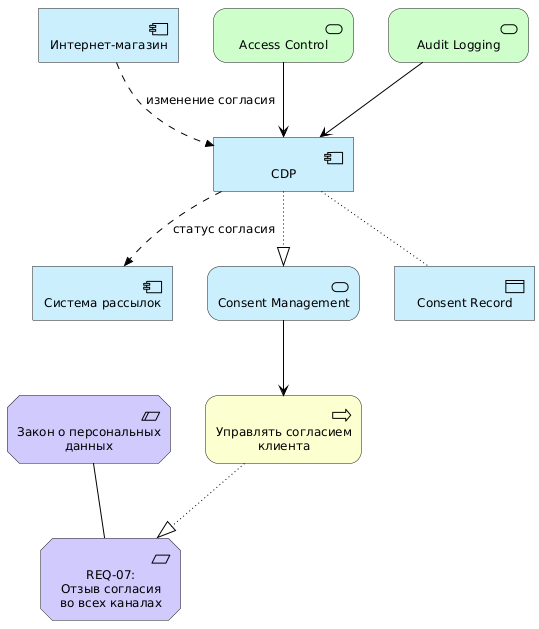

# Глава 3. TOGAF как фреймворк архитектуры предприятия

[← Предыдущая глава](../02-architecture-layers/README.md) · [К оглавлению](../README.md) · [Следующая глава →](../04-adm-method/README.md)

**После изучения этой главы студент должен уметь:**

1. объяснять, что такое архитектурный фреймворк;
2. описывать назначение TOGAF в архитектуре предприятия;
3. различать фреймворк, метод, язык моделирования и инструмент;
4. объяснять общую структуру TOGAF;
5. понимать назначение ADM — Architecture Development Method;
6. объяснять роль архитектурного контента, архитектурного репозитория и архитектурного управления;
7. применять базовую логику TOGAF к учебным и профессиональным задачам;
8. понимать, как TOGAF связан с ArchiMate и PlantUML.

## 3.1. Учебная ситуация: RetailPro нужны не только диаграммы

В предыдущих главах мы рассмотрели, что RetailPro хочет перейти к персонализированным предложениям и единому профилю клиента. Мы уже можем выделить слои архитектуры:

```text
Цель: увеличить повторные продажи
Требование: единый профиль клиента
Бизнес-процесс: подготовить персональную кампанию
Приложения: CRM, POS, интернет-магазин, CDP
Данные: профиль клиента, история покупок, согласия
Технологии: API Gateway, облачное хранилище данных
```

Допустим, архитектурная команда RetailPro построила несколько диаграмм:

- мотивационную диаграмму;
- бизнес-диаграмму процесса кампании;
- прикладную диаграмму интеграции CRM, POS и CDP;
- технологическую диаграмму облачной платформы.

Это полезно, но у руководства появляются новые вопросы:

1. Кто решил, что целевая архитектура должна быть именно такой?
2. Какие заинтересованные лица участвовали в согласовании?
3. Какие требования были учтены?
4. Какие альтернативные решения рассматривались?
5. Как перейти от текущего состояния к целевому?
6. Как контролировать проекты внедрения?
7. Как убедиться, что новые решения не нарушают архитектурные принципы?
8. Где хранить архитектурные артефакты?
9. Как поддерживать архитектуру в актуальном состоянии?

Диаграммы сами по себе не отвечают на эти вопросы. Нужен не только язык описания архитектуры, но и **метод организации архитектурной работы**.

Именно для этого используются архитектурные фреймворки, например **TOGAF**.

## 3.2. Что такое архитектурный фреймворк

> **Архитектурный фреймворк** — это набор понятий, методов, процессов, ролей, артефактов и рекомендаций, которые помогают системно разрабатывать, описывать, согласовывать и развивать архитектуру предприятия.

Проще говоря, фреймворк отвечает на вопросы:

```text
Как организовать архитектурную работу?
Какие этапы пройти?
Какие артефакты подготовить?
Кто должен участвовать?
Как принимать архитектурные решения?
Как управлять изменениями?
Как обеспечить соответствие проектов целевой архитектуре?
```

**Чем фреймворк отличается от диаграммы?**

Диаграмма — это отдельное представление архитектуры.

**Фреймворк — это более широкий подход, который определяет:**

- как выбрать нужные представления;
- когда их строить;
- с кем согласовывать;
- как использовать их для принятия решений;
- как связать их с требованиями и проектами.

**Пример.** В RetailPro прикладная диаграмма может показать следующие связи:

```text
CRM → CDP ← POS
Интернет-магазин → CDP
CDP → аналитическая платформа
```

Но фреймворк помогает ответить на вопросы:

```text
Почему выбрана CDP?
Какие требования она реализует?
Какой этап внедрения первый?
Кто владелец клиентских данных?
Какие риски есть?
Как контролировать соответствие проекта принципу API-first?
```

## 3.3. TOGAF: общее представление

**TOGAF** — это один из наиболее распространенных фреймворков архитектуры предприятия. Название исторически расшифровывается как **The Open Group Architecture Framework**.

TOGAF предлагает:

- метод разработки архитектуры;
- подход к управлению архитектурным контентом;
- рекомендации по архитектурному управлению;
- механизмы работы с требованиями;
- подходы к планированию миграции;
- организацию архитектурной функции;
- понятия для архитектурного репозитория.

TOGAF помогает организациям:

1. связать стратегию и реализацию;
2. согласовать бизнес и ИТ;
3. описать текущую и целевую архитектуру;
4. выявить архитектурные разрывы;
5. сформировать дорожную карту изменений;
6. управлять архитектурными требованиями;
7. контролировать реализацию проектов;
8. поддерживать архитектуру в актуальном состоянии.

**Таблица 3.1.** Как TOGAF помогает RetailPro

| Проблема RetailPro | Как помогает TOGAF |
|---|---|
| Нет единого понимания цели CDP | помогает сформировать Architecture Vision |
| Разные ожидания подразделений | требует выявить stakeholders и assessments |
| Неясно текущее состояние данных | предлагает описать Baseline Architecture |
| Неясно будущее состояние | предлагает описать Target Architecture |
| Много возможных решений | помогает анализировать альтернативы и компромиссы |
| Нужна поэтапная реализация | предлагает Migration Planning |
| Проекты могут отклониться от архитектуры | предлагает Implementation Governance |
| Архитектура устаревает | предлагает Architecture Change Management |

## 3.4. Фреймворк, метод, язык и инструмент: не путать

Начинающие аналитики часто смешивают TOGAF, ArchiMate, PlantUML и конкретные EA-инструменты. Важно различать их роли.

**Таблица 3.2.** Сравнение понятий

| Понятие | Отвечает на вопрос | Пример |
|---|---|---|
| Фреймворк | Как организовать архитектурную работу? | TOGAF |
| Метод | Какие шаги выполнить? | TOGAF ADM |
| Язык моделирования | Как формально описать архитектуру? | ArchiMate |
| Инструмент | Где создавать и хранить модели? | Archi, Bizzdesign, Sparx EA |
| Текстовая нотация | Как описать диаграмму кодом? | PlantUML |
| ИИ-ассистент | Как помочь с генерацией и проверкой моделей? | Агенты на базе LLM |

Можно провести аналогию со строительством здания.

**Таблица 3.3.** Аналогия со строительством

| В строительстве | В архитектуре предприятия |
|---|---|
| Метод управления проектированием | TOGAF ADM |
| Язык чертежей | ArchiMate |
| CAD-система | EA-инструмент |
| Текстовое описание чертежа | PlantUML |
| Помощник, предлагающий черновик | ИИ |
| Проект здания | Архитектурное описание предприятия |

TOGAF не заменяет ArchiMate, а ArchiMate не заменяет TOGAF.

## 3.5. Общая структура TOGAF

TOGAF можно рассматривать как набор взаимосвязанных компонентов. Для учебного курса на первом этапе важно понимать следующие части:

1. Architecture Development Method, ADM;
2. Architecture Content;
3. Enterprise Continuum;
4. Architecture Repository;
5. Architecture Capability;
6. Architecture Governance;
7. Techniques and Guidelines.

### 3.5.1. Architecture Development Method, ADM

**ADM** — это центральный метод TOGAF. Он описывает цикл разработки и развития архитектуры предприятия.

**ADM помогает пройти путь:**

```text
подготовка архитектурной работы
↓
архитектурное видение
↓
бизнес-архитектура
↓
архитектура данных и приложений
↓
технологическая архитектура
↓
решения и возможности
↓
план миграции
↓
контроль реализации
↓
управление изменениями
```

В следующей главе ADM будет рассмотрен подробно.

**Архитектурный контент (Architecture Content**) — это совокупность артефактов, которые создаются в ходе архитектурной работы.

К архитектурному контенту относятся:

- принципы;
- требования;
- модели;
- диаграммы;
- матрицы;
- каталоги;
- описания текущей и целевой архитектуры;
- дорожные карты;
- архитектурные решения.

**Таблица 3.4.** Архитектурный контент RetailPro

| Артефакт | Пример |
|---|---|
| Architecture Principles | API-first, Privacy by design |
| Stakeholder Map | директор по маркетингу, ИТ-директор, юридический отдел |
| Business Capability Map | клиентская аналитика, управление лояльностью |
| Application Portfolio | CRM, POS, интернет-магазин, CDP |
| Data Entity Catalog | клиент, покупка, согласие, товар |
| Application Integration Diagram | CRM → CDP ← POS |
| Gap Analysis | нет единого профиля клиента |
| Migration Roadmap | внедрение CDP, интеграция POS, запуск аналитики |

**Enterprise Continuum** — это способ организовать архитектурные активы от более общих к более специфичным.

Проще говоря, не каждую архитектуру нужно придумывать с нуля. Организация может использовать:

- отраслевые референсные модели;
- типовые архитектурные паттерны;
- стандарты;
- шаблоны решений;
- ранее созданные архитектурные артефакты.

**Пример.** Использование типовых решений RetailPro

```text
Общий паттерн: омниканальная клиентская платформа
Отраслевой паттерн: Customer Data Platform для ритейла
Корпоративный стандарт: API-first
Конкретное решение: CDP поставщика X, интегрированная с CRM и POS
```

Enterprise Continuum помогает связать общие архитектурные идеи с конкретными решениями предприятия.

**Architecture Repository** — это хранилище архитектурных материалов организации. В нем могут храниться:

- архитектурные принципы;
- модели текущей архитектуры;
- модели целевой архитектуры;
- стандарты;
- шаблоны;
- требования;
- решения;
- дорожные карты;
- результаты архитектурных проверок.

Даже если организация не использует специализированный EA-инструмент, она может начать с простого репозитория в виде структурированного хранения файлов файловой системе или Git. Подробнее о такой организации репозитория см.

**Пример.** Репозиторий RetailPro в файловой системе

```text
/architecture
  /principles
    api-first.md
    privacy-by-design.md
  /models
    baseline-application-architecture.puml
    target-customer-platform.puml
    migration-roadmap.puml
  /decisions
    adr-001-select-cdp.md
    adr-002-api-gateway-standard.md
  /requirements
    customer-profile-requirements.md
  /roadmaps
    customer-platform-roadmap.md
```

**Architecture Capability** — это способность организации выполнять архитектурную работу на регулярной основе. Она включает:

- роли архитекторов;
- архитектурный процесс;
- архитектурный совет;
- правила принятия решений;
- методики;
- инструменты;
- обучение;
- метрики качества архитектуры.

**Таблица 3.5.** Архитектурная способность RetailPro (минимальная архитектурная функция)

| Элемент | Пример |
|---|---|
| Роль | архитектор предприятия |
| Орган | архитектурный совет |
| Процесс | рассмотрение крупных ИТ-инициатив |
| Принципы | API-first, единый источник данных о клиенте |
| Инструмент | Archi + PlantUML + Git |
| Результат | согласованные архитектурные решения |

**Architecture Governance** — это архитектурное управление: механизмы, которые обеспечивают соблюдение архитектурных принципов, стандартов и целевой архитектуры.

**Архитектурное управление отвечает на вопросы:**

```text
Кто утверждает архитектурные решения?
Как проверяется соответствие проекта архитектуре?
Что делать, если проект отклоняется от принципов?
Как фиксируются исключения?
Кто несет ответственность?
```

**Пример.** Нарушение принципа API-first

В RetailPro подрядчик предлагает интеграцию мобильного приложения напрямую с базой данных CRM.

Архитектурный принцип RetailPro:

```text
Новые приложения должны интегрироваться через API.
```

Поэтому, архитектурный совет должен принять решение:

```text
Запретить прямой доступ мобильного приложения к базе CRM.
Требовать использование Customer API через API Gateway.
Зафиксировать решение в Architecture Decision Record.
```

## 3.6. ADM: центральный цикл TOGAF

ADM — это сердце TOGAF. Он задает последовательность фаз архитектурной работы.

**Таблица 3.6.** Фазы ADM

| Фаза | Назначение |
|---|---|
| Preliminary Phase | подготовить архитектурную функцию и принципы |
| Phase A: Architecture Vision | сформировать видение архитектуры |
| Phase B: Business Architecture | описать бизнес-архитектуру |
| Phase C: Information Systems Architecture | описать данные и приложения |
| Phase D: Technology Architecture | описать технологическую архитектуру |
| Phase E: Opportunities and Solutions | определить решения и пакеты работ |
| Phase F: Migration Planning | спланировать переход |
| Phase G: Implementation Governance | контролировать реализацию |
| Phase H: Architecture Change Management | управлять изменениями архитектуры |
| Requirements Management | управлять требованиями на всех фазах |



**Рис. 3.1.** Фазы TOGAF ADM. Источник: [https://www.opengroup.org/togaf](https://www.opengroup.org/togaf)

**Важно понимать: ADM — это не жесткая последовательность «один раз и навсегда». Это цикл.**

**Пример.** Итеративность в RetailPro. Сначала RetailPro планировала только email-персонализацию. Через полгода руководство решило добавить мобильное приложение и push-уведомления. Это означает, что архитектура должна быть пересмотрена:

- добавляется новый канал взаимодействия;
- появляются новые данные о поведении клиента;
- нужны новые согласия;
- требуется Mobile API;
- меняется дорожная карта;
- появляются новые риски безопасности.

ADM помогает управлять такими изменениями как повторяемым процессом.

## 3.7. TOGAF и архитектурные артефакты

TOGAF не требует ограничиваться диаграммами. Архитектурная работа включает разные типы артефактов.

**Таблица 3.7.** Три основные формы архитектурного контента

| Форма | Что показывает | Пример |
|---|---|---|
| Каталог | список элементов | каталог приложений |
| Матрица | связи между двумя типами элементов | процессы × приложения |
| Диаграмма | визуальное представление связей | ArchiMate-диаграмма |

**Таблица 3.8.** Пример каталога приложений

| ID | Приложение | Владелец | Назначение | Статус |
|---|---|---|---|---|
| APP-01 | CRM | Директор по маркетингу | управление клиентами | используется |
| APP-02 | POS | Директор розницы | продажи в магазинах | используется |
| APP-03 | Интернет-магазин | Директор e-commerce | онлайн-продажи | используется |
| APP-04 | CDP | ИТ-директор | единый профиль клиента | планируется |
| APP-05 | Excel-отчеты | Маркетинг | отчетность | подлежит замене |

**Таблица 3.9.** Пример матрицы «процессы × приложения»

| Бизнес-процесс | CRM | POS | Интернет-магазин | CDP | Система рассылок |
|---|---|---|---|---|---|
| Подготовить кампанию | Да | Нет | Нет | Да | Да |
| Сегментировать клиентов | Частично | Нет | Нет | Да | Нет |
| Оформить покупку в магазине | Нет | Да | Нет | Частично | Нет |
| Оформить онлайн-заказ | Нет | Нет | Да | Частично | Нет |
| Отправить предложение | Нет | Нет | Нет | Частично | Да |

Такая матрица помогает увидеть, какие приложения поддерживают какие процессы.

**Пример диаграммы.** Диаграмма может быть построена на ArchiMate и PlantUML. Ниже приведен код PlantUML и соответствующая диаграмма.





**Рис. 3.2.** Пример артефакта TOGAF: связь процесса и приложений

## 3.8. TOGAF и управление требованиями

В TOGAF управление требованиями находится в центре ADM (см. Рис. 3.1). Это означает, что требования должны учитываться на всех фазах архитектурной работы.

**Почему требования находятся в центре?** Архитектура должна отвечать требованиям заинтересованных лиц. Если требования меняются, архитектура должна быть пересмотрена.

**Пример.** Юридический отдел RetailPro формулирует новое требование:

```text
REQ-07:
Клиент должен иметь возможность отозвать согласие на маркетинговые коммуникации во всех каналах.
```

**Таблица 3.10**. Области, н которые влияет данное требование:

| Область | Влияние |
|---|---|
| Бизнес-процессы | процесс управления согласиями |
| Данные | объект данных «согласие клиента» |
| Приложения | CRM, CDP, интернет-магазин, система рассылок |
| Технологии | механизмы авторизации и журналирования |
| Миграция | добавить пакет работ по синхронизации согласий |

**Трассируемость требования.** Требование должно быть связано с архитектурными элементами.

```text
REQ-07
↓
Business Process: Управлять согласием клиента
↓
Application Service: Consent Management
↓
Application Component: CDP
↓
Data Object: Consent Record
↓
Technology Service: Access Control / Audit Logging
```

**PlantUML-пример трассируемости**





**Рис. 3.3.** Трассируемость требования REQ-07

## 3.9. TOGAF и архитектурное управление

Архитектура предприятия имеет смысл только тогда, когда она влияет на реальные решения. Поэтому важна архитектурная governance-модель.

**Архитектурное управление** (architectural governance) – это система правил, ролей и процедур, обеспечивающая соответствие проектов согласованной архитектуре.

Оно помогает избежать ситуации, когда архитектура есть в презентациях, но проекты реализуются как раньше.

**Пример.** RetailPro создает архитектурный совет, который рассматривает инициативы:

- внедрение CDP;
- запуск мобильного приложения;
- замена CRM;
- новая система лояльности;
- интеграция маркетинговых сервисов.

**В совет входят:**

```text
ИТ-директор
Архитектор предприятия
Руководитель маркетинга
Руководитель e-commerce
Специалист по информационной безопасности
Представитель юридического отдела
```

**Пример архитектурного контроля.** Проект мобильного приложения предлагает хранить отдельный профиль клиента внутри мобильного приложения.

Архитектурный совет проверяет это решение на соответствие принципу:

```text
Единый источник данных о клиенте.
```

Решение совета:

```text
Не создавать отдельный мастер-профиль клиента в мобильном приложении.
Мобильное приложение должно получать данные через Customer API из CDP.
```

## 3.10. Пример применения TOGAF к RetailPro на высоком уровне

Ниже показано, как одна архитектурная инициатива RetailPro может пройти через логику TOGAF.

Архитектурная инициатива

```text
Создать единую цифровую платформу клиентского взаимодействия,
обеспечивающую персональные предложения во всех каналах продаж.
```

**Таблица 3.10.** Прохождение по фазам ADM

| Фаза ADM | Что делает RetailPro |
|---|---|
| Preliminary | определяет принципы API-first, Privacy by design, единый источник клиентских данных |
| Phase A | формирует видение единой клиентской платформы |
| Phase B | описывает процессы маркетинга, продаж и управления лояльностью |
| Phase C | описывает данные клиента, покупки, согласия; приложения CRM, POS, CDP |
| Phase D | проектирует API Gateway, Message Broker, Cloud Data Warehouse |
| Phase E | определяет решения: внедрить CDP, интегрировать POS, создать аналитику |
| Phase F | строит дорожную карту на 4 квартала |
| Phase G | контролирует проекты внедрения CDP и интеграции |
| Phase H | управляет изменениями, например добавлением мобильного приложения |
| Requirements Management | отслеживает требования к профилю клиента, согласиям, API, безопасности |

В результате RetailPro получает:

```text
архитектурное видение
перечень заинтересованных лиц
архитектурные принципы
модель текущей архитектуры
модель целевой архитектуры
gap-анализ
целевую прикладную архитектуру
целевую технологическую архитектуру
дорожную карту миграции
архитектурные решения
требования к проектам
```

## 3.11. Мини-кейс: когда TOGAF особенно полезен

**Ситуация.** RetailPro запускает сразу несколько инициатив:

1. внедрение CDP;
2. замена CRM;
3. запуск мобильного приложения;
4. модернизация POS;
5. внедрение аналитики персональных предложений;
6. переход части инфраструктуры в облако.

Каждая инициатива имеет своего заказчика, бюджет, подрядчиков и сроки.

**Проблема.** Без архитектурного фреймворка эти инициативы могут развиваться несогласованно:

- новая CRM создаст еще один профиль клиента;
- мобильное приложение будет интегрироваться напрямую с CRM;
- POS будет передавать данные пакетной выгрузкой;
- аналитическая платформа будет использовать неполные данные;
- юридические требования будут учтены только в одном канале;
- облачная инфраструктура будет построена без стандартов безопасности.

TOGAF позволяет:

```text
сформировать единое архитектурное видение;
определить принципы;
описать целевую архитектуру;
согласовать требования;
разбить изменения на work packages;
управлять зависимостями;
проводить архитектурные проверки;
обновлять архитектуру при изменениях.
```

## 3.12. Типичные ошибки студентов при изучении TOGAF

1. Считать TOGAF языком моделирования. TOGAF — не язык диаграмм. Для диаграмм можно использовать ArchiMate.

2. Считать ADM жестким водопадным процессом. ADM — это цикл, который адаптируется к организации. Не обязательно выполнять все фазы с одинаковой глубиной. На практике можно использовать упрощенную версию.

3. Игнорировать архитектурное управление. Если архитектура не влияет на проекты, она остается презентацией. Важно определить кто отвечает за архитектуру, кто утверждает решения, как проверяется соответствие принципам и как фиксируются исключения.

4. Пытаться применить TOGAF полностью и буквально. TOGAF большой и гибкий. Его нужно адаптировать.

Для учебных кейсов и в ряде случае на практике достаточно использовать:

```text
ADM как логику фаз;
базовые артефакты;
принципы;
требования;
gap-анализ;
migration roadmap;
governance-логику.
```

## 3.13. Практическое задание

**Задание: применить TOGAF к инициативе RetailPro**

Используя кейс RetailPro, опишите, как можно применить TOGAF к инициативе «единая клиентская платформа».

**Часть 1.** Определите архитектурную инициативу. Сформулируйте инициативу в 2–3 предложениях.

Пример:

```text
RetailPro планирует создать единую клиентскую платформу,
которая объединит данные из CRM, POS и интернет-магазина
и позволит формировать персональные предложения во всех каналах.
```

**Часть 2.** Определите заинтересованных лиц. Заполните таблицу.

| Stakeholder | Интерес / Concern |
|---|---|
| Директор по маркетингу | |
| ИТ-директор | |
| Юридический отдел | |
| Руководитель розничных продаж | |
| Клиент | |

**Часть 3.** Сформулируйте минимум три архитектурных принципа

Пример:

| Принцип | Пояснение |
|---|---|
| API-first | новые интеграции должны выполняться через API |
| Единый источник клиентских данных | мастер-профиль клиента должен быть единым |
| Privacy by design | требования защиты данных учитываются на этапе проектирования |

**Часть 4.** Заполните упрощенную карту ADM

| Фаза ADM | Что нужно сделать в RetailPro |
|---|---|
| Preliminary | |
| Phase A | |
| Phase B | |
| Phase C | |
| Phase D | |
| Phase E | |
| Phase F | |
| Phase G | |
| Phase H | |
| Requirements Management | |

**Часть 5.** Определите архитектурные артефакты, которые нужно создать

| Артефакт | Назначение |
|---|---|
| Architecture Vision | |
| Baseline Application Architecture | |
| Target Application Architecture | |
| Data Entity Catalog | |
| Gap Analysis | |
| Migration Roadmap | |
| Architecture Decision Record | |

**Часть 6.** Постройте простую диаграмму связи TOGAF-артефактов

## 3.14. Контрольные вопросы

1. Что такое архитектурный фреймворк?
2. Для чего нужен TOGAF?
3. Чем TOGAF отличается от ArchiMate?
4. Чем ArchiMate отличается от PlantUML?
5. Что такое ADM?
6. Почему ADM называют циклом?
7. Какие основные фазы ADM вы знаете?
8. Что такое архитектурный контент?
9. Что такое Architecture Repository?
10. Что такое Enterprise Continuum?
11. Что такое Architecture Capability?
12. Что такое Architecture Governance?
13. Почему требования находятся в центре ADM?
14. Какие артефакты может создать архитектурная команда RetailPro?
15. Почему TOGAF нужно адаптировать, а не применять механически?

## 3.15. Краткие выводы главы

1. Архитектурные диаграммы необходимы, но недостаточны для управления развитием предприятия.
2. Архитектурный фреймворк задает способ организации архитектурной работы.
3. TOGAF является одним из наиболее распространенных фреймворков архитектуры предприятия.
4. Центральный элемент TOGAF – ADM, метод разработки архитектуры.
5. ADM помогает пройти путь от архитектурного видения до миграционного планирования и управления изменениями.
6. TOGAF следует отличать от ArchiMate: TOGAF задает процесс, ArchiMate – язык моделирования.
7. PlantUML может использоваться как текстовый способ создания ArchiMate-диаграмм.
8. Архитектурный контент включает каталоги, матрицы, диаграммы, требования, принципы, решения и дорожные карты.
9. Architecture Governance обеспечивает связь архитектуры с реальными проектными решениями.
10. TOGAF нужно адаптировать к масштабу и зрелости организации.

---

[← Предыдущая глава](../02-architecture-layers/README.md) · [К оглавлению](../README.md) · [Следующая глава →](../04-adm-method/README.md)
