# Глава 4. Метод ADM: архитектурный цикл TOGAF

[← Предыдущая глава](../03-togaf-framework/README.md) · [К оглавлению](../README.md) · [Следующая глава →](../05-archimate-language/README.md)

**После изучения этой главы студент должен уметь:**

1. объяснять назначение Architecture Development Method, ADM;
2. описывать основные фазы ADM;
3. применять логику ADM к архитектурной инициативе;
4. различать текущую, целевую и переходную архитектуру;
5. формулировать результаты каждой фазы ADM на учебном кейсе;
6. связывать фазы ADM с архитектурными артефактами;
7. понимать роль управления требованиями в ADM;
8. использовать ADM как итерационный цикл, а не как жесткий линейный процесс;
9. строить простую модель архитектурного цикла и дорожной карты изменений.

## 4.1. Учебная ситуация: RetailPro переходит к единой клиентской платформе

Компания RetailPro хочет создать единую клиентскую платформу, которая позволит:

- объединить данные клиентов из CRM, POS и интернет-магазина;
- сформировать единый профиль клиента;
- учитывать согласия на обработку персональных данных;
- сегментировать клиентов;
- запускать персональные предложения во всех каналах;
- анализировать эффективность кампаний.

На уровне идеи всё выглядит достаточно понятно:

```text
Нужно внедрить CDP и интегрировать ее с CRM, POS и интернет-магазином.
```

Но если сразу перейти к выбору продукта или к разработке интеграций, возникает множество вопросов:

- кто является заказчиком и какие у него ожидания;
- какие бизнес-цели должны быть достигнуты;
- какие процессы изменятся;
- какие данные являются критичными;
- какие приложения уже существуют;
- какая целевая архитектура нужна;
- какие технологические решения выбрать;
- какие работы выполнять первыми;
- как управлять рисками;
- как проверять, что проект соответствует архитектуре.

Метод ADM помогает пройти архитектурную работу последовательно и управляемо.

## 4.2. Что такое ADM

**ADM**, или **Architecture Development Method**, — это центральный метод TOGAF, описывающий цикл разработки, реализации и развития архитектуры предприятия.

ADM можно рассматривать как маршрут архитектурной работы (модель из документации TOGAF представлена на Рис. 3.1, перевод фаз на русский язык на Рис. 4.1, определение фаз – в Таблице 4.1). Но при этом ADM не является жестким одноразовым водопадом. Это цикл, который может повторяться при изменении требований, стратегии, технологий или внешней среды.

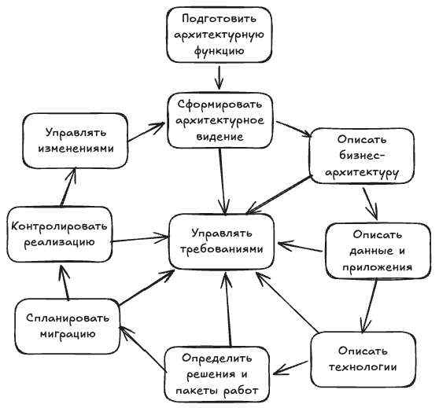

Рис. 4.1. Фазы ADM

Например, RetailPro сначала строит архитектуру для email-персонализации. Через полгода компания решает добавить мобильное приложение. Это создает новые требования:

- push-уведомления;
- мобильная идентификация клиента;
- мобильные согласия;
- API для приложения;
- дополнительные меры безопасности.

Архитектура должна быть пересмотрена. Значит, ADM запускается снова или частично повторяется.

**Таблица 4.1.** Основные фазы ADM

| Фаза | Назначение | Главный вопрос |
|---|---|---|
| Preliminary Phase | Подготовить архитектурную функцию | Как мы будем заниматься архитектурой? |
| Phase A: Architecture Vision | Сформировать видение | Зачем и что хотим изменить? |
| Phase B: Business Architecture | Описать бизнес | Как должен работать бизнес? |
| Phase C: Information Systems Architecture | Описать данные и приложения | Какие данные и приложения нужны? |
| Phase D: Technology Architecture | Описать технологии | На чем будет работать решение? |
| Phase E: Opportunities and Solutions | Определить решения | Какие варианты и пакеты работ выбрать? |
| Phase F: Migration Planning | Спланировать переход | Как перейти от текущего состояния к целевому? |
| Phase G: Implementation Governance | Контролировать реализацию | Соответствует ли проект архитектуре? |
| Phase H: Architecture Change Management | Управлять изменениями | Как поддерживать архитектуру актуальной? |
| Requirements Management | Управлять требованиями | Какие требования влияют на архитектуру? |

## 4.3. Requirements Management: требования в центре ADM

Хотя в TOGAF Requirements Management часто изображается в центре ADM, в учебной логике его удобно рассмотреть сразу. Требования влияют на все фазы архитектурного цикла.

Почему требования находятся в центре? Архитектура не создается ради самой архитектуры. Она должна отвечать требованиям заинтересованных лиц. Требования могут поступать от:

- бизнеса;
- ИТ;
- клиентов;
- регуляторов;
- службы безопасности;
- проектных команд;
- операционных подразделений.

**Таблица 4.2.** Пример требований RetailPro

| ID | Требование | Источник |
|---|---|---|
| REQ-01 | Система должна обеспечивать единый профиль клиента | Маркетинг |
| REQ-02 | Покупки из POS должны передаваться в течение 5 минут | Продажи |
| REQ-03 | Клиентские согласия должны учитываться во всех каналах | Юридический отдел |
| REQ-04 | Интеграции должны выполняться через API | ИТ-директор |
| REQ-05 | Данные должны быть доступны для аналитики кампаний | Аналитики |

Требование должно быть связано с архитектурными элементами, другими словами, необходимо обеспечить его трассируемость (прослеживаемость). PlantUML-пример трассируемости требования и его визуализация представлены ниже.

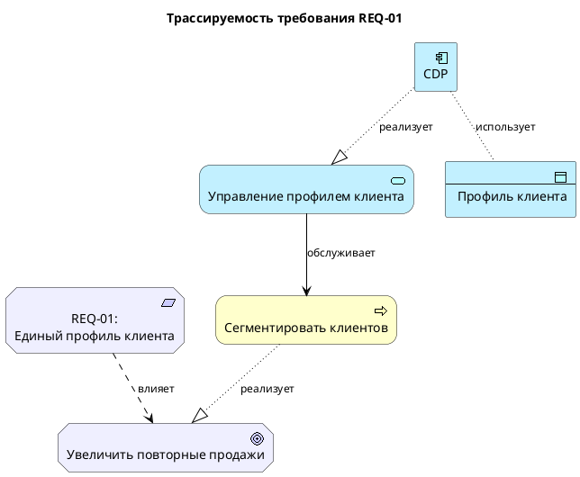

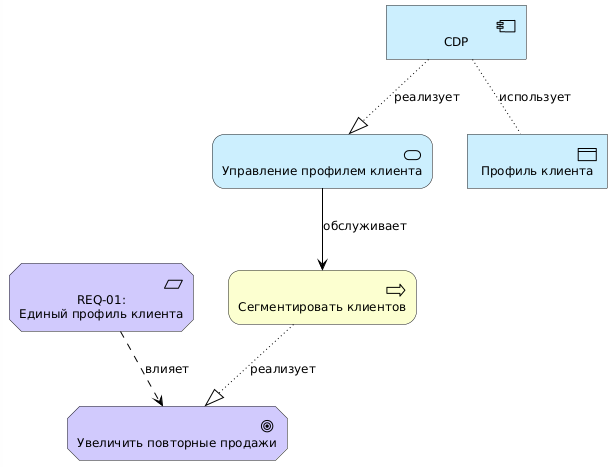

**Рис. 4.2.** Трассируемость требования REQ-01.

Из этого следует важный вывод: если требование невозможно связать с целью, процессом или решением, его нужно уточнить.

## 4.4. Preliminary Phase: подготовка архитектурной работы

Preliminary Phase отвечает на вопрос:

*Как организация будет заниматься архитектурой?*

На этой фазе определяются:

- границы архитектурной деятельности;
- архитектурные принципы;
- роли и ответственность;
- архитектурный процесс;
- инструменты;
- правила архитектурного управления.

**Пример.** RetailPro решает, что архитектурная работа по клиентской платформе должна охватывать:

```text
маркетинг;
розничные продажи;
интернет-магазин;
клиентские данные;
CRM;
POS;
систему рассылок;
аналитическую платформу;
технологии интеграции;
требования по персональным данным.
```

Вне рамок инициативы остаются:

```text
складская логистика;
финансовый учет;
HR-системы;
закупки.
```

**Архитектурный принцип** — это устойчивое правило, которым нужно руководствоваться при принятии архитектурных решений.

**Таблица 4.3.** Пример принципов RetailPro

| Принцип | Формулировка | Следствие |
|---|---|---|
| Единый источник клиентских данных | мастер-профиль клиента должен быть единым | нельзя создавать отдельные независимые клиентские базы |
| API-first | интеграции новых систем должны выполняться через API | прямой доступ к БД запрещен |
| Privacy by design | защита персональных данных учитывается при проектировании | согласия и доступы моделируются заранее |
| Cloud where reasonable | новые аналитические сервисы предпочтительно размещать в облаке | нужно оценивать безопасность и стоимость облака |
| Data ownership | у ключевых данных должен быть владелец | назначается владелец данных клиента |

Принципы влияют на формирование требований. Пример модели, связывающей принципы и требования на языке PlantUML:

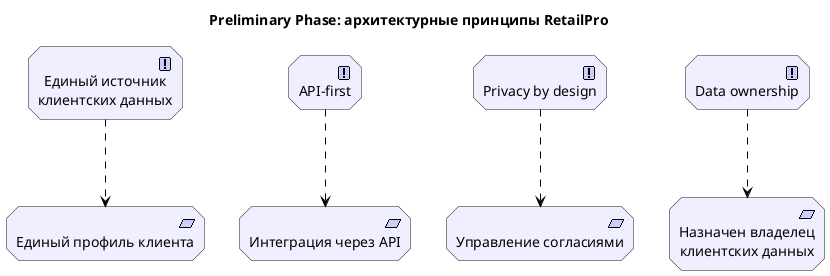

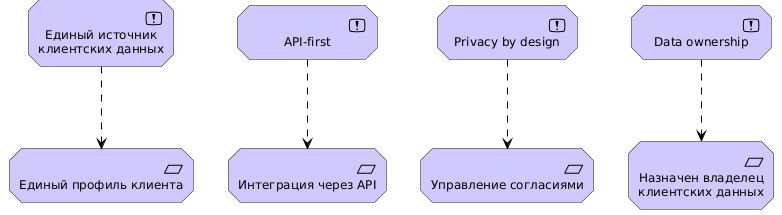

**Рис. 4.3.** Архитектурные принципы и требования

Помимо идентификации архитектурных требований на этой фазе должны быть определены следующие артефакты: роли и их полномочия в процессе работы над архитектурой, порядок внесения и согласования изменений, используемые инструменты.

## 4.5. Phase A: Architecture Vision

Фаза A отвечает на вопрос:

*Зачем нужна архитектурная инициатива и каким должно быть высокоуровневое целевое состояние?*

На этой фазе формируется архитектурное видение, то есть определяются:

- цели;
- заинтересованные лица;
- основные требования;
- ограничения;
- ожидаемая ценность;
- границы архитектурной работы;
- принципы фиксации архитектурных решений.

Пример Architecture Vision для RetailPro

```text
RetailPro создаст единую цифровую платформу клиентского взаимодействия,
которая объединит клиентские данные из CRM, POS и интернет-магазина,
обеспечит единый профиль клиента, позволит формировать персональные предложения во всех каналах продаж и повысит повторные продажи.
```

В Таблице 4.4 представлены ключевые заинтересованные лица, их цели и требования к реализации данного видения. Далее приведен фрагмент кода на PlantUML и соответствующая мотивационная диаграмма (Рис. 4.4).

**Таблица 4.4.** Ожидания стейкхолдеров

| Стейкхолдеры | Цели и требования |
|---|---|
| Директор по маркетингу | повысить эффективность кампаний |
| ИТ-директор | обеспечить управляемую интеграцию |
| Директор розничных продаж | видеть актуальную информацию о клиенте в магазине |
| Руководитель e-commerce | использовать данные онлайн-поведения |
| Юридический отдел | соблюдать требования по персональным данным |
| Клиент | получать релевантные предложения и контролировать согласия |

Пример кода на PlantUML:

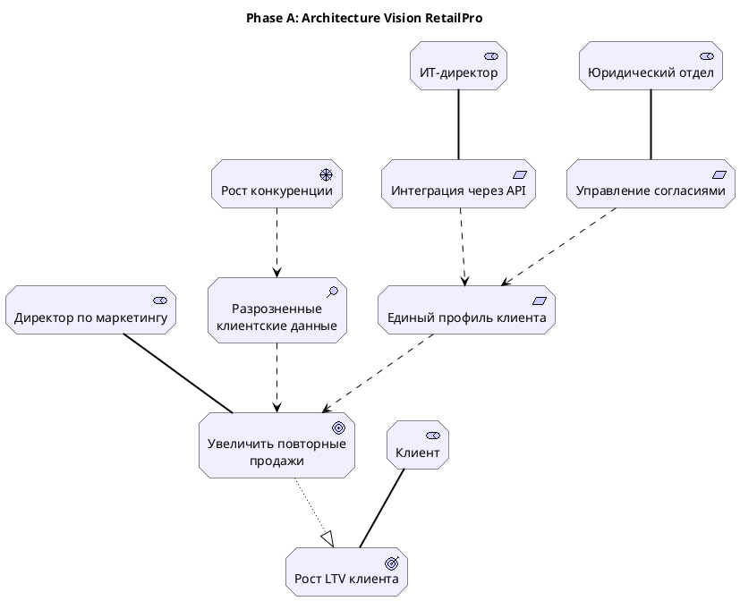

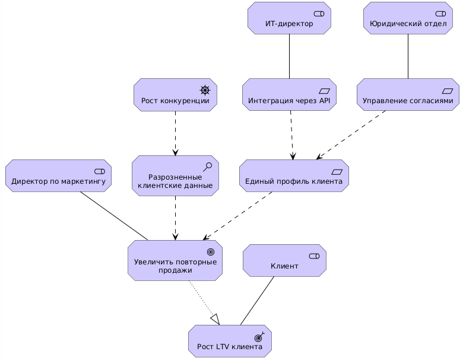

**Рис. 4.4.** Архитектурное видение RetailPro.

Другие артефакты, которые создаются на Фазе А, представлены в Таблице 4.5.

**Таблица 4.5.** Артефакты Фазы А.

| Артефакт | Пример |
|---|---|
| Architecture Vision | единая клиентская платформа |
| Stakeholder Map | маркетинг, ИТ, продажи, юридический отдел |
| Business Goals | рост повторных продаж |
| High-level Requirements | единый профиль, API, согласия |
| Statement of Architecture Work | описание объема и результата архитектурной работы |
| Initial Risk Assessment | риски данных, интеграции, безопасности |

## 4.6. Phase B: Business Architecture

Phase B отвечает на вопрос:

*Как должен быть устроен бизнес для достижения архитектурного видения?*

На этой фазе описываются:

- бизнес-способности;
- бизнес-процессы;
- бизнес-роли;
- организационные единицы;
- бизнес-услуги;
- потоки создания ценности;
- бизнес-объекты;
- изменения в ответственности.

Текущая бизнес-архитектура RetailPro:

```text
Маркетолог вручную выгружает списки клиентов из CRM.
Аналитик готовит сегменты в Excel.
Система рассылок используется отдельно.
Результаты кампаний анализируются вручную.
Согласия клиентов проверяются не во всех каналах.
```

Целевая бизнес-архитектура RetailPro:

```text
Маркетолог задает цель кампании.
Аналитик использует готовые клиентские сегменты из аналитической платформы.
Персональные предложения доставляются через согласованные каналы.
Согласия клиентов проверяются автоматически.
Результаты кампании анализируются на основе объединенных данных.
```

Мы начинаем моделирование бизнеса с идентификации способностей, которые нужны для достижения поставленных целей (подробнее см. Приложение G). Затем для каждой способности определяется бизнес-процесс, ее реализующий.

**Таблица 4.6.** Бизнес-способности RetailPro

| Способность | Назначение |
|---|---|
| Управление клиентскими данными | иметь актуальный и полный профиль клиента |
| Клиентская аналитика | сегментировать клиентов и прогнозировать их интересы |
| Управление кампаниями | планировать и запускать кампании |
| Управление согласиями | соблюдать требования персональных данных |
| Омниканальное взаимодействие | доставлять предложения в разных каналах |

Соответствующая модель PlantUML и архитектурная диаграмма:

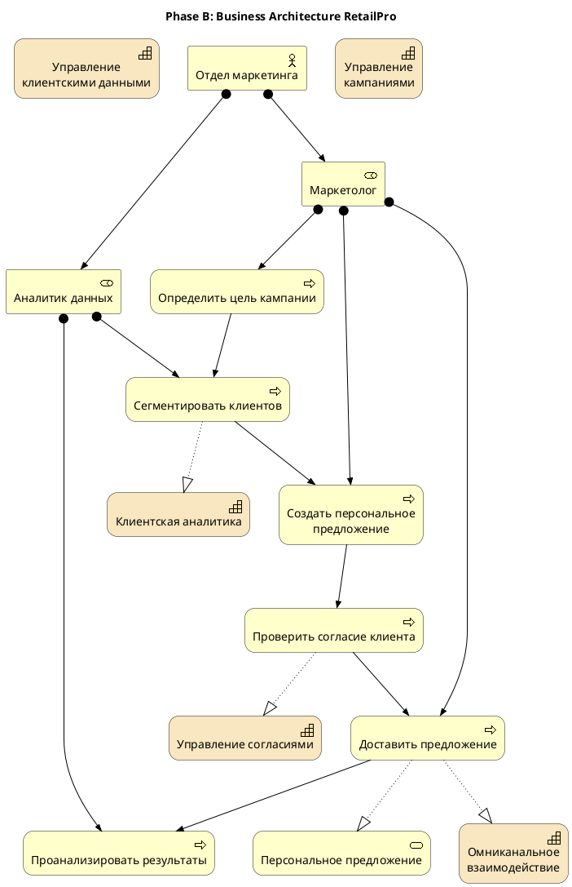

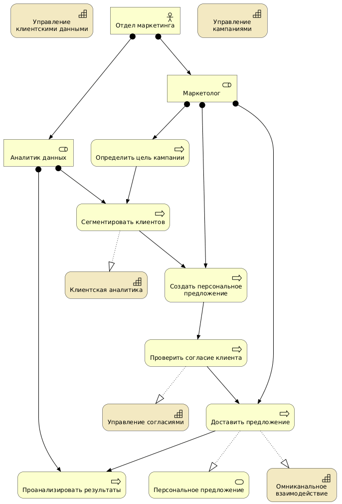

**Рис. 4.5.** Фаза B: Бизнес-архитектура RetailPro

## 4.7. Phase C: Information Systems Architecture

Phase C описывает информационные системы. Она обычно делится на две части:

1. Архитектура данных / Data Architecture;
2. Архитектура приложений / Application Architecture.

**Data Architecture** отвечает на вопрос:

*Какие данные нужны, где они создаются, где хранятся, как используются и кто за них отвечает?*

**Таблица 4.7.** Текущая архитектура данных RetailPro

| Данные | Где находятся | Проблема |
|---|---|---|
| Клиент | CRM, POS, интернет-магазин | дубли и разные идентификаторы |
| История покупок | POS, интернет-магазин | нет единого представления |
| Согласия | CRM, сайт | не синхронизированы |
| Сегменты | Excel | ручной расчет |
| Результаты кампаний | система рассылок | не связаны с продажами |

**Таблица 4.8.** Целевая архитектура данных RetailPro

| Данные | Целевое состояние |
|---|---|
| Профиль клиента | единый профиль в CDP |
| История покупок | объединена из POS и интернет-магазина |
| Согласия клиента | централизованный учет |
| Клиентский сегмент | рассчитывается аналитической платформой |
| Результаты кампаний | связаны с продажами и клиентским профилем |

Модель PlantUML, которая показывает, как бизнес-объекты будут отображены на данные в информационных системах в целевой архитектуре:

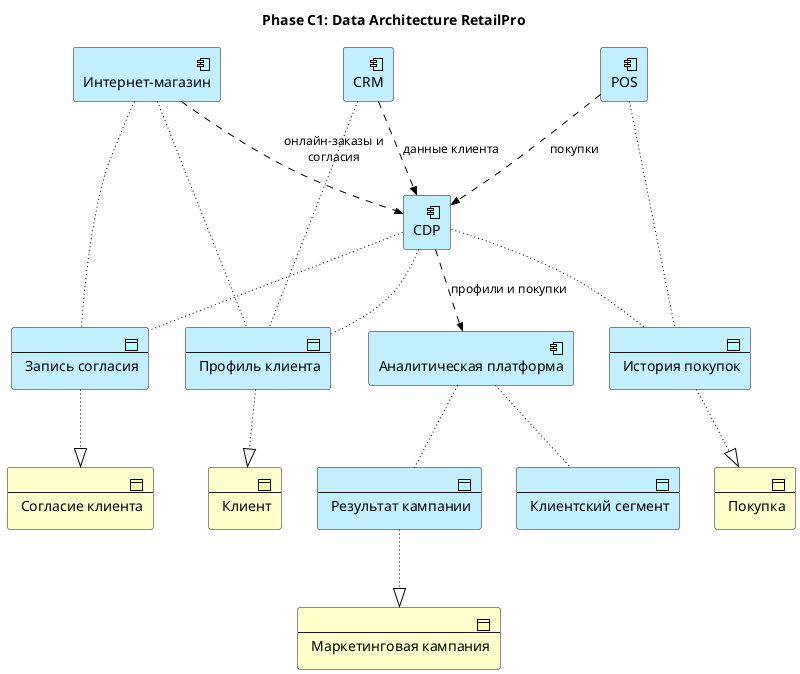

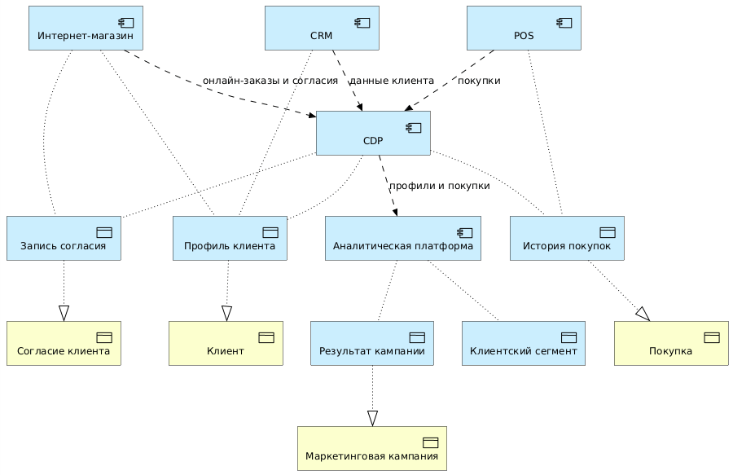

**Рис. 4.6.** Фаза C: Целевая архитектура данных RetailPro

**Application Architecture** отвечает на вопрос:

*Какие приложения и прикладные сервисы нужны для поддержки бизнес-процессов и данных?*

Текущая архитектура приложений RetailPro:

```text
CRM хранит часть клиентских данных.
POS хранит продажи в магазинах.
Интернет-магазин хранит онлайн-заказы.
Система рассылок работает с ручными выгрузками.
Excel используется для сегментации и отчетности.
Нет CDP.
Нет единого Customer API.
```

Целевая архитектура приложений RetailPro:

```text
CDP формирует единый профиль клиента.
CRM, POS и интернет-магазин передают данные в CDP.
Аналитическая платформа рассчитывает сегменты.
Система рассылок получает сегменты автоматически.
Customer API предоставляет доступ к профилю клиента.
Consent Management Service управляет согласиями.
```

Модель PlantUML целевой архитектуры приложений

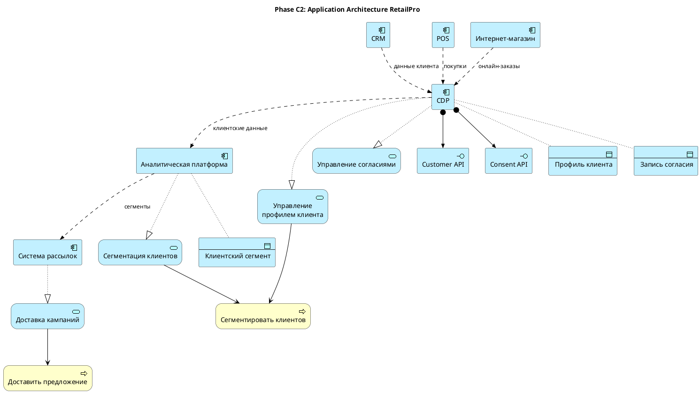

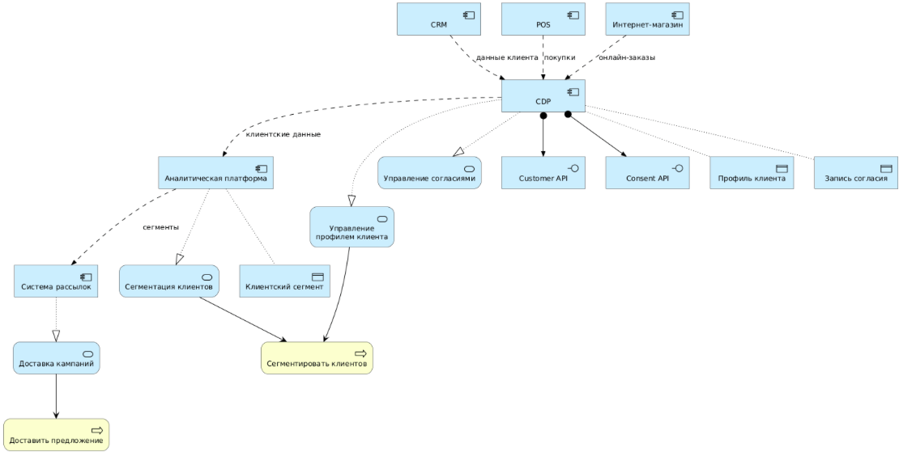

**Рис. 4.7.** Фаза C: Целевая архитектура приложений RetailPro

## 4.8. Phase D: Technology Architecture

Фаза D отвечает на вопрос:

*Какие технологические платформы и инфраструктурные сервисы нужны для реализации целевой архитектуры?*

На этой фазе описываются:

- вычислительные платформы;
- облачные сервисы;
- базы данных;
- интеграционные технологии;
- сетевые элементы;
- системное ПО;
- средства мониторинга;
- средства безопасности.

Текущая техническая архитектура RetailPro:

```text
CRM размещена в локальном ЦОД.
POS передает данные пакетными выгрузками.
Интернет-магазин размещен у внешнего провайдера.
Отчеты хранятся в Excel-файлах.
Нет единой интеграционной платформы.
Мониторинг интеграций ограничен.
```

Целевая техническая архитектура RetailPro:

```text
API Gateway управляет доступом к сервисам.
Message Broker обеспечивает событийную передачу данных.
Cloud Data Warehouse хранит данные для аналитики.
Identity Provider управляет доступом.
Monitoring Platform контролирует интеграции.
CDP и аналитические сервисы размещаются в облаке.
```

Модель PlantUML целевой технической архитектуры:

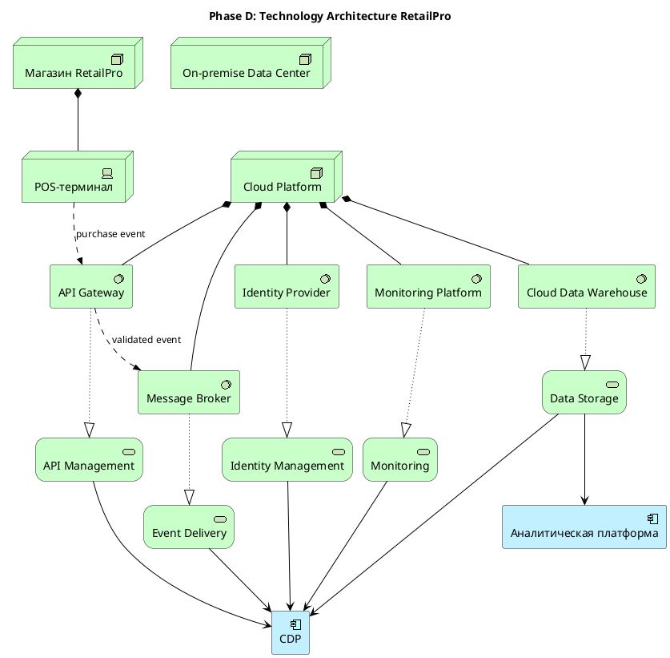

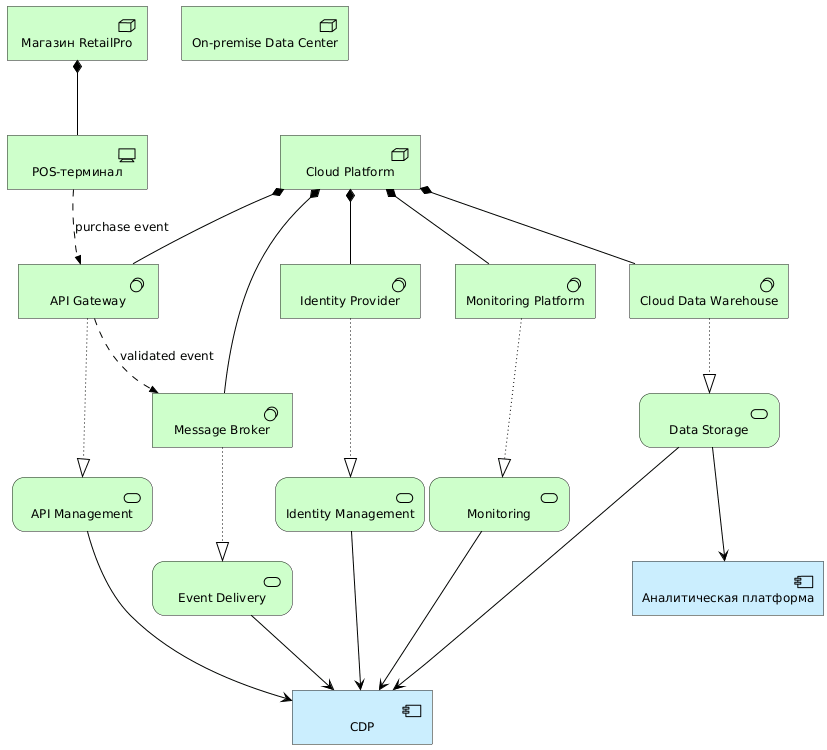

**Рис. 4.8.** Фаза D: Целевая техническая архитектура RetailPro

## 4.9. Phase E: Opportunities and Solutions

Phase E отвечает на вопрос:

*Какие решения и пакеты работ позволят реализовать целевую архитектуру?*

На этой фазе:

- анализируются варианты решений;
- определяются work packages;
- формируются переходные архитектуры;
- оцениваются зависимости;
- начинается подготовка дорожной карты.

### 4.9.2. Возможные решения RetailPro

RetailPro может рассмотреть три альтернативных решения, представленные в Таблице 4.9, критерии их оценки – в Таблице 4.10.

**Таблица 4.9.** Возможные решения RetailPro.

| Вариант | Описание |
|---|---|
| Развивать CRM | сделать CRM центральной системой клиентских данных |
| Внедрить CDP | использовать специализированную платформу клиентских данных |
| Построить собственное хранилище данных (DWH) | создать кастомное хранилище и сервисы профиля |

**Таблица 4.10.** Простая оценка вариантов

| Критерий | CRM как центр | Готовая CDP | Собственное DWH |
|---|---|---|---|
| Скорость внедрения | | | |
| Единый профиль клиента | | | |
| Гибкость | | | |
| Стоимость запуска | | | |
| Риск реализации | | | |
| Поддержка маркетинга | | | |

Здесь мы не приводим конкретные оценки каждой альтернативы и весовые коэффициенты критериев, поскольку это зависит от конкретной ситуации, а задача многокритериального выбора и не является темой данного учебника.

Предположим, что по результатам анализа RetailPro выбирает готовую CDP как целевое решение первого этапа. Это ведет к формированию пакетов работ (work packages), представленных в таблице 4.11.

**Таблица 4.11.** Пакеты работ RetailPro.

| Work Package | Содержание |
|---|---|
| WP1: Аудит клиентских данных | выявить источники и качество данных |
| WP2: Внедрение CDP | выбрать и внедрить платформу |
| WP3: Интеграция CRM и интернет-магазина | подключить основные клиентские источники |
| WP4: Интеграция POS | передавать данные о покупках |
| WP5: Аналитика сегментов | настроить расчет клиентских сегментов |
| WP6: Автоматизация кампаний | связать сегменты с системой рассылок |

Модель PlantUML

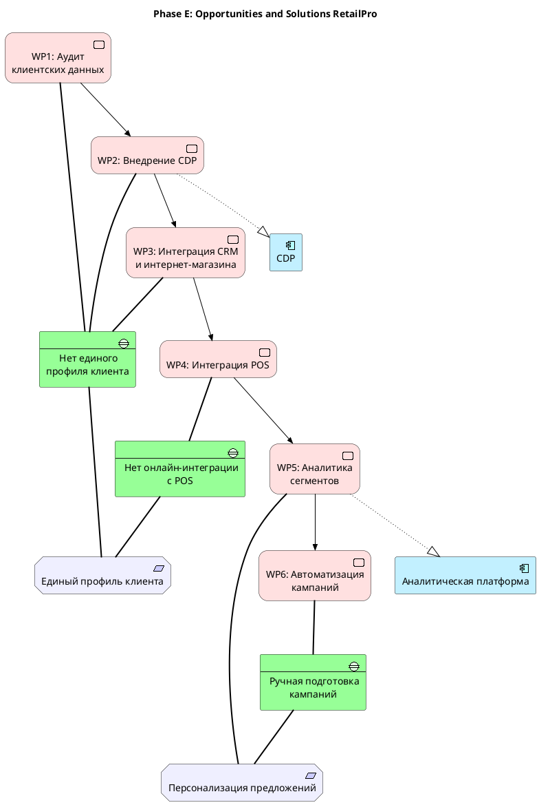

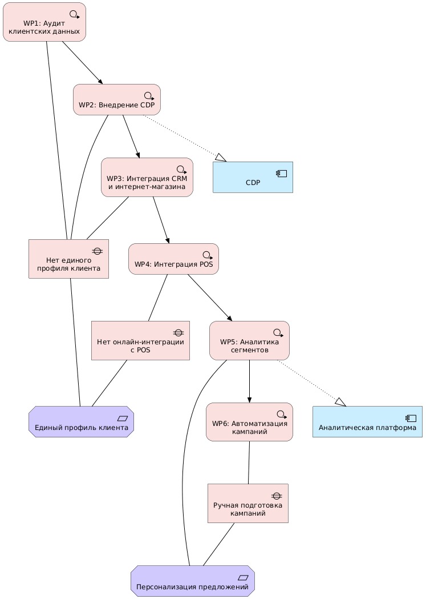

**Рис. 4.9.** Фаза E: Пакеты работ для реализации целевой архитектуры RetailPro

## 4.10. Phase F: Migration Planning

Фаза F отвечает на вопрос:

*Как перейти от текущей архитектуры к целевой с учетом приоритетов, зависимостей, ресурсов и рисков?*

На этой фазе:

- уточняется дорожная карта;
- определяются зависимости между пакетами работ;
- оцениваются сроки и ресурсы;
- выбираются переходные архитектуры;
- согласуется план миграции.

**Таблица 4.12.** Пример дорожной карты RetailPro

| Период | Основные изменения |
|---|---|
| Q1 | аудит клиентских данных, назначение владельцев данных |
| Q2 | внедрение CDP, интеграция CRM и интернет-магазина |
| Q3 | подключение POS, настройка передачи событий покупок |
| Q4 | запуск клиентской аналитики и автоматизация кампаний |

Соответственно, RetailPro может выделить переходные архитектурные модели, которые будут поддерживать бесперебойное функционирование компании в процессе трансформации (Таблица 4.13).

**Таблица 4.13.** Переходные архитектуры

| Плато / Plateau | Описание |
|---|---|
| Baseline | данные разрознены, кампании ручные |
| Transition 1 | CDP внедрена, CRM и сайт подключены |
| Transition 2 | POS подключен, покупки передаются регулярно |
| Target | персонализация работает во всех каналах |

Модель PlantUML

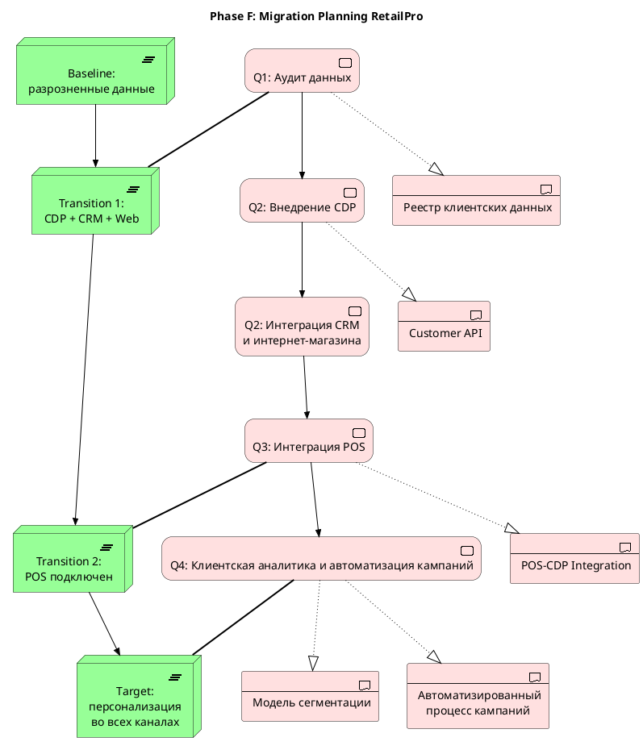

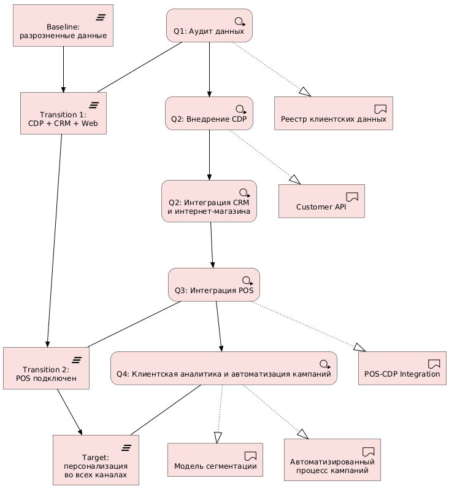

**Рис. 4.10.** Фаза F: План миграции на целевую архитектуру RetailPro

## 4.11. Phase G: Implementation Governance

Фаза G отвечает на вопрос:

*Соответствует ли реализация проекта согласованной архитектуре?*

На этой фазе:

- архитектура передается проектным командам;
- формируются архитектурные контракты;
- проводится проверка решений;
- управляются отклонения;
- фиксируются архитектурные решения;
- контролируется соответствие принципам.

Пример архитектурного контроля RetailPro. Проектная команда CDP предлагает:

```text
Система рассылок будет напрямую читать таблицы CDP.
```

Архитектор проверяет это предложение на соответствие принципам:

```text
API-first
Privacy by design
Единый контроль доступа
```

Решение:

```text
Прямой доступ к таблицам CDP запрещен.
Система рассылок должна получать сегменты через Campaign API.
Доступ должен проверяться через Identity Provider.
```

**Таблица 4.14.** Пример содержания архитектурного контракта

| Раздел | Пример |
|---|---|
| Проект | внедрение CDP |
| Архитектурные требования | Customer API, Consent API |
| Принципы | API-first, Privacy by design |
| Ограничения | запрет прямого доступа к БД |
| Контрольные точки | review архитектуры интеграции |
| Ответственные | архитектор, руководитель проекта |

## 4.12. Phase H: Architecture Change Management

Фаза H отвечает на вопрос:

*Как управлять изменениями архитектуры после ее утверждения?*

Архитектура не остается неизменной. Меняются:

- стратегия;
- рынок;
- технологии;
- регуляторные требования;
- бизнес-модель;
- ожидания клиентов;
- состояние ИТ-ландшафта.

**Пример.** Через год после запуска CDP RetailPro решает внедрить мобильное приложение. Появляются новые требования:

```text
клиент должен видеть бонусный баланс в приложении;
push-уведомления должны учитывать согласия;
мобильное приложение должно использовать Customer API;
история покупок должна быть доступна клиенту;
нужна защита мобильного канала.
```

Таблица 4.15 отражает слои архитектуры, на которые влияет это изменение.

**Таблица 4.15.** Влияние предлагаемого изменения.

| Область | Влияние |
|---|---|
| Business | новый процесс мобильного взаимодействия |
| Data | новые данные о поведении в приложении |
| Application | мобильное приложение, Mobile API |
| Technology | защита API, push notification service |
| Requirements | новые согласия и требования безопасности |
| Roadmap | новый пакет работ |

Типовой процесс управления изменениями показан на рис. 4.11.

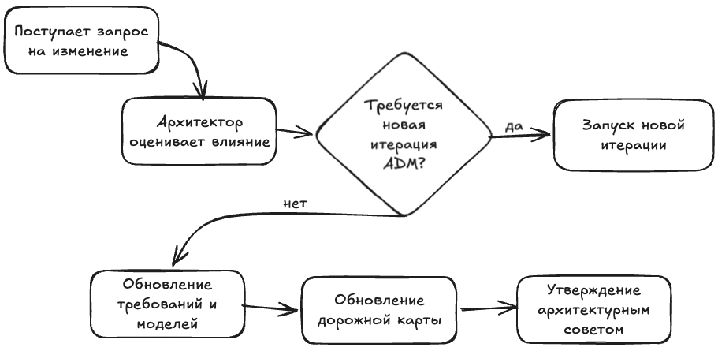

Рис. 4.11. Процесс управления изменениями архитектуры

## 4.13. Связь фаз ADM с архитектурными артефактами

ADM полезен тем, что каждая фаза производит конкретные результаты.

**Таблица 4.16.** Артефакты ADM

| Фаза | Основные артефакты | Пример RetailPro |
|---|---|---|
| Preliminary | принципы, governance-модель | API-first, архитектурный совет |
| Phase A | Architecture Vision, stakeholder map | видение клиентской платформы |
| Phase B | бизнес-модели, capability map | процесс персональной кампании |
| Phase C Data | модель данных, data catalog | профиль клиента, согласия |
| Phase C Application | модель приложений | CRM, POS, CDP, Analytics |
| Phase D | технологическая модель | API Gateway, Message Broker |
| Phase E | solution options, work packages | внедрение CDP, интеграция POS |
| Phase F | migration roadmap | Q1–Q4 roadmap |
| Phase G | architecture contract, compliance assessment | запрет прямого доступа к БД |
| Phase H | change request, updated architecture | мобильное приложение |
| Requirements Management | requirements catalog | REQ-01…REQ-05 |

## 4.14. Упрощенный ADM для учебного проекта

Полный TOGAF может быть слишком большим для учебного проекта. Поэтому в курсе можно использовать упрощенный цикл (Рис. 4.12) и минимальный набор артефактов (Таблица 4.17).

```text
1. Определить проблему и stakeholders.
2. Сформулировать цели, требования и принципы.
3. Описать текущую архитектуру.
4. Описать целевую архитектуру.
5. Выявить gaps.
6. Определить work packages.
7. Сформировать migration roadmap.
8. Проверить соответствие решений принципам.
9. Подготовить архитектурное описание.
```

**Рис. 4.12.** Минимальный цикл ADM

**Таблица 4.17.** Минимальный набор артефактов

| Артефакт | Минимальное содержание |
|---|---|
| Architecture Vision | цель, проблема, границы |
| Stakeholder Map | 5–7 заинтересованных лиц |
| Principles | 3–5 принципов |
| Baseline Architecture | текущие процессы, приложения, данные |
| Target Architecture | целевые процессы, приложения, данные |
| Gap Analysis | 5–7 разрывов |
| Work Packages | 4–6 пакетов работ |
| Roadmap | 3–4 этапа перехода |
| Diagrams | минимум 4 ArchiMate-диаграммы |
| PlantUML Code | код минимум для 2 диаграмм |

## 4.15. Типичные ошибки студентов при применении ADM

1. Начинать с Phase C или D. Часто студенты сразу описывают приложения и технологии, необходимо начинать с идентификации целей, требований и анализа возможных реализаций.

2. Пропускать Baseline Architecture. Если не описать текущее состояние, невозможно выполнить gap-анализ.

3. Не формулировать принципы. Без принципов трудно принимать решения. Например, если нет принципа API-first, команда может выбрать прямую интеграцию с базами данных.

4. Путать gap и work package. Gap — это разрыв. Work Package — работа, которая помогает его закрыть.

5. Делать roadmap без зависимостей. Если аналитика зависит от CDP, нельзя ставить аналитику раньше внедрения CDP и интеграции данных.

6. Игнорировать Phase G. Архитектура должна сопровождать реализацию. Иначе проект может отклониться от целевого решения.

7. Считать Phase H необязательной. Архитектура устаревает. Новые требования должны управляться, иначе целевая архитектура быстро потеряет актуальность.

## 4.16. Практическое задание

Задание: пройти упрощенный ADM для кейса RetailPro.

Используя кейс RetailPro, подготовьте архитектурное описание инициативы «единая клиентская платформа».

**Часть 1.** Preliminary Phase. Сформулируйте:

1. границы архитектурной работы;
2. 3–5 архитектурных принципов;
3. состав архитектурного совета.

**Часть 2.** Phase A: Architecture Vision. Сформулируйте:

- архитектурное видение;
- 5 stakeholders;
- 5 concerns;
- 5 требований.

**Часть 3.** Phase B: Business Architecture. Опишите:

- 3–5 бизнес-способностей;
- 1 ключевой бизнес-процесс;
- роли участников;
- бизнес-услугу.

**Часть 4.** Phase C: Information Systems Architecture. Опишите:

Data Architecture

- 5 ключевых объектов данных;
- источники данных;
- проблемы качества данных.

Application Architecture

- 5–7 приложений;
- 3 прикладных сервиса;
- основные потоки данных.

**Часть 5.** Phase D: Technology Architecture. Опишите:

- технологические сервисы;
- платформы;
- интеграционные технологии;
- средства безопасности.

**Часть 6.** Phase E: Opportunities and Solutions. Определите:

- 3 варианта решения;
- критерии выбора;
- выбранный вариант;
- 4–6 work packages.

**Часть 7.** Phase F: Migration Planning. Постройте roadmap минимум из четырех этапов.

| Этап | Пакеты работ | Результат |
|---|---|---|
| Q1 | | |
| Q2 | | |
| Q3 | | |
| Q4 | | |

**Часть 8.** Phase G: Implementation Governance. Опишите:

- 3 архитектурных правила контроля;
- пример архитектурного нарушения;
- решение архитектурного совета.

**Часть 9.** Phase H: Architecture Change Management. Опишите возможный будущий запрос на изменение, например:

```text
добавить мобильное приложение;
добавить push-уведомления;
добавить ML-рекомендации;
подключить маркетплейс.
```

Для него укажите:

- какие слои архитектуры будут затронуты;
- какие требования изменятся;
- какие модели нужно обновить.

## 4.17. Контрольные вопросы

1. Что такое ADM?
2. Почему ADM называется циклом?
3. Какие фазы входят в ADM?
4. Почему Requirements Management находится в центре ADM?
5. Что создается на Preliminary Phase?
6. Что такое Architecture Vision?
7. Чем Baseline Architecture отличается от Target Architecture?
8. Что описывается в Business Architecture?
9. Почему Phase C делится на Data Architecture и Application Architecture?
10. Что описывается в Technology Architecture?
11. Что такое Work Package?
12. Что такое Gap?
13. Что такое Plateau?
14. Чем Phase E отличается от Phase F?
15. Что проверяется в Phase G?
16. Зачем нужна Phase H?
17. Какие артефакты ADM нужны для учебного проекта?
18. Какие ошибки чаще всего возникают при применении ADM?

## 4.18. Краткие выводы главы

1. ADM — центральный метод TOGAF для разработки и развития архитектуры предприятия.
2. ADM помогает пройти путь от подготовки архитектурной работы до управления изменениями.
3. Требования находятся в центре ADM, потому что архитектура должна отвечать потребностям заинтересованных лиц.
4. Preliminary Phase определяет правила архитектурной работы, роли, принципы и governance.
5. Phase A формирует архитектурное видение и границы инициативы.
6. Phase B описывает бизнес-архитектуру.
7. Phase C описывает данные и приложения.
8. Phase D описывает технологическую архитектуру.
9. Phase E определяет решения и пакеты работ.
10. Phase F формирует план миграции и переходные архитектуры.
11. Phase G обеспечивает соответствие реализации целевой архитектуре.
12. Phase H поддерживает архитектуру актуальной при изменениях.
13. Для учебного проекта ADM следует применять в упрощенном, но логически полном виде.
14. Главная ценность ADM – не в формальном прохождении фаз, а в управляемой связи между целями, требованиями, архитектурными решениями и реализацией.

---

[← Предыдущая глава](../03-togaf-framework/README.md) · [К оглавлению](../README.md) · [Следующая глава →](../05-archimate-language/README.md)
