# Глава 5. Назначение и логика языка ArchiMate 4.0

[← Предыдущая глава](../04-adm-method/README.md) · [К оглавлению](../README.md) · [Следующая глава →](../06-archimate-relationships/README.md)

**После изучения этой главы студент должен уметь:**

1. объяснять, зачем нужен язык архитектурного моделирования ArchiMate;
2. отличать ArchiMate от TOGAF, BPMN, UML и PlantUML;
3. понимать базовую структуру языка ArchiMate;
4. объяснять понятия слоя и аспекта в ArchiMate;
5. различать активную структуру, поведение и пассивную структуру;
6. объяснять роль мотивационных, стратегических, бизнес-, прикладных, технологических и миграционных элементов;
7. читать простую ArchiMate-модель;
8. создавать минимальную ArchiMate-диаграмму на PlantUML;
9. понимать типичные ошибки при первом знакомстве с ArchiMate.

## 5.1. Учебная ситуация: RetailPro нужна единая архитектурная нотация

Компания RetailPro работает над инициативой создания единой клиентской платформы. В процессе обсуждения участвуют разные специалисты:

- директор по маркетингу;
- ИТ-директор;
- бизнес-аналитик;
- архитектор предприятия;
- разработчики;
- специалист по данным;
- специалист по информационной безопасности;
- руководитель проекта;
- юридический отдел.

Каждый участник привык к своему способу описания проблемы (Таблица 5.1).

**Таблица 5.1.** Разные описания одной инициативы

| Участник | Как описывает ситуацию |
|---|---|
| Директор по маркетингу | Нужно увеличить повторные продажи и персонализировать предложения |
| Бизнес-аналитик | Нужно изменить процесс подготовки кампаний |
| Специалист по данным | Нужен единый профиль клиента и качество мастер-данных |
| ИТ-директор | Нужно интегрировать CRM, POS и интернет-магазин |
| Разработчик | Нужны API и события покупок |
| Инфраструктурный специалист | Нужны облачное хранилище и брокер сообщений |
| Юридический отдел | Нужно учитывать согласия клиентов |

Все говорят о реальной проблеме, но на разных языках. Если использовать только текстовые описания, легко потерять связи:

```text
Цель бизнеса → процесс → данные → приложения → технологии → проекты
```

Для того чтобы эти связи можно было формально и наглядно описывать, используется язык **ArchiMate**.

## 5.2. Что такое ArchiMate

**ArchiMate** — это открытый язык архитектурного моделирования, предназначенный для описания архитектуры предприятия через взаимосвязанные элементы бизнеса, данных, приложений, технологий, мотивации, стратегии и изменений.

```text
ArchiMate — это язык, с помощью которого можно моделировать архитектуру предприятия.
```

Он позволяет показать:

- зачем нужны изменения;
- какие бизнес-возможности требуются;
- какие процессы реализуют ценность;
- какие приложения поддерживают процессы;
- какие данные используются;
- какие технологии обеспечивают работу приложений;
- какие проекты переводят предприятие из текущего состояния в целевое.

ArchiMate нужен, чтобы:

1. создать общий язык для бизнеса и ИТ;
2. моделировать связи между слоями предприятия;
3. анализировать влияние изменений;
4. описывать текущую и целевую архитектуру;
5. выявлять архитектурные разрывы;
6. строить дорожные карты миграции;
7. документировать архитектурные решения;
8. поддерживать трассируемость от целей до реализации.

**Пример.** Что дает ArchiMate в кейсе RetailPro. Без ArchiMate:

```text
Нужно внедрить CDP, чтобы персонализировать предложения.
```

С ArchiMate можно показать отношения между различными элементами компании:

```text
Stakeholder: Директор по маркетингу
    ↓
Goal: увеличить повторные продажи
    ↓
Requirement: единый профиль клиента
    ↓
Business Process: сегментировать клиентов
    ↓
Application Service: управление профилем клиента
    ↓
Application Component: CDP
    ↓
Data Object: профиль клиента
    ↓
Technology Service: database hosting
```

Второе описание более архитектурное, потому что оно показывает смысловые связи.

## 5.3. ArchiMate, TOGAF, BPMN, UML и PlantUML: в чем различие

Начинающие часто путают разные методы, языки и инструменты. Важно понимать их назначение.

**Таблица 5.2.** Сравнение методов, языков и инструментов

| Инструмент / язык / метод | Основное назначение | Пример использования |
|---|---|---|
| TOGAF | метод и фреймворк архитектурной работы | пройти ADM-фазы |
| ArchiMate | язык моделирования архитектуры предприятия | описать связь цели, процесса, приложения и технологии |
| BPMN | язык моделирования бизнес-процессов | детально описать процесс обработки заказа |
| UML | язык моделирования программных систем | описать классы, компоненты, последовательности |
| PlantUML | текстовый способ описания диаграмм | сгенерировать ArchiMate-диаграмму из кода |
| EA-инструмент | среда хранения и анализа моделей | Archi, Bizzdesign, Sparx EA |

**TOGAF и ArchiMate.** TOGAF отвечает на вопрос «Как организовать работу по совершенствованию архитектуры предприятия?» ArchiMate предоставляет средства построения моделей. Например, на фазе B: `Business Architecture` TOGAF требует описать бизнес-архитектуру. Для этого ArchiMate предлагает элементы `Business Actor`, `Business Role`, `Business Process`, `Business Service`, `Business Object`.

**ArchiMate и BPMN.** BPMN лучше подходит для детального описания логики бизнес-процесса, поскольку включает такие элементы как событие (event), задача (task), ветвления по условию (gateway), сообщение (message), обработка исключений (exception handling) и инструменты для моделирования ролей (pool и lane). ArchiMate лучше подходит для архитектурной связи процесса с другими слоями.

| ArchiMate | BPMN |
|---|---|
| 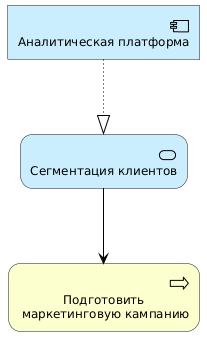 | 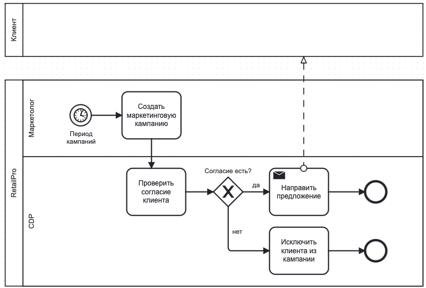 |

То есть ArchiMate отвечает на архитектурный вопрос: `Как процесс связан с приложениями и данными?`

BPMN отвечает на процессный вопрос: `Как именно выполняется процесс?`

**ArchiMate и UML.** UML применяется преимущественно для проектирования программных систем: варианты использования (Use Case), диаграммы классов; диаграммы компонентов; диаграммы последовательности; диаграммы развертывания. На Рис. 5.1 представлена диаграмма классов, связывающая классы Клиент (Customer), Покупки (Purchase) и Маркетинговые кампании (MarketingCampaign). Эти данные будут использоваться в приложении CDP.

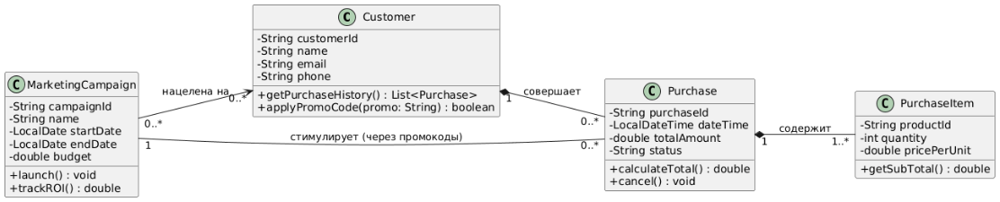

Рис. 5.1. Диаграмма классов CDP.

UML показывает внутреннюю структуру программного решения. ArchiMate работает на более высоком архитектурном уровне. В примере выше ArchiMate показывает связь приложения «Аналитическая платформа» с бизнесом.

**ArchiMate и PlantUML.** PlantUML не является языком архитектуры предприятия в строгом смысле. Это инструмент текстового описания диаграмм. Хотя изначально этот язык разработан для описания UML диаграмм, с его помощью можно записывать и ArchiMate-элементы в виде кода. Код для генерации диаграммы, приведенной выше:

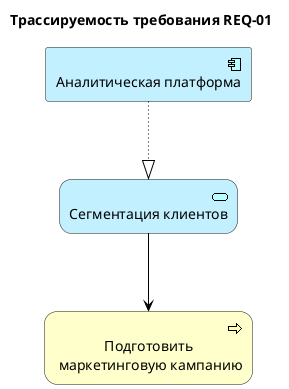

## 5.4. Архитектурная модель, элемент, отношение и представление

Перед изучением структуры ArchiMate нужно ввести несколько базовых понятий.

**Архитектурная модель** – это формальное описание выбранной части предприятия с помощью элементов и отношений.

Модель может включать любые объекты, которые уже обсуждались в предыдущих главах: цели, процессы, роли, приложения, данные, технологии, требования и т.д.

**Элемент** – это объект модели определенного типа.

**Отношение** показывает смысловую связь между элементами. В ArchiMate эти связи имеют формальные типы:

```text
Realization
Serving
Access
Flow
Influence
Triggering
Assignment
Composition
```

Отношения будут подробно изучаться в следующей главе.

**View** (или **представление**) – это конкретная диаграмма, показывающая часть модели для определенной аудитории и задачи. Одна и та же модель может иметь разные представления.

**Таблица 5.3.** Разные представления RetailPro

| View | Аудитория | Что показывает |
|---|---|---|
| Motivation View | руководство | зачем нужна клиентская платформа |
| Business View | маркетинг | как меняется процесс кампаний |
| Application View | ИТ | как интегрируются CRM, POS, CDP |
| Technology View | инфраструктурная команда | какие платформы нужны |
| Migration View | проектный офис | как будет выполняться переход |

## 5.5. Общая структура языка ArchiMate

> **Примечание о версиях.** В ArchiMate 4.0 термин «слой» (layer) заменен термином «домен» (domain), а часть элементов версии 3.x исключена: Constraint, Contract, Gap, Representation, Implementation Event и элементы Interaction (Business, Application, Technology Interaction). Их роль выполняют специализации более общих элементов (например, Constraint — специализация Requirement, Gap — специализация Assessment или Deliverable). В учебнике эти понятия описаны по терминологии версии 3.x, так как они удобны для обучения, а библиотека ArchiMate для PlantUML (проверено на версии 1.2026.8) по-прежнему содержит соответствующие макросы.

ArchiMate организован по слоям и аспектам. Можно выделить следующие группы элементов (Таблица 5.4).

**Таблица 5.4.** Группы элементов ArchiMate.

| Группа | Назначение |
|---|---|
| Motivation | цели, требования, принципы, ограничения |
| Strategy | возможности, ресурсы, направления действий |
| Business | бизнес-роли, процессы, услуги, объекты |
| Application | приложения, сервисы приложений, данные |
| Technology | инфраструктура и технологические сервисы |
| Physical | физические объекты, оборудование, материалы |
| Implementation & Migration | проекты, пакеты работ, разрывы, состояния |

Внутри основных слоев элементы часто можно понимать через три аспекта:

1. активная структура;
2. поведение;
3. пассивная структура.

Эта логика очень важна для понимания ArchiMate.

## 5.6. Три аспекта: активная структура, поведение, пассивная структура

При описании компании через три основных архитектурных слоя (бизнес, приложения и данные, технологии) всегда можно задать три вопроса:

```text
Кто или что действует?
Что выполняется?
Над чем выполняется действие?
```

Этим вопросам соответствуют три аспекта (Таблица 5.5)

**Таблица 5.5.** Аспекты ArchiMate

| Вопрос | Аспект | Примеры |
|---|---|---|
| Кто или что действует? | Active Structure | роль, приложение, сервер |
| Что выполняется? | Behavior | процесс, функция, сервис |
| Над чем выполняется действие? | Passive Structure | бизнес-объект, объект данных, артефакт |

**Таблица 5.6.** Пример для бизнес-слоя

| Аспект | Элемент RetailPro |
|---|---|
| Active Structure | Маркетолог |
| Behavior | Подготовить маркетинговую кампанию |
| Passive Structure | Маркетинговая кампания |

Смысл:

```text
Маркетолог выполняет процесс подготовки кампании, который работает с бизнес-объектом «Маркетинговая кампания».
```

**Таблица 5.7.** Пример для слоя приложений

| Аспект | Элемент RetailPro |
|---|---|
| Active Structure | CDP |
| Behavior | Управление профилем клиента |
| Passive Structure | Профиль клиента |

Смысл:

```text
CDP реализует сервис управления профилем клиента, который использует объект данных «Профиль клиента».
```

**Таблица 5.8.** Пример для технологического слоя

| Аспект | Элемент RetailPro |
|---|---|
| Active Structure | Cloud Platform |
| Behavior | Database Hosting |
| Passive Structure | customer_profile_table.sql |

**Смысл:**

```text
Облачная платформа предоставляет сервис размещения базы данных, на которой физически хранится артефакт customer_profile_table.sql.
```

**Таблица 5.9.** Сводная таблица аспектов

| Слой | Active Structure | Behavior | Passive Structure |
|---|---|---|---|
| Business | Business Actor, Business Role | Business Process, Business Service | Business Object |
| Application | Application Component | Application Function, Application Service | Data Object |
| Technology | Node, Device, System Software | Technology Function, Technology Service | Artifact |
| Physical | Equipment, Facility | Physical Process | Material |

## 5.7. Мотивационные элементы ArchiMate

Мотивационные элементы помогают объяснить, почему архитектура должна измениться.

**Таблица 5.10.** Мотивационные элементы

| Элемент | Смысл | ArchiMate | Пример RetailPro |
|---|---|---|---|
| Stakeholder | заинтересованное лицо | 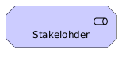 | директор по маркетингу |
| Driver | фактор изменений | 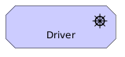 | рост конкуренции |
| Assessment | оценка ситуации | 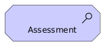 | разрозненные данные |
| Goal | желаемое состояние | 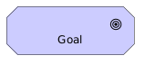 | увеличить повторные продажи |
| Outcome | измеримый результат | 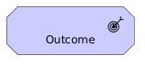 | рост LTV |
| Requirement | необходимое свойство решения |  | единый профиль клиента |
| Principle | правило проектирования | 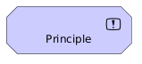 | API-first |

**Примечание:** В версиях ArchiMate 3.X присутствовал элемент constraint (ограничение), однако он исключен из версии 4.0, поскольку все ограничения можно описать как requirement.

Ниже приводятся более формальные определения элементов ArchiMate, предназначенных для описания мотивации:

**Stakeholder** – это лицо, группа, подразделение или организация, имеющие интерес к архитектуре или затрагиваемые архитектурными изменениями.

**Driver** – это внутренний или внешний фактор, который мотивирует организацию изменяться.

**Assessment** – это результат оценки влияния drivers на организацию. Assessment может описывать проблему, риск, возможность или слабое место.

Driver и Assessment: Driver – фактор. Assessment – оценка состояния компании относительно этого фактора.

Одной из практик идентификации Assessments является SWOT анализ, суждения о сильных и слабых сторонах компании, угрозах и возможностях можно включать в модель мотивации. Но при этом важно, что эти суждения должны быть ассоциированы с конкретными заинтересованными лицами и их драйверами.

**Goal** – это желаемое состояние или результат, которого хочет достичь организация.

**Outcome** – это конкретный, обычно измеримый результат достижения цели.

Outcome и Goal: Goal описывает желаемое направление, а outcome — наблюдаемый эффект.

**Requirement** – это необходимое свойство архитектуры, системы, процесса или решения, которое должно быть реализовано для достижения целей. Этот элемент отвечает на вопрос «что необходимо обеспечить?».

**Constraint** – это ограничение, которое должно соблюдаться при проектировании или реализации архитектуры. Этот элемент исключен из версии ArchiMate 4.0, предлагается описывать ограничения как требования.

**Principle** – это общее правило или руководство, которое должно направлять архитектурные решения.

Пример мотивационной модели

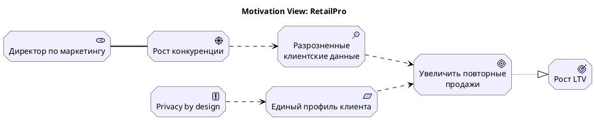

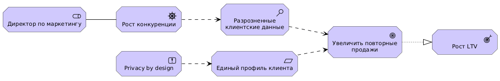

Рис. 5.2. Мотивационное представление RetailPro.

Как читать эту модель:

```text
Директор по маркетингу заинтересован в реакции на рост конкуренции.
Рост конкуренции выявляет проблему разрозненных клиентских данных.
Эта проблема влияет на цель увеличения повторных продаж.
Измеримым результатом достижения этой цели будет рост LTV.
Для достижения цели требуется единый профиль клиента.
Принцип Privacy by design влияет на реализацию этого требования.
```

## 5.8. Стратегические элементы ArchiMate

Стратегический слой показывает, какие способности и ресурсы нужны организации для достижения целей.

**Таблица 5.11.** Стратегические элементы

| Элемент | Смысл | ArchiMate | Пример RetailPro |
|---|---|---|---|
| Capability | способность организации | 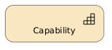 | клиентская аналитика |
| Resource | актив или ресурс | 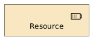 | клиентские данные |
| Course of Action | направление действий | 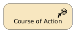 | развить омниканальную персонализацию |
| Value Stream | поток создания ценности | 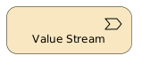 | персонализировать клиентское взаимодействие |

Определения и комментарии:

**Capability** – это способность организации выполнять определенный вид деятельности или достигать определенного результата.

**Resource** – это актив, которым располагает организация и который используется для реализации capabilities.

Важно различать стратегический ресурс и объект данных. Resource идентифицируется и обсуждается на стратегическом уровне, Data Object – на прикладном уровне.

**Course of Action** – это выбранный подход или направление действий, с помощью которого организация намерена достичь целей или развить capabilities.

Course of Action и Work Package: Course of Action – стратегическое направление. Work Package – конкретная работа или проект.

**Value Stream** — это последовательность этапов, через которые создается ценность для заинтересованного лица.

Value Stream и Business Process: Value Stream показывает этапы создания ценности, а процесс показывает конкретную операционную логику.

Пример стратегической модели

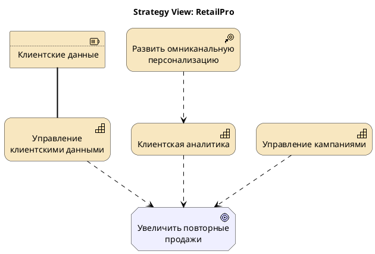

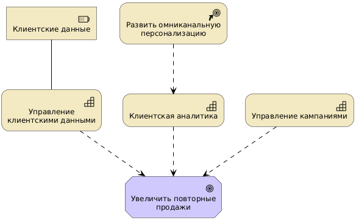

Рис. 5.3. Стратегическое представление RetailPro

Как читать модель:

```text
Для увеличения повторных продаж RetailPro должна развивать клиентскую аналитику и управление кампаниями. Направление действий — омниканальная персонализация. Ключевой ресурс — клиентские данные.
```

**Связь мотивационных и стратегических моделей**

Модель мотивации показывает, **зачем** нужны изменения. Стратегическая модель показывает, **какие способности и направления действий** нужны для достижения целей.

Типовая цепочка моделирования:

```text
Stakeholder
↓
Driver
↓
Assessment
↓
Goal
↓
Outcome
↓
Requirement
↓
Course of Action
↓
Capability
↓
Resource
```

Пример RetailPro

```text
Stakeholder: Директор по маркетингу

Driver: Ожидание персональных предложений

Assessment: Низкая персонализация предложений

Goal: Увеличить повторные продажи

Outcome: Повторные продажи +15%

Requirement: Единый профиль клиента

Course of Action: Централизовать клиентские данные

Capability: Управление клиентскими данными

Resource: Клиентские данные
```

Модель PlantUML

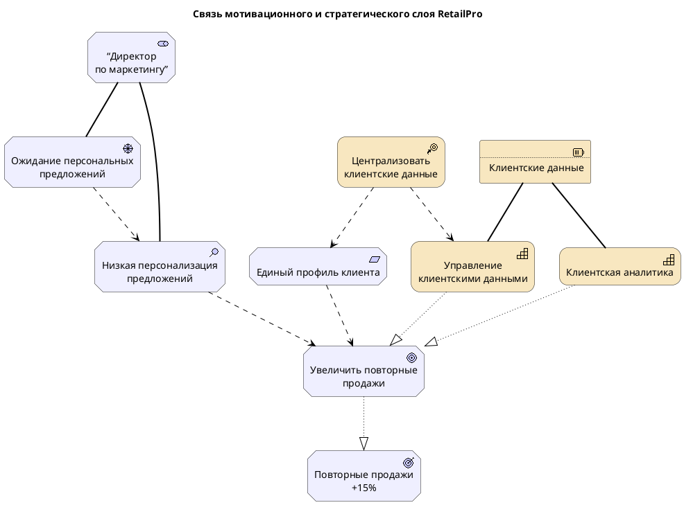

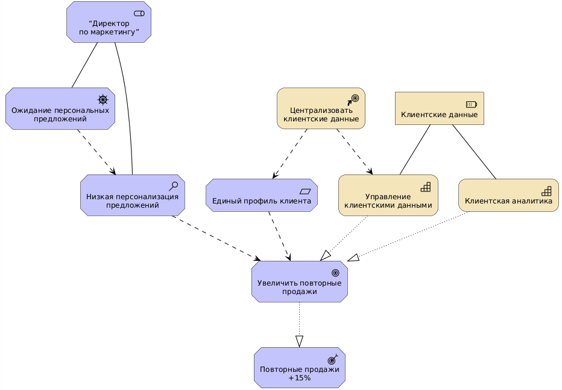

Рис. 5.4. Мотивационно-стратегическая модель RetailPro

## 5.9. Бизнес-элементы ArchiMate

Бизнес-слой ArchiMate описывает организацию, ее деятельность, участников, бизнес-процессы, бизнес-объекты и бизнес-услуги.

**Таблица 5.12.** Элементы бизнес-слоя

| Элемент | Смысл | ArchiMate | Пример RetailPro |
|---|---|---|---|
| Business Actor | Подразделение или участник | 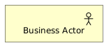 | Отдел маркетинга |
| Business Role | Роль | 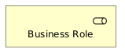 | Маркетолог |
| Business Process | Процесс | 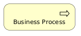 | Подготовить кампанию |
| Business Function | Функция | 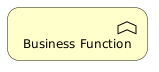 | Маркетинг |
| Business Event | Событие | 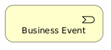 | Начало сезонной акции |
| Business Service | Услуга | 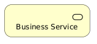 | Персональное предложение |
| Business Object | Бизнес-понятие | 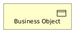 | Клиент, кампания, договор |
| Business Collaboration | Объединение ролей или акторов | 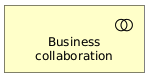 | Команда из маркетолога, аналитика и юриста |
| Business Interaction | Поведение business collaboration | 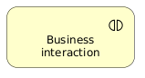 | Согласовать параметры компании |
| Product | Продукт | 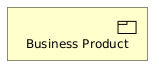 | Программа лояльности |

Определения и комментарии:

**Business Actor** — это организационная единица, человек, группа людей или внешний участник, который способен выполнять бизнес-роли или участвовать в бизнес-поведении.

**Business Role** – это роль или ответственность, которую выполняет Business Actor. Один актор может выполнять несколько ролей. Одна роль может выполняться разными акторами.

**Business Process** – это последовательность бизнес-действий, направленная на достижение определенного результата.

**Business Function** – это устойчивая область бизнес-деятельности, объединяющая сходное поведение.

**Таблица 5.13.** Примеры бизнес-функций и бизнес-процессов

| Business Function | Business Process |
|---|---|
| Маркетинг | Подготовить кампанию |
| Продажи | Оформить покупку |
| Клиентская поддержка | Обработать обращение |
| Управление данными | Обновить профиль клиента |
| Управление лояльностью | Начислить бонусы |

Business function и Capability: Capability отвечает на вопрос «что организация должна уметь», Business Function определяет «какая деятельность выполняется».

**Business Event** – это событие, значимое для бизнеса, которое может запускать процесс или быть результатом процесса.

**Business Object** – это пассивный объект или сущность предметной области, с которыми работают бизнес-процессы и бизнес-функции.

Business Object – понятие бизнеса. Data Object – цифровое представление в приложении. Data Object, как правило, является реализацией бизнес-объекта.

**Business Service** – это поведение, которое бизнес предоставляет внешнему или внутреннему потребителю и которое имеет ценность для него.

Когда нужно показать совместную работу нескольких ролей или акторов, используются элементы:

**Business Collaboration** – это объединение двух или более бизнес-ролей или акторов, работающих совместно.

**Business Interaction** – это поведение, выполняемое Business Collaboration.

Иногда для более точного описания бизнеса используются элементы:

**Business Interface** – это точка доступа к бизнес-услуге. Это аналогия Application Interface, который показывает канал взаимодействия с Application Component (например, API). Business Interface описывает каналы взаимодействия с Business Service. В случае RetailPro доступ к сервису «Предоставление персонального предложения» может осуществляться через интерфейсы Web-канал или POS-канал.

**Representation** – это форма представления бизнес-объекта. Например, бизнес-объект «Персональное предложение» может быть представлен как «Email- предложение» или «Электронный купон».

Пример модели бизнеса

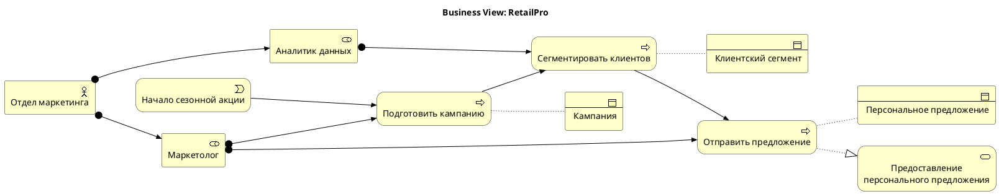

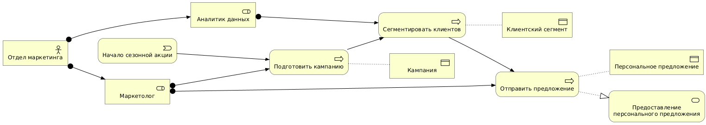

Рис. 5.5. Бизнес-представление RetailPro

**Связь между бизнес-процессами и бизнес-функциями**

Выше уже обсуждалось различие между бизнес-функциями и бизнес-процессами, а также степень детализации, которая необходима и достаточна для моделирования бизнеса.

На практике бизнес-процессы часто пересекают несколько функциональных областей, причем каждая функция выполняется отдельным подразделением предприятия. В таком случае на уровне архитектурной моделей достаточно показать общий процесс, а его шаги смоделировать как функции, выполняемые разными ролями. Это тем более справедливо, что разные подразделения используют собственные прикладные функции.

Пример RetailPro

```text
Заявка на закупку создается департаментом логистики и проходит согласование планового и финансового отделов. Каждое подразделение использует специализированные функции единой ERP системы.
```

Пример PlantUML

```plantuml
@startuml
!include <archimate/Archimate>

left to right direction

title Согласование заявки на закупку в ERP (ArchiMate)

' --- БИЗНЕС-СЛОЙ (Business Layer) ---
Business_Actor(log_dept, "Департамент\nлогистики")
Business_Actor(plan_dept, "Плановый\nотдел")
Business_Actor(fin_dept, "Финансовый\nотдел")

Business_Process(proc_po, "Согласование заявки на закупку")  {
  Business_Function(fn_create, "Создание заявки\nна закупку")
  Business_Function(fn_plan_appr, "Согласование\nлимитов")
  Business_Function(fn_fin_appr, "Финансовое\nутверждение")
}

' --- СЛОЙ ПРИЛОЖЕНИЙ (Application Layer) ---
Application_Component(erp_system, "Единая ERP-система")  {
   Application_Function(mod_log, "Модуль\nлогистики")
   Application_Function(mod_plan, "Модуль\nпланирования")
   Application_Function(mod_fin, "Финансовый\nмодуль")
  }

' --- СВЯЗИ И СТРУКТУРА ---

' Закрепление процессов за отделами (Назначение / Assignment)
Rel_Assignment(log_dept, fn_create)
Rel_Assignment(plan_dept, fn_plan_appr)
Rel_Assignment(fin_dept, fn_fin_appr)

' Последовательность бизнес-процессов (Flow)
Rel_Triggering(fn_create, fn_plan_appr)
Rel_Triggering(fn_plan_appr, fn_fin_appr)

' Использование функций ERP-системы (Serving / Использование)
Rel_Serving(mod_log, fn_create)
Rel_Serving(mod_plan, fn_plan_appr)
Rel_Serving(mod_fin, fn_fin_appr)
@enduml
```

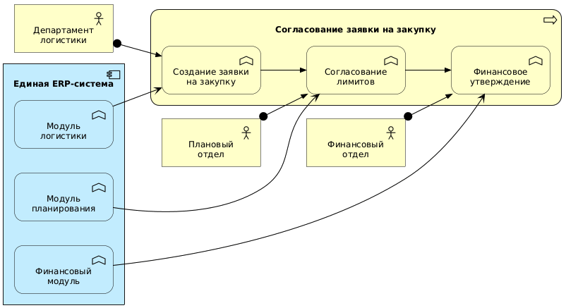

Рис. 5.6. Модель связи бизнес-процесса и бизнес-функций

Для детального моделирования бизнес-процесса и участвующих в его реализации функциональных подразделений лучше использовать BPMN.

**Связь бизнес-слоя с мотивационным и стратегическим слоями**

Бизнес-слой не существует отдельно. Он должен быть связан с мотивацией и стратегией.

Типовая цепочка:

```text
Goal
↓
Capability
↓
Business Process
↓
Business Service
```

Пример RetailPro

```text
Goal: Увеличить повторные продажи

Capability: Клиентская аналитика

Business Process: Сегментировать клиентов

Business Service: Предоставление персонального предложения
```

## 5.10. Прикладные элементы ArchiMate

Прикладной слой описывает информационные системы, их сервисы, функции, интерфейсы, данные и взаимодействия. Прикладной слой должен показывать, как приложения поддерживают бизнес.

**Таблица 5.14.** Элементы слоя приложений и данных

| Элемент | Смысл | ArchiMate | Пример RetailPro |
|---|---|---|---|
| Application Component | приложение или модуль | 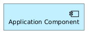 | CDP |
| Application Service | сервис, предоставляемый приложением | 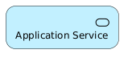 | управление профилем клиента |
| Application Function | функция внутри приложения | 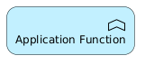 | расчет сегмента |
| Application Process | прикладной процесс | 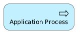 | обновить профиль клиента |
| Application Interface | интерфейс | 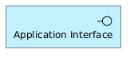 | Customer API |
| Data Object | данные приложения | 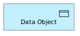 | профиль клиента |

Определения:

**Application Component** – это модульная, развертываемая или логически выделенная часть информационной системы, которая предоставляет прикладное поведение.

**Application Service** – это функциональность, которую приложение предоставляет пользователям, бизнес-процессам или другим приложениям.

**Application Function** – это внутреннее поведение приложения, сгруппированное по назначению.

**Application Process** – это последовательность прикладного поведения, выполняемая приложением.

**Application Event** – это событие, значимое на прикладном уровне, которое может запускать прикладной процесс или быть результатом прикладного процесса.

**Application Interface** – это точка доступа, через которую прикладной сервис становится доступен пользователям или другим приложениям.

Когда нужно показать совместную работу нескольких приложений, используются элементы:

**Application Collaboration** – это объединение нескольких приложений, совместно выполняющих поведение.

**Application Interaction** – это поведение, выполняемое несколькими приложениями совместно.

Пример прикладной модели

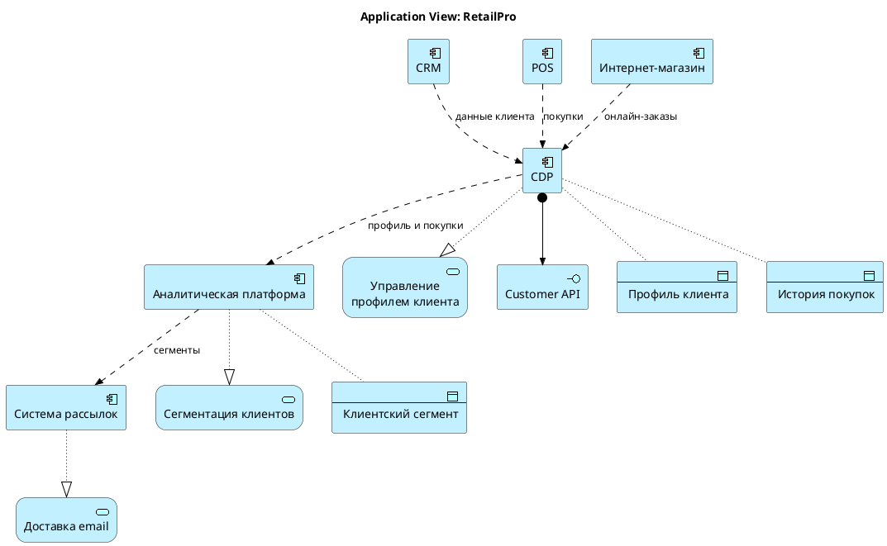

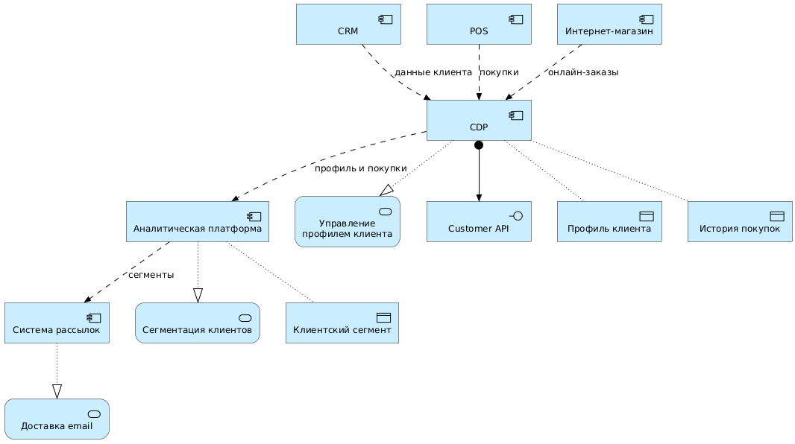

Рис. 5.7. Прикладное представление RetailPro

## 5.11. Технологические элементы ArchiMate

Технологический слой ArchiMate описывает инфраструктуру, платформы, системное программное обеспечение, сети, устройства, технологические сервисы и физические артефакты, которые поддерживают прикладный слой.

**Таблица 5.15.** Элементы технологического слоя

| Элемент | Смысл | ArchiMate | Пример RetailPro |
|---|---|---|---|
| Node | вычислительный узел | 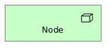 | Cloud Platform |
| Device | физическое устройство | 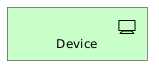 | POS-терминал |
| System Software | системное ПО | 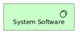 | Kubernetes, PostgreSQL |
| Technology Service | технологический сервис | 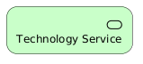 | Database Hosting |
| Technology Interface | технологический интерфейс | 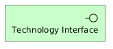 | HTTPS endpoint |
| Artifact | физический файл или компонент | 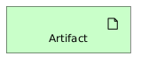 | customer-service.jar |
| Communication Network | сеть | 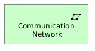 | корпоративная сеть |

Определения:

**Node** — это вычислительный или инфраструктурный ресурс, на котором могут размещаться системное ПО, приложения или артефакты.

**Device** — это физический ИТ-ресурс, который выполняет вычисления, хранение, ввод-вывод или коммуникации.

**System Software** — это программное обеспечение, которое предоставляет технологическую среду для приложений и технологических сервисов.

**Technology Service** — это технологическая функциональность, предоставляемая инфраструктурой, платформой или системным ПО приложениям или другим технологическим элементам.

**Technology Interface** — это точка доступа к технологическому сервису.

**Artifact** — это физический или развертываемый объект, например файл, исполняемый компонент, конфигурация, схема базы данных или контейнерный образ.

Data Object — логический объект данных. Artifact — физическая реализация или файл.

**Communication Network** — это коммуникационная сеть, обеспечивающая связь между устройствами и узлами.

Пример технологической модели

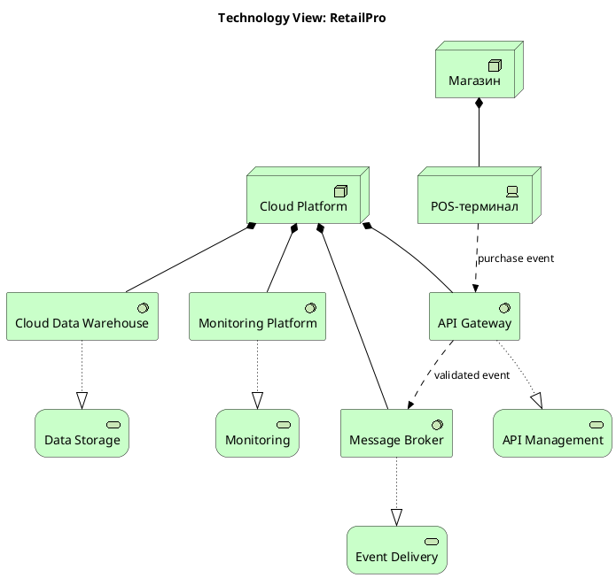

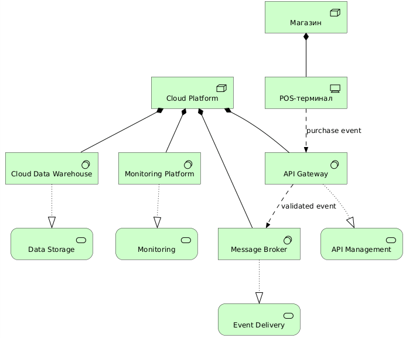

Рис. 5.8. Технологическое представление RetailPro

## 5.12. Элементы для описания реализации и миграции

Эти элементы помогают описывать переход от текущей архитектуры к целевой.

**Таблица 5.16.** Элементы реализации и миграции

| Элемент | Смысл | ArchiMate | Пример RetailPro |
|---|---|---|---|
| Work Package | пакет работ или проект |  | внедрить CDP |
| Deliverable | результат работы |  | Customer API |
| Implementation Event | событие реализации |  | запуск CDP |
| Plateau | устойчивое состояние архитектуры |  | целевая архитектура |
| Gap | разрыв между состояниями |  | нет единого профиля клиента |

Определения:

**Gap** — это разрыв между двумя архитектурными состояниями. Этот элемент отвечает на вопрос: чего не хватает в текущем состоянии для достижения целевого состояния?

**Gap-анализ** — это метод сравнения текущей архитектуры с целевой архитектурой для выявления разрывов, которые необходимо устранить, чтобы перейти к желаемому состоянию.

Разрывы удобно классифицировать по слоям архитектуры:

- **Business gap** — разрыв в бизнес-процессах, ролях, услугах или способностях.
- **Data gap** — разрыв в данных, их качестве, структуре, владении или доступности.
- **Application gap** — разрыв в приложениях, сервисах, интерфейсах или интеграциях.
- **Technology gap** — разрыв в инфраструктуре, платформах, системном ПО или технологических сервисах.
- **Governance gap** — разрыв в правилах управления, ответственности и контроле.

**Work Package** — это набор работ, проект, программа, инициатива или задача, направленные на реализацию изменений архитектуры.

**Deliverable** — это конкретный результат, создаваемый work package.

**Implementation Event** — это событие, связанное с реализацией, запуском или завершением архитектурного изменения.

**Plateau** — это относительно устойчивое состояние архитектуры в определенный момент времени.

Пример миграционной модели


Рис. 5.9. Миграционное представление RetailPro

**Связь Work Package, Gap, Requirement и Target Element**

Модель миграции становится полезной, когда показывает не просто список проектов, а архитектурную логику:

```text
Requirement
↓
Gap
↓
Work Package
↓
Deliverable
↓
Target Architecture Element
```

Пример RetailPro

```text
Requirement: Единый профиль клиента

Gap: Нет единого профиля клиента

Work Package: Внедрить CDP

Deliverable: Настроенная CDP

Target Element: Application Component - CDP, Data Object - Customer Profile
```

Модель PlantUML


Рис. 5.10. Связь требований, разрывов, пакетов работ и целевых элементов

## 5.13. Сквозная ArchiMate-модель

Теперь объединим несколько слоев в одну простую модель.

**Модель должна показать цепочку:**

```text
Stakeholder
↓
Goal
↓
Requirement
↓
Business Process
↓
Application Service
↓
Application Component
↓
Data Object
↓
Technology Service
↓
Node
↓
Work Package
```

PlantUML-код сквозной модели


Рис. 5.11. Сквозное представление RetailPro

Как читать эту модель:

```text
Директор по маркетингу заинтересован в увеличении повторных продаж.
Для достижения этой цели требуется единый профиль клиента.
Бизнес-процесс сегментации клиентов участвует в предоставлении персонального предложения.
Процесс использует прикладной сервис управления профилем клиента.
Этот сервис реализуется CDP.
CDP работает с объектом данных «Профиль клиента».
CDP поддерживается технологическим сервисом Database Hosting.
Этот сервис реализуется облачной платформой.
Пакет работ «Внедрить CDP» реализует соответствующий прикладной компонент.
```

## 5.14. Как именовать элементы ArchiMate

Качество модели сильно зависит от названий элементов.

**Таблица 5.17.** Общие правила именования элементов

| Тип элемента | Хорошее название | Плохое название |
|---|---|---|
| Goal | Увеличить повторные продажи | CDP |
| Requirement | Единый профиль клиента | Сделать красиво |
| Business Process | Сегментировать клиентов | Сегментация |
| Application Component | CDP | Сегментация клиентов |
| Application Service | Управление профилем клиента | CDP |
| Data Object | Профиль клиента | Управлять клиентом |
| Technology Service | Database Hosting | PostgreSQL |
| Node | Cloud Platform | Аналитика |

Рекомендации:

1. **Цели** формулируйте как желаемые бизнес-результаты:

```text
Увеличить повторные продажи
Снизить время обработки заказа
Повысить качество клиентских данных
```

2. **Процессы** формулируйте глаголами:

```text
Сегментировать клиентов
Обработать заказ
Проверить согласие клиента
```

3. **Объекты данных** формулируйте существительными:

```text
Профиль клиента
История покупок
Запись согласия
```

4. **Сервисы** формулируйте как предоставляемую способность:

```text
Управление профилем клиента
Сегментация клиентов
Доставка email-предложений
```

## 5.15. Типичные ошибки при первом знакомстве с ArchiMate

**Ошибка 1. Считать ArchiMate просто набором иконок.** ArchiMate — это не просто визуальная нотация. Важно не только как выглядит элемент, но и что он означает.

**Ошибка 2. Путать слои**

Неверно:

```text
Business Process: CDP
```

Правильно:

```text
Application Component: CDP
```

**Ошибка 3. Путать поведение и структуру**

Неверно:

```text
Application Component: Управление профилем клиента
```

Лучше:

```text
Application Service: Управление профилем клиента
Application Component: CDP
```

**Ошибка 4. Путать объект данных и бизнес-объект**

```text
Business Object: Клиент
Data Object: Профиль клиента
```

**Ошибка 5. Не показывать отношения.** Модель из одних элементов почти бесполезна.

**Ошибка 6. Строить слишком большую диаграмму.** Новички часто пытаются поместить всю архитектуру на одну диаграмму. Лучше создавать несколько представлений.

**Ошибка 7. Использовать ArchiMate вместо BPMN для детального процесса.** ArchiMate хорошо показывает архитектурную роль процесса. Для детального сценария процесса лучше использовать BPMN.

## 5.16. Практикум: распознавание элементов ArchiMate

Исходное описание

```text
RetailPro хочет увеличить повторные продажи.
Для этого директор по маркетингу требует персонализировать предложения.
Проблема состоит в том, что данные о клиентах разрознены между CRM, POS и интернет-магазином.
Компания планирует внедрить CDP, которая будет формировать единый профиль клиента.
Аналитическая платформа будет использовать профиль клиента и историю покупок для сегментации.
Система рассылок будет доставлять персональные предложения клиентам.
Интеграция должна выполняться через API Gateway.
```

**Задание 1.** Выделите элементы и заполните таблицу.

| Фрагмент | Тип ArchiMate | Слой |
|---|---|---|
| RetailPro хочет увеличить повторные продажи | | |
| директор по маркетингу | | |
| персонализировать предложения | | |
| данные о клиентах разрознены | | |
| CRM | | |
| POS | | |
| интернет-магазин | | |
| CDP | | |
| единый профиль клиента | | |
| аналитическая платформа | | |
| история покупок | | |
| система рассылок | | |
| API Gateway | | |

**Задание 2.** Постройте связи, сформулируйте минимум 8 отношений:

**Пример:**

```text
CDP реализует сервис управления профилем клиента.
CDP использует профиль клиента.
POS передает историю покупок в CDP.
```

**Задание 3.** Постройте PlantUML-модель. Используйте заготовку:


## 5.17. Практическое задание: создать три представления RetailPro

Создайте три ArchiMate-представления для инициативы RetailPro.

**Представление 1. Motivation View.** Должно включать:

- stakeholder;
- driver;
- assessment;
- goal;
- requirement;
- principle.

**Представление 2. Application View.** Должно включать:

- CRM;
- POS;
- интернет-магазин;
- CDP;
- аналитическую платформу;
- систему рассылок;
- профиль клиента;
- историю покупок;
- потоки данных.

**Представление 3. Migration View.** Должно включать:

- baseline plateau;
- target plateau;
- минимум 2 gaps;
- минимум 3 work packages;
- минимум 2 deliverables.

## 5.18. Контрольные вопросы

1. Что такое ArchiMate?
2. Зачем нужен язык архитектурного моделирования?
3. Чем ArchiMate отличается от TOGAF?
4. Чем ArchiMate отличается от BPMN?
5. Чем ArchiMate отличается от UML?
6. Как PlantUML связан с ArchiMate?
7. Что такое архитектурная модель?
8. Что такое элемент ArchiMate?
9. Что такое отношение ArchiMate?
10. Что такое view?
11. Какие основные группы элементов есть в ArchiMate?
12. Что такое активная структура?
13. Что такое поведение?
14. Что такое пассивная структура?
15. Как отличить Business Object от Data Object?
16. Как отличить Application Component от Application Service?
17. Зачем нужны Implementation & Migration элементы?
18. Какие типичные ошибки возникают при первом моделировании на ArchiMate?

## 5.19. Краткие выводы главы

1. ArchiMate — это язык моделирования архитектуры предприятия.
2. Он нужен для формального описания связей между целями, бизнесом, данными, приложениями, технологиями и изменениями.
3. TOGAF задает процесс архитектурной работы, а ArchiMate помогает моделировать результаты этой работы.
4. BPMN лучше подходит для детального описания процессов, UML — для проектирования программных систем.
5. PlantUML позволяет описывать ArchiMate-диаграммы текстом.
6. ArchiMate организован по слоям и аспектам.
7. Три базовых аспекта — активная структура, поведение и пассивная структура.
8. В бизнес-слое активными элементами являются акторы и роли, поведением — процессы и сервисы, пассивными элементами — бизнес-объекты.
9. В прикладном слое активными элементами являются компоненты приложений, поведением — прикладные сервисы и функции, пассивными элементами — объекты данных.
10. В технологическом слое активными элементами являются узлы и системное ПО, поведением — технологические сервисы, пассивными элементами — артефакты.
11. Implementation & Migration элементы позволяют описывать переход от текущей архитектуры к целевой.
12. Главная ценность ArchiMate — не в отдельных символах, а в смысловых связях между элементами архитектуры.

---

[← Предыдущая глава](../04-adm-method/README.md) · [К оглавлению](../README.md) · [Следующая глава →](../06-archimate-relationships/README.md)
