# Глава 6. Отношения в ArchiMate

[← Предыдущая глава](../05-archimate-language/README.md) · [К оглавлению](../README.md) · [Следующая глава →](../07-plantuml-basics/README.md)

**После изучения этой главы студент должен уметь:**

1. объяснять, зачем в ArchiMate нужны формальные отношения;
2. различать основные группы отношений ArchiMate;
3. использовать структурные отношения: composition, aggregation, assignment, realization;
4. использовать отношения зависимости: serving, access, influence, association;
5. использовать динамические отношения: triggering и flow;
6. понимать назначение specialization и junction;
7. читать простые ArchiMate-модели по типам отношений;
8. выбирать подходящее отношение для типовой архитектурной ситуации;
9. выявлять типичные ошибки в использовании отношений;
10. строить PlantUML-диаграммы с корректными связями ArchiMate.

## 6.1. Учебная ситуация: почему стрелок недостаточно

В предыдущей главе мы познакомились с основными элементами ArchiMate. Теперь рассмотрим, как эти элементы связываются между собой. Предположим, архитектор RetailPro построил такую схему:

```text
Директор по маркетингу → Увеличить повторные продажи → CDP → Профиль клиента → POS
```

На первый взгляд схема выглядит понятной. Но что означают стрелки?

Возможны разные интерпретации:

```text
Директор по маркетингу использует цель?
Цель запускает CDP?
CDP владеет профилем клиента?
POS реализует профиль клиента?
Профиль клиента передается в POS?
```

Если все связи обозначать одной стрелкой, модель становится неоднозначной. ArchiMate решает эту проблему с помощью формальных типов отношений.

Рассмотрим несколько утверждений:

```text
CDP реализует сервис управления профилем клиента.
Сервис управления профилем клиента обслуживает процесс сегментации клиентов.
CDP использует объект данных «Профиль клиента».
POS передает данные о покупках в CDP.
Требование «Единый профиль клиента» влияет на цель «Увеличить повторные продажи».
```

Каждое утверждение требует своего типа отношения (Таблица 6.1).

**Таблица 6.1.** Типы отношений в учебном примере

| Утверждение | Отношение ArchiMate |
|---|---|
| CDP реализует сервис | Realization |
| Сервис обслуживает процесс | Serving |
| CDP использует данные | Access |
| POS передает данные в CDP | Flow |
| Требование влияет на цель | Influence |

Именно поэтому в ArchiMate важно не просто соединять элементы, а выбирать правильный тип связи.

## 6.2. Зачем нужны отношения в ArchiMate

Отношения показывают смысловую связь между элементами архитектурной модели. Они позволяют отвечать на вопросы:

- какие приложения поддерживают бизнес-процессы;
- какие данные используются приложениями;
- какие технологии поддерживают приложения;
- какие требования влияют на цели;
- какие процессы запускают другие процессы;
- какие элементы являются частью других элементов;
- какие пакеты работ реализуют целевые элементы;
- какие последствия возникнут при изменении системы.

**Пример.** Анализ влияния изменения. Если RetailPro решит заменить CDP, архитектурная модель должна помочь понять:

```text
Какие сервисы реализует CDP?
Какие данные использует CDP?
Какие бизнес-процессы зависят от сервисов CDP?
Какие приложения получают данные из CDP?
Какие требования связаны с CDP?
Какие технологические сервисы поддерживают CDP?
```

Это возможно только если отношения в модели заданы осмысленно.

## 6.3. Основные группы отношений ArchiMate

Для учебных целей отношения ArchiMate удобно разделить на несколько групп:

1. структурные отношения;
2. отношения зависимости;
3. динамические отношения;
4. отношения специализации;
5. junction-отношения.

**Таблица 6.2.** Сводная таблица отношений

| Группа | Отношение | Представление в ArchiMate | Смысл |
|---|---|---|---|
| Структурные | Composition |  | сильное отношение «часть-целое» |
| | Aggregation |  | слабое отношение «часть-целое» |
| | Assignment | 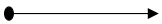 | назначение активного элемента на поведение |
| | Realization |  | реализация более абстрактного элемента |
| Зависимости | Serving |  | один элемент предоставляет сервис другому |
| | Access |  | доступ к объекту данных или бизнес-объекту |
| | Influence |  | влияние одного элемента на другой |
| | Association |  | общая смысловая связь |
| Динамические | Triggering |  | один элемент запускает другой |
| | Flow |  | поток информации, товара, денег или данных |
| Специализация | Specialization |  | элемент является специальным случаем другого |
| Junction | Junction |  | логическое объединение или разделение связей |

## 6.4. Composition: сильное отношение «часть-целое»

**Composition** показывает, что один элемент является составной частью другого и не рассматривается как самостоятельное целое в данном контексте.

```text
A состоит из B.
B является частью A.
```

Если целое исчезает, его составная часть в рамках данной модели также теряет смысл.

Пример RetailPro:

```text
Cloud Platform состоит из API Gateway, Message Broker и Cloud Data Warehouse.
```

Код PlantUML:

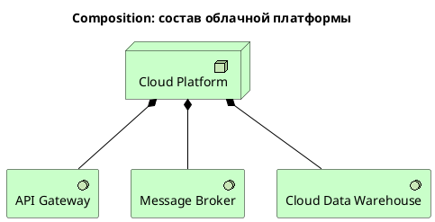

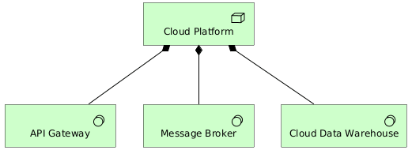

**Рис. 6.1.** Пример отношения Composition

Многие инструменты визуального моделирования (например, Archi) допускают альтернативное представление связи composition, в этом случае дочерние элементы на диаграмме помещаются внутрь родительского (Рис. 6.2).

Такой подход оправдан, поскольку упрощает восприятие информации, но при этом важно убедится, что связь действительно создается и сохраняется в архитектурной модели. Например, аналогичное представление можно создать на языке PlantUML, но при этом будут потеряны связи.

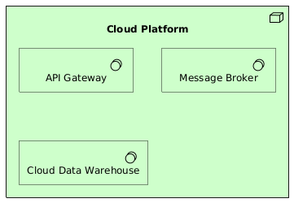

**Рис. 6.2.** Альтернативное представление связи Composition

**Типичные ошибки**

**Ошибка 1.** Использовать composition для любой связи

Плохо:

```text
CRM состоит из клиента
```

Если CRM использует данные клиента, лучше использовать `Access:`

```plantuml
Rel_Access(app_crm, data_customer_profile)
```

**Ошибка 2.** Использовать composition для временной зависимости

Если один проект выполняется после другого, это не composition, а `Triggering`.

## 6.5. Aggregation: слабое отношение «часть-целое»

**Aggregation** показывает более слабое отношение «целое — части». Части могут существовать отдельно и не являются жестко принадлежащими целому.

```text
A объединяет B.
A включает B как часть набора.
```

Пример RetailPro

```text
Клиентское взаимодействие включает управление клиентскими данными,
клиентскую аналитику и управление кампаниями.
```

Это удобно для карты бизнес-возможностей. PlantUML-пример

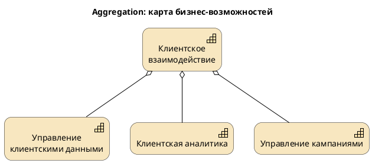

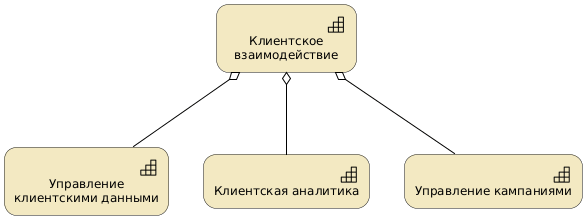

**Рис. 6.3.** Пример связи Aggregation

**Таблица 6.3.** Composition или Aggregation?

| Ситуация | Лучше использовать |
|---|---|
| Жесткая составная часть | Composition |
| Слабое включение в группу | Aggregation |
| Карта способностей | Aggregation |
| Физическое или логическое размещение внутри узла | часто Composition |
| Список направлений программы | Aggregation |

## 6.6. Assignment: назначение ответственности или исполнителя

**Assignment** показывает, что активный структурный элемент назначен на выполнение поведения или роли.

```text
Кто выполняет что?
Что назначено на что?
```

Примеры RetailPro

```text
Отдел маркетинга выполняет роль маркетолога кампаний.
Маркетолог выполняет процесс подготовки кампании.
CDP выполняет функцию управления профилем клиента.
```

PlantUML-пример на бизнес-слое

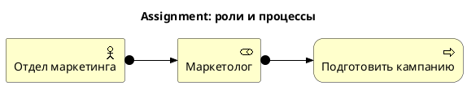

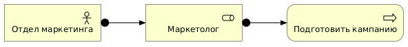

**Рис. 6.4.** Пример связи Assignment в модели бизнес-архитектуры

PlantUML-пример на прикладном слое

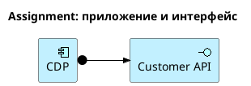

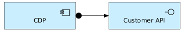

**Рис. 6.5.** Пример связи Assignment в модели архитектуры приложений

**Типичные ошибки**

**Ошибка 1.** Путать Assignment и Serving.

Если маркетолог выполняет процесс – это `Assignment`.

Если приложение поддерживает процесс через сервис – это обычно `Serving`.

**Ошибка 2. Назначать данные на процесс**

Данные не выполняют процесс. Процесс может иметь доступ к данным через `Access`.

## 6.7. Realization: реализация более абстрактного элемента

**Realization** показывает, что более конкретный элемент реализует более абстрактный.

```text
A реализует B.
```

**Таблица 6.4.** Элементы, связываемые отношением Realization

| Более конкретный элемент | Более абстрактный элемент |
|---|---|
| Application Component | Application Service |
| Business Process | Business Service |
| Work Package | Deliverable |
| Data Object | Business Object |
| System Software | Technology Service |

Примеры RetailPro

```text
CDP реализует сервис управления профилем клиента.
Процесс доставки предложения реализует бизнес-услугу персонального предложения.
Пакет работ «Внедрить CDP» реализует результат «Customer API».
```

PlantUML-пример

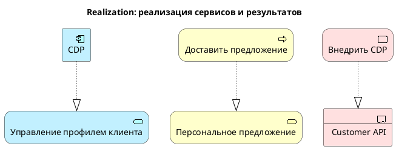

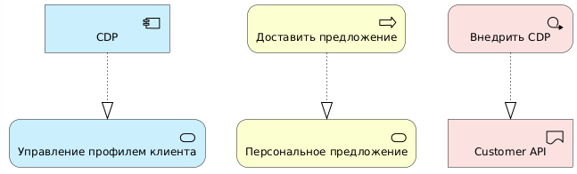

**Рис. 6.6.** Пример отношения Realization

**Типичные ошибки**

**Ошибка 1.** Перепутать направление

Неверно:

```plantuml
Rel_Realization(as_customer_profile, app_cdp)
```

Правильно:

```plantuml
Rel_Realization(app_cdp, as_customer_profile)
```

Компонент реализует сервис, а не наоборот.

**Ошибка 2.** Использовать realization вместо serving

Если сервис используется процессом, это не realization, а serving:

```plantuml
Rel_Serving(as_customer_profile, bp_segment_customers)
```

## 6.8. Serving: предоставление сервиса

**Serving** показывает, что один элемент предоставляет функциональность другому элементу.

```text
A обслуживает B.
B использует A.
```

Serving часто используется для связи между слоями. Это один из ключевых принципов ArchiMate: детали реализации сервиса скрываются от его пользователя. Например, на уровне бизнес-архитектуры мы можем показать, что бизнес-процесс использует прикладной сервис, но его реализация будет описана в слое архитектуры приложений.

Примеры RetailPro:

```text
Сервис управления профилем клиента обслуживает процесс сегментации клиентов.
Технологический сервис Database Hosting обслуживает CDP.
Customer API обслуживает CRM и интернет-магазин.
```

Пример PlantUML:

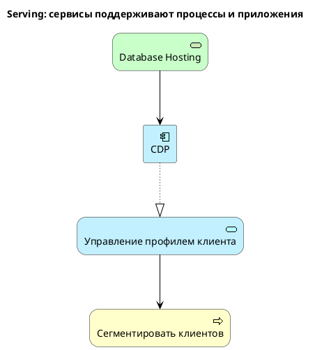

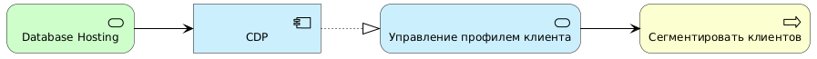

**Рис. 6.7.** Пример отношения Serving

Как читать эту модель:

```text
Процесс сегментации клиентов использует сервис управления профилем клиента.
Сервис реализуется CDP.
CDP использует технологический сервис размещения базы данных.
```

**Типичные ошибки**

**Ошибка 1.** Путать направление. Если сервис поддерживает процесс, то

```plantuml
Rel_Serving(as_customer_profile, bp_segment_customers)
```

**Ошибка 2.** Использовать Serving вместо Flow. Если данные передаются из POS в CDP, это поток, а не сервисное обслуживание:

```plantuml
Rel_Flow(app_pos, app_cdp, "покупки")
```

## 6.9. Access: доступ к объектам

**Access** показывает, что поведенческий или структурный элемент получает доступ к пассивному объекту: бизнес-объекту, объекту данных или артефакту.

```text
A читает, записывает или использует данные B.
```

Примеры RetailPro:

```text
CDP использует профиль клиента.
Аналитическая платформа использует историю покупок.
Процесс подготовки кампании использует бизнес-объект «Маркетинговая кампания».
```

Пример PlantUML:

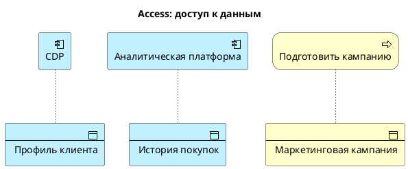

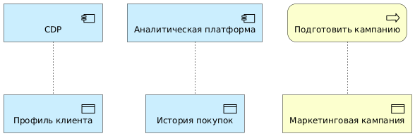

**Рис. 6.8.** Пример отношения Access

В строгих моделях может возникнуть необходимость уточнить права доступа к объекту:

- read;
- write;
- read/write;
- access без уточнения.

В учебных PlantUML-моделях часто используется общий `Rel_Access`. Если нужно пояснить характер доступа, можно добавить текст, который будет отображен на диаграмме возле соответствующей связи:

```plantuml
Rel_Access(app_cdp, data_customer_profile, "read/write")
Rel_Access(app_analytics, data_purchase_history, "read")
```

**Типичные ошибки**

**Ошибка 1.** Использовать Access между двумя приложениями. Если одно приложение передает данные другому, лучше использовать `Flow`.

```plantuml
Rel_Flow(app_pos, app_cdp, "данные покупок")
```

**Ошибка 2.** Использовать Access для поддержки процесса. Если сервис поддерживает процесс, это `Serving`, не `Access`.

## 6.10. Flow: поток информации, данных или объектов

**Flow** показывает передачу информации или материальных объектов от одного элемента к другому.

```text
A передает что-то B.
```

Примеры RetailPro:

```text
POS передает данные о покупках в CDP.
Интернет-магазин передает онлайн-заказы в CDP.
CDP передает клиентские сегменты в систему рассылок.
```

Пример PlantUML:

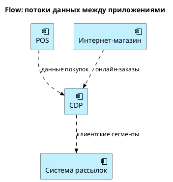

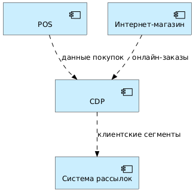

**Рис. 6.9.** Пример отношения Flow

**Таблица 6.5.** Flow и Access: в чем различие

| Ситуация | Отношение |
|---|---|
| приложение использует объект данных | Access |
| приложение передает данные другому приложению | Flow |
| процесс работает с бизнес-объектом | Access |
| процесс передает документ другому процессу | Flow |

**Типичные ошибки**

**Ошибка 1.** Flow без указания содержания

Плохо:

```plantuml
Rel_Flow(app_pos, app_cdp)
```

Хорошо:

```plantuml
Rel_Flow(app_pos, app_cdp, "данные покупок")
```

**Ошибка 2.** Использовать Flow для любой связи. Если элемент поддерживает другой элемент, это не поток, а `Serving`.

## 6.11. Triggering: запуск или следование

**Triggering** показывает, что один поведенческий элемент запускает или предшествует другому.

```text
A запускает B.
После A начинается B.
```

Примеры RetailPro:

```text
Начало сезонной акции запускает подготовку кампании.
Подготовка кампании запускает сегментацию клиентов.
Сегментация клиентов запускает создание персонального предложения.
```

Пример PlantUML:

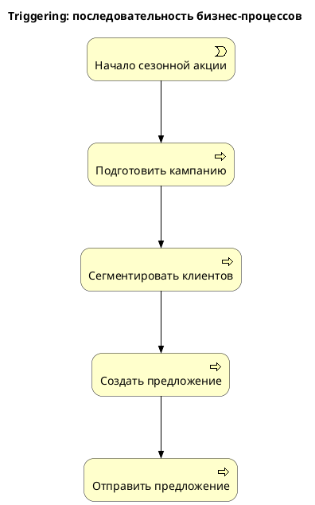


**Рис. 6.10.** Пример отношения Triggering

**Таблица 6.6.** Triggering и Flow: в чем различие

| Ситуация | Отношение |
|---|---|
| один процесс запускает другой | Triggering |
| один процесс передает документ другому | Flow |
| POS отправляет событие покупки в CDP | Flow |
| событие покупки запускает обновление профиля | Triggering |

## 6.12. Influence: влияние

**Influence** показывает, что один мотивационный или стратегический элемент влияет на другой.

```text
A влияет на B.
```

Влияние может быть положительным или отрицательным. В учебных моделях чаще просто указывается факт влияния.

Примеры RetailPro:

```text
Рост конкуренции влияет на цель увеличения повторных продаж.
Разрозненные данные негативно влияют на повторные продажи.
Принцип API-first влияет на требование интеграции через API.
Требование единого профиля клиента влияет на цель повторных продаж.
```

Пример PlantUML:

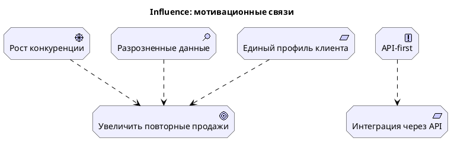

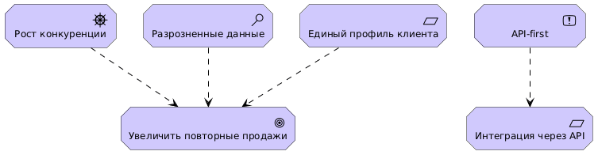

**Рис. 6.11.** Пример отношения Influence

**Типичные ошибки**

**Ошибка 1**. Использовать Influence между приложениями. Если POS передает данные в CDP, это не influence, а flow.

**Ошибка 2.** Использовать Influence вместо Realization. Если CDP реализует сервис, это realization, а не influence.

## 6.13. Association: общая смысловая связь

**Association** — самое общее отношение. Оно показывает, что элементы связаны, но связь не выражается более специальным отношением.

```text
A связан с B.
```

Association полезно использовать:

- на ранних этапах моделирования;
- когда тип связи пока не уточнен;
- для слабой смысловой связи;
- между заинтересованным лицом и проблемами, которые оно идентифицирует;
- между work package и gap, если не используется более точное отношение.

Пример RetailPro:

```text
Директор по маркетингу связан с целью увеличения повторных продаж.
Пакет работ связан с архитектурным разрывом.
```

Пример PlantUML:

```plantuml
@startuml
!include <archimate/Archimate>

title Association: общие связи

Motivation_Stakeholder(st_cmo, "Директор по маркетингу")
Motivation_Goal(goal_repeat_sales, "Увеличить повторные продажи")

Implementation_WorkPackage(wp_implement_cdp, "Внедрить CDP")
Implementation_Gap(gap_no_single_profile, "Нет единого профиля клиента")

Rel_Association(st_cmo, goal_repeat_sales)
Rel_Association(wp_implement_cdp, gap_no_single_profile)

@enduml
plantuml
```

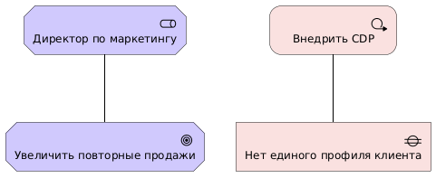

**Рис. 6.12.** Пример отношения Association

**Типичные ошибки**

**Ошибка 1**. Использовать Association вместо всех отношений. Такая модель теряет аналитическую ценность.

**Ошибка 2.** Не уточнять связь после анализа. Association допустима на черновом этапе, но в итоговой модели лучше заменить ее на более точное отношение, если это возможно.

## 6.14. Specialization: частный случай

**Specialization** показывает, что один элемент является более конкретным вариантом другого.

```text
A является специальным случаем B.
```

Примеры RetailPro:

```text
Email-предложение является специальным видом персонального предложения.
Push-предложение является специальным видом персонального предложения.
Premium customer является специальным видом клиента.
```

Пример PlantUML:

```plantuml
@startuml
!include <archimate/Archimate>

title Specialization: виды предложений

Business_Object(bo_personal_offer, "Персональное предложение")
Business_Object(bo_email_offer, "Email-предложение")
Business_Object(bo_push_offer, "Push-предложение")
Business_Object(bo_pos_offer, "Предложение на кассе")

Rel_Specialization(bo_email_offer, bo_personal_offer)
Rel_Specialization(bo_push_offer, bo_personal_offer)
Rel_Specialization(bo_pos_offer, bo_personal_offer)

@enduml
```

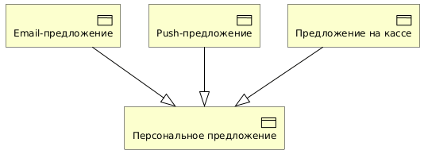

**Рис. 6.13.** Пример отношения Specialization

**Типичные ошибки**

**Ошибка 1.** Использовать specialization для описания состава элемента. Если CDP включает модуль профиля клиента, это не specialization, а composition или aggregation.

**Ошибка 2.** Использовать specialization для последовательности. Если один процесс идет после другого, это triggering, не specialization.

## 6.15. Junction: логика AND/OR

Junction используется для объединения или разделения отношений с логикой AND или OR.

```text
Для выполнения требования нужны несколько условий одновременно.
Или достаточно одного из альтернативных условий.
```

**Пример AND.** Для единого профиля клиента RetailPro нужны одновременно:

```text
данные из CRM;
данные из POS;
данные из интернет-магазина.
```

**Пример OR.** Клиент может быть идентифицирован по одному из признаков:

```text
email;
телефон;
карта лояльности.
```

**Пример PlantUML с условной логикой**

PlantUML не поддерживает отношений AND и OR, приведенный здесь пример создан в приложении Archi.

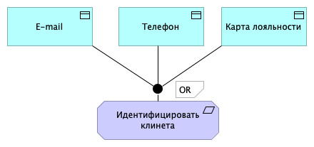

**Рис. 6.14.** Пример отношения OR

**Типичные ошибки**

**Ошибка 1.** Использовать junction там, где достаточно обычных связей. Junction нужен только тогда, когда важно явно показать логическую комбинацию условий.

**Ошибка 2.** Не подписывать логику AND/OR. Если используется junction, нужно указать, что он означает.

## 6.16. Как выбрать правильное отношение

**Таблица 6.7.** Практическая таблица выбора

| Если вы хотите сказать... | Используйте |
|---|---|
| A состоит из B | Composition |
| A включает B как часть набора | Aggregation |
| A выполняет B | Assignment |
| A реализует B | Realization |
| A предоставляет сервис B | Serving |
| A использует данные B | Access |
| A передает что-то B | Flow |
| A запускает B | Triggering |
| A влияет на B | Influence |
| A связан с B, но тип связи неясен | Association |
| A является частным случаем B | Specialization |

**Примеры выбора отношений.**

Исходный текст:

```text
CDP предоставляет сервис управления профилем клиента для процесса сегментации клиентов.
```

Разбор:

```text
CDP реализует сервис управления профилем клиента.
Сервис управления профилем клиента обслуживает процесс сегментации клиентов.
```

Модель:

```plantuml
Application_Component(app_cdp, "CDP")
Application_Service(as_customer_profile, "Управление профилем клиента")
Business_Process(bp_segment_customers, "Сегментировать клиентов")

Rel_Realization(app_cdp, as_customer_profile)
Rel_Serving(as_customer_profile, bp_segment_customers)
```

Исходный текст:

```text
POS передает данные о покупках в CDP, а CDP сохраняет историю покупок.
```

Разбор:

```text
POS передает данные в CDP → Flow.
CDP использует историю покупок → Access.
```

Модель:

```plantuml
Application_Component(app_pos, "POS")
Application_Component(app_cdp, "CDP")
Application_DataObject(data_purchase_history, "История покупок")

Rel_Flow(app_pos, app_cdp, "данные покупок")
Rel_Access(app_cdp, data_purchase_history)
```

## 6.17. Сквозной пример: отношения в модели RetailPro

**Описание:**

RetailPro хочет увеличить повторные продажи. Для этого нужно обеспечить единый профиль клиента. Процесс сегментации клиентов использует сервис управления профилем клиента. Этот сервис реализуется CDP. CDP использует профиль клиента и получает данные покупок из POS. CDP размещается на облачной платформе, которая предоставляет сервис Database Hosting. Пакет работ «Внедрить CDP» реализует CDP.

**Модель PlantUML**

```plantuml
@startuml
!include <archimate/Archimate>

title Сквозной пример отношений ArchiMate

' === Motivation ===
Motivation_Goal(goal_repeat_sales, "Увеличить повторные продажи")
Motivation_Requirement(req_single_profile, "Единый профиль клиента")

' === Business ===
Business_Process(bp_segment_customers, "Сегментировать клиентов")

' === Application ===
Application_Service(as_customer_profile, "Управление профилем клиента")
Application_Component(app_cdp, "CDP")
Application_Component(app_pos, "POS")
Application_DataObject(data_customer_profile, "Профиль клиента")
Application_DataObject(data_purchase_history, "История покупок")

' === Technology ===
Technology_Node(node_cloud, "Cloud Platform")
Technology_Service(ts_database_hosting, "Database Hosting")

' === Implementation ===
Implementation_WorkPackage(wp_implement_cdp, "Внедрить CDP")

' === Relations ===
Rel_Influence(req_single_profile, goal_repeat_sales)

Rel_Serving(as_customer_profile, bp_segment_customers)
Rel_Realization(app_cdp, as_customer_profile)

Rel_Access(app_cdp, data_customer_profile)
Rel_Access(app_cdp, data_purchase_history)
Rel_Flow(app_pos, app_cdp, "данные покупок")

Rel_Realization(node_cloud, ts_database_hosting)
Rel_Serving(ts_database_hosting, app_cdp)

Rel_Realization(wp_implement_cdp, app_cdp)
Rel_Association(wp_implement_cdp, req_single_profile)

@enduml
```

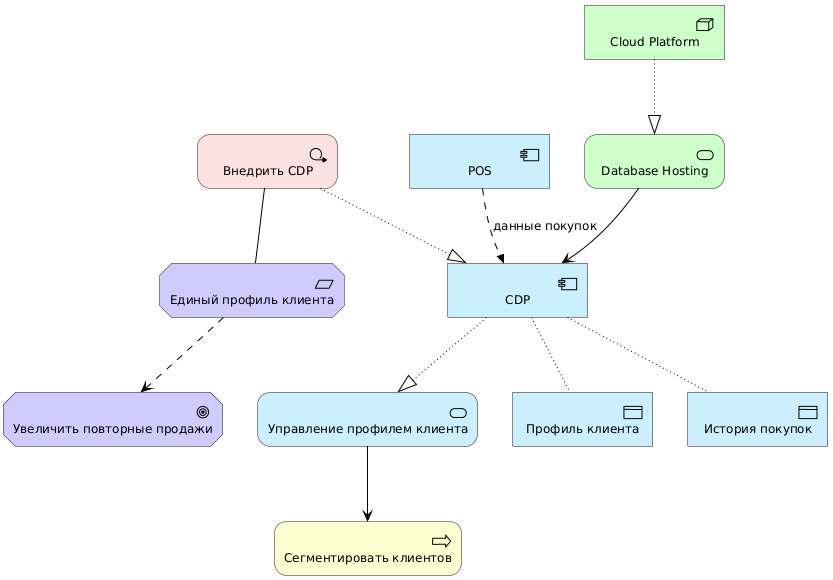

**Рис. 6.15.** Пример отношений в сквозной модели

**Как читать модель по отношениям**

```text
Requirement «Единый профиль клиента» влияет на Goal «Увеличить повторные продажи».
Application Service «Управление профилем клиента» обслуживает Business Process «Сегментировать клиентов».
Application Component «CDP» реализует этот сервис.
CDP использует Data Object «Профиль клиента» и «История покупок».
POS передает данные покупок в CDP.
Cloud Platform реализует Technology Service «Database Hosting».
Database Hosting обслуживает CDP.
Work Package «Внедрить CDP» реализует CDP.
```

## 6.18. Проверка корректности отношений

Перед сдачей модели полезно проверять каждую связь как предложение на естественном языке. Для каждого отношения постройте фразу:

```text
Источник [тип отношения] цель.
```

Пример:

```text
CDP реализует сервис управления профилем клиента.
```

Если фраза звучит странно, отношение, вероятно, выбрано неверно.

**Таблица 6.8.** Примеры проверки

| Связь | Проверочная фраза | Оценка |
|---|---|---|
| `Rel_Realization(app_cdp, as_customer_profile)` | CDP реализует сервис управления профилем клиента | корректно |
| `Rel_Serving(as_customer_profile, bp_segment_customers)` | Сервис обслуживает процесс сегментации | корректно |
| `Rel_Access(app_pos, app_cdp)` | POS имеет доступ к CDP | сомнительно |
| `Rel_Flow(app_pos, app_cdp, "покупки")` | POS передает покупки в CDP | корректно |
| `Rel_Assignment(data_customer_profile, bp_segment_customers)` | Профиль клиента назначен на процесс | некорректно |

## 6.19. Представление отношений на PlantUML

Основные макросы

```plantuml
Rel_Composition(source, target)
Rel_Aggregation(source, target)
Rel_Assignment(source, target)
Rel_Realization(source, target)
Rel_Serving(source, target)
Rel_Access(source, target)
Rel_Flow(source, target, "поток")
Rel_Triggering(source, target)
Rel_Influence(source, target)
Rel_Association(source, target)
Rel_Specialization(source, target)
```

**Мини-пример всех базовых отношений**

```plantuml
@startuml
!include <archimate/Archimate>

title Шпаргалка отношений ArchiMate

Motivation_Goal(goal_1, "Goal")
Motivation_Requirement(req_1, "Requirement")

Business_Actor(actor_1, "Business Actor")
Business_Role(role_1, "Business Role")
Business_Process(process_1, "Business Process")
Business_Object(object_1, "Business Object")
Business_Service(service_1, "Business Service")

Application_Component(app_1, "Application Component")
Application_Service(app_service_1, "Application Service")
Application_DataObject(data_1, "Data Object")

Technology_Node(node_1, "Node")
Technology_Service(tech_service_1, "Technology Service")

Rel_Influence(req_1, goal_1)
Rel_Assignment(actor_1, role_1)
Rel_Assignment(role_1, process_1)
Rel_Access(process_1, object_1)
Rel_Realization(process_1, service_1)

Rel_Serving(app_service_1, process_1)
Rel_Realization(app_1, app_service_1)
Rel_Access(app_1, data_1)

Rel_Realization(node_1, tech_service_1)
Rel_Serving(tech_service_1, app_1)

@enduml
```

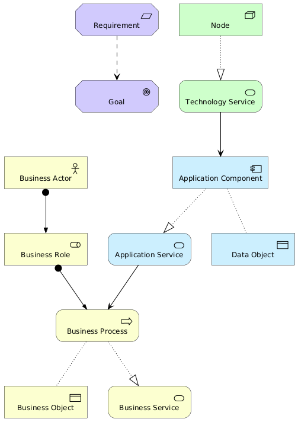

**Рис. 6.16.** Пример базовых отношений

## 6.20. Типичные ошибки студентов

**Ошибка 1.** Использовать одну стрелку для всего. Если все связи обозначены как `Association`, модель становится слабой.

**Ошибка 2.** Путать Realization и Serving

```text
CDP реализует сервис.
Сервис обслуживает процесс.
```

**Ошибка 3.** Путать Flow и Access

```text
POS передает данные в CDP → Flow.
CDP использует данные → Access.
```

**Ошибка 4.** Путать Assignment и Serving

```text
Маркетолог выполняет процесс → Assignment.
Сервис поддерживает процесс → Serving.
```

**Ошибка 5.** Нарушать направление отношений. Особенно часто ошибаются в:

```text
Realization
Serving
Triggering
Flow
```

**Ошибка 6.** Использовать Influence вне мотивационного контекста. Не стоит показывать, что CRM «влияет» на POS, если речь идет о передаче данных. Лучше использовать `Flow`.

**Ошибка 7.** Не подписывать Flow. Поток без подписи плохо интерпретируется.

## 6.21. Практикум: выбор отношений

**Задание 1.** Для каждой фразы выберите подходящее отношение ArchiMate.

| Фраза | Отношение |
|---|---|
| CDP реализует сервис управления профилем клиента | |
| Сервис управления профилем клиента поддерживает процесс сегментации | |
| POS передает покупки в CDP | |
| CDP использует профиль клиента | |
| Маркетолог выполняет процесс подготовки кампании | |
| Рост конкуренции влияет на цель роста продаж | |
| Cloud Platform включает API Gateway | |
| Email-предложение является видом персонального предложения | |
| Пакет работ «Внедрить CDP» связан с gap «нет единого профиля» | |
| Начало сезонной акции запускает подготовку кампании | |

**Задание 2.** Ниже приведены сомнительные связи. Исправьте их.

```plantuml
Rel_Realization(as_customer_profile, app_cdp)
Rel_Access(app_pos, app_cdp)
Rel_Assignment(data_customer_profile, bp_segment_customers)
Rel_Influence(app_pos, app_cdp)
Rel_Serving(bp_segment_customers, as_customer_profile)
```

Ожидаемый вариант:

```plantuml
Rel_Realization(app_cdp, as_customer_profile)
Rel_Flow(app_pos, app_cdp, "данные покупок")
Rel_Access(bp_segment_customers, bo_customer_segment)
Rel_Flow(app_pos, app_cdp, "данные покупок")
Rel_Serving(as_customer_profile, bp_segment_customers)
```

**Задание 3.** На основе описания постройте PlantUML-модель:

```text
Директор по маркетингу хочет увеличить повторные продажи.
Для этого требуется персонализация предложений.
Процесс подготовки кампании использует сервис сегментации клиентов.
Сервис сегментации реализуется аналитической платформой.
Аналитическая платформа использует профиль клиента и историю покупок.
CDP передает профиль клиента и историю покупок в аналитическую платформу.
Облачное хранилище данных поддерживает аналитическую платформу.
Пакет работ «Создать аналитику» реализует аналитическую платформу.
```

## 6.22. Контрольные вопросы

1. Зачем в ArchiMate нужны формальные отношения?
2. Какие основные группы отношений существуют?
3. Что означает Composition?
4. Чем Aggregation отличается от Composition?
5. Что показывает Assignment?
6. Что показывает Realization?
7. Как определить направление Realization?
8. Что показывает Serving?
9. Чем Serving отличается от Assignment?
10. Что показывает Access?
11. Чем Access отличается от Flow?
12. Что показывает Triggering?
13. Чем Triggering отличается от Flow?
14. Что показывает Influence?
15. Когда допустимо использовать Association?
16. Что показывает Specialization?
17. Для чего используется Junction?
18. Как проверить корректность отношения в модели?
19. Какие ошибки чаще всего возникают при использовании отношений?
20. Почему важно подписывать Flow?

## 6.23. Краткие выводы главы

1. Отношения в ArchiMate не менее важны, чем элементы.
2. Одна и та же стрелка без типа не передает архитектурный смысл.
3. Composition и Aggregation описывают отношения «часть-целое».
4. Assignment показывает назначение исполнителя или активного элемента на поведение.
5. Realization показывает реализацию более абстрактного элемента более конкретным.
6. Serving показывает, что один элемент предоставляет сервис другому.
7. Access показывает использование данных или других пассивных объектов.
8. Flow показывает передачу информации, данных, товаров или других объектов.
9. Triggering показывает запуск или последовательность поведения.
10. Influence используется для моделирования влияния, особенно в мотивационном контексте.
11. Association лучше использовать осторожно, когда тип связи пока не уточнен.
12. Specialization показывает отношение «частный случай».
13. Junction помогает моделировать логику AND/OR.
14. Корректность отношений можно проверять через естественные фразы.
15. Хорошая ArchiMate-модель — это не набор значков, а сеть осмысленных отношений.

---

[← Предыдущая глава](../05-archimate-language/README.md) · [К оглавлению](../README.md) · [Следующая глава →](../07-plantuml-basics/README.md)
