# Глава 7. Основы PlantUML для архитектурного моделирования

[← Предыдущая глава](../06-archimate-relationships/README.md) · [К оглавлению](../README.md) · [Следующая глава →](../08-archimate-in-plantuml/README.md)

**После изучения этой главы студент должен уметь:**

1. объяснять, что такое PlantUML и зачем он нужен архитектору предприятия;
2. понимать преимущества текстового описания диаграмм;
3. создавать простые PlantUML-диаграммы;
4. использовать базовый синтаксис PlantUML;
5. понимать структуру PlantUML-файла;
6. использовать PlantUML в Markdown-документации;
7. хранить архитектурные диаграммы как код;
8. понимать роль PlantUML в ИИ-ассистированном моделировании;
9. выявлять типичные синтаксические ошибки PlantUML;
10. подготовиться к использованию ArchiMate-библиотеки в PlantUML.

## 7.1. Учебная ситуация: архитектурные диаграммы нужно быстро обновлять

Архитектурная команда RetailPro подготовила несколько диаграмм для инициативы единой клиентской платформы:

- мотивационная диаграмма;
- бизнес-диаграмма маркетинговой кампании;
- прикладная диаграмма интеграции CRM, POS, интернет-магазина и CDP;
- технологическая диаграмма облачной платформы;
- дорожная карта миграции.

Сначала диаграммы были нарисованы в презентации. Но вскоре возникли проблемы:

```text
На одной диаграмме CDP называется Customer Platform.
На другой — Customer Data Platform.
В презентации устарела связь POS → CDP.
В roadmap поменялись сроки.
ИТ-директор попросил показать Message Broker.
Юридический отдел добавил требование по согласиям.
Архитектор изменил принцип интеграции на API-first.
```

Каждое изменение приходится вручную вносить в несколько файлов. Возникают расхождения. Поэтому архитектор предлагает другой подход:

```text
Описывать диаграммы в виде текстового кода PlantUML, хранить их в Git, генерировать изображения автоматически и использовать ИИ для создания черновиков диаграмм.
```

Такой подход называется **diagrams as code** — «диаграммы как код».

## 7.2. Что такое PlantUML

**PlantUML** — это инструмент, который позволяет создавать диаграммы на основе текстового описания. Другими словами:

```text
Вы пишете текстовый код диаграммы.
PlantUML генерирует изображение.
```

PlantUML - это инструмент c открытым исходным кодом (open source), предложенный французским разработчиком Арно Рокесом (Arnaud Roques). Первый официальный релиз проекта состоялся 17 апреля 2009 г.

Как следует из названия, этот инструмент изначально создавался для работы с диаграммами UML, но сейчас он поддерживает множество других форматов, связанных с разработкой программного обеспечения (блок-диаграммы, ArchiMate, C4, сетевые диаграммы, ERD, графики Ганта, Mindmap и WBS), а также визуализацию файлов JSON и YAML.

Основная информация об языке PlantUML, его расширениях для других типов диаграмм и прочих возможностях представлена на сайте [https://plantuml.com](https://plantuml.com). По адресу [https://plantuml.com/plantuml](https://plantuml.com/plantuml) доступен сервер, позволяющий редактировать код и генерировать диаграммы онлайн.

PlantUML также можно загрузить на компьютер пользователя в виде jar файла. Это полезно, если требуется интеграция с другими системами – редакторами кода (например, VSCode), интегрированными средами разработки (JetBrain) и базами знаний (Obsidian). Для этих и многих других приложений существуют специальные плагины, позволяющие работать с PlantUML. Подробнее о запуске PlantUML см. ниже в разделе 7.9.

Основным конкурентом PlantUML является Mermaid. Главное отличие между ними заключается в том, что PlantUML – это мощный бэкенд-инструмент на базе Java, требующий установки для локального использования, в то время как Mermaid – это легковесная библиотека на JavaScript, работающая в любом браузере без установки. Это ограничивает использование Mermaid для работы с большими диаграммами, корпоративной документацией и сложными архитектурными проектами. Кроме того, в Mermaid пока отсутствует поддержка ArchiMate.

Стоит также упомянуть, что помимо [https://plantuml.com/plantuml](https://plantuml.com/plantuml) доступны другие коммерческие и бесплатные онлайн-редакторы PlantUML, например:

- [https://planttext.com](https://planttext.com)
- [https://www.vpascode.com](https://www.vpascode.com)
- [https://www.eraser.io/make/free-plantuml-maker](https://www.eraser.io/make/free-plantuml-maker)

Пример простой PlantUML-диаграммы:

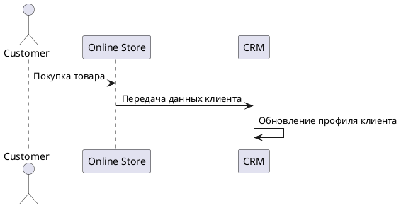

Это диаграмма последовательности (sequence diagram) UML, она показывает, как взаимодействуют системы во время покупки в онлайн магазине:

```text
Клиент покупает товар в интернет-магазине.
Интернет-магазин передает данные клиента в CRM.
CRM обновляет профиль клиента.
```

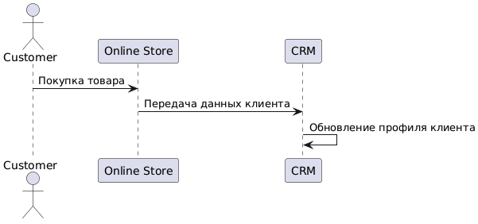

Рис. 7.1. Простая диаграмма PlantUML

## 7.3. Почему архитектору полезен PlantUML

Когда диаграммы создаются вручную, например в приложениях типа Microsoft Visio или Draw.io, возникают проблемы, перечисленные в Таблице 7.1. Это связано с тем, что данные системы не поддерживают семантику языка ArchiMate, а просто предоставляют набор графических примитивов.

**Таблица 7.1.** Проблемы при моделировании архитектуры в графических редакторах

| Проблема | Последствие |
|---|---|
| сложно отслеживать изменения | непонятно, какая версия актуальна |
| трудно сравнивать версии | изменения на рисунке не видны в diff |
| разные названия элементов | модель становится несогласованной |
| много ручной работы | диаграммы быстро устаревают |
| сложно переиспользовать фрагменты | архитектурные паттерны не масштабируются |
| трудно использовать ИИ | ИИ лучше работает с текстом, чем с картинками |
| ограничения групповой работы | сложно согласовывать изменения, вносимые разными участниками проект |

Отметим, что даже использование специализированных инструментов типа Archi, которые ориентированы на ArchiMate – моделирование, не устраняет все эти проблемы.

Подход diagrams as code на основе PlantUML позволяет:

1. хранить диаграммы как текст;
2. управлять версиями диаграмм в Git;
3. автоматически генерировать изображения;
4. легко копировать и адаптировать шаблоны;
5. включать диаграммы в Markdown-документы;
6. использовать ИИ для генерации и проверки кода;
7. быстро обновлять диаграммы;
8. поддерживать согласованность архитектурной документации при групповой работе.

**Пример Git-diff.** Если диаграмма хранится как PlantUML-код, изменение видно в тексте:

```plantuml
- Application_Component(app_excel, "Excel-сегментация")
+ Application_Component(app_analytics, "Аналитическая платформа")

- Rel_Flow(app_excel, app_email, "файл сегментов")
+ Rel_Flow(app_analytics, app_email, "клиентские сегменты")
```

Такой diff сразу показывает архитектурное изменение.

## 7.4. Как работает PlantUML

PlantUML-код обычно имеет структуру:

```plantuml
@startuml

' описание элементов
' описание связей

@enduml
```

Минимальный пример

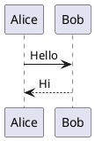

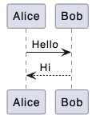

Рис. 7.2. Диаграмма PlantUML

Каждая диаграмма начинается с `@startuml` и заканчивается: `@endum`.Если забыть один из этих маркеров, диаграмма не сгенерируется.

Комментарии начинаются с апострофа:

```text
' Это комментарий
Alice -> Bob: Hello
```

Комментарии полезны для разделения диаграммы на блоки, например:

```text
' === Applications ===
' === Data objects ===
' === Relations ===
```

Для заголовка используется команда `title`:

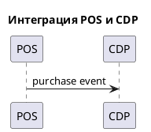

## 7.5. Первый пример: диаграмма последовательности интеграции POS и CDP

Диаграмма последовательности (одна из диаграмм языка UML) показывает взаимодействие участников во времени. Сценарий RetailPro:

```text
Клиент совершает покупку в магазине.
POS регистрирует покупку.
POS передает событие покупки через API Gateway.
API Gateway отправляет событие в Message Broker.
CDP получает событие и обновляет профиль клиента.
```

PlantUML-код

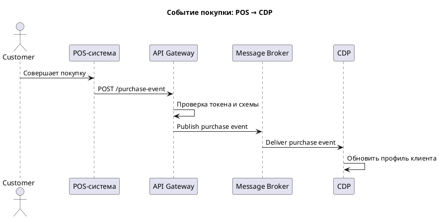

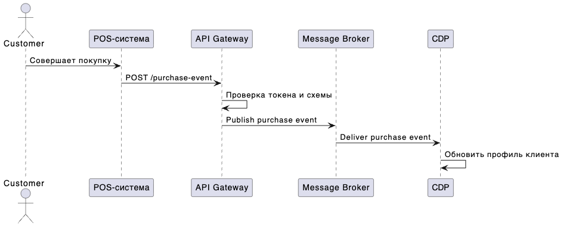

Рис. 7.3. Событие покупки: POS -\> CDP

Как читать диаграмму

```text
Клиент совершает покупку.
POS отправляет событие в API Gateway.
API Gateway проверяет запрос.
Message Broker доставляет событие в CDP.
CDP обновляет профиль клиента.
```

Sequence-диаграмма хорошо показывает последовательность взаимодействия объектов во времени, но не показывает более абстрактные архитектурные элементы (цели, суждения, способности и др.) и их связи. Для этого лучше использовать ArchiMate.

## 7.6. Второй пример: диаграмма компонентов

Диаграмма компонентов UML показывает разбиение программной системы на модули и связи между ними. Это не ArchiMate, но полезно для простого технического обсуждения.

PlantUML-код

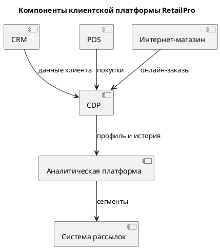

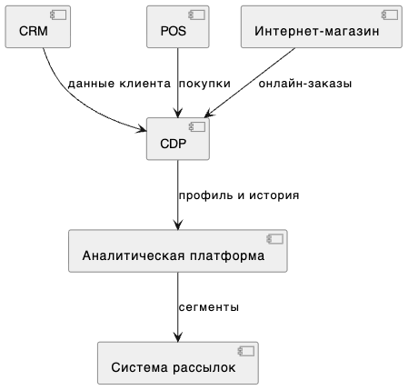

Рис. 7.4. Компоненты клиентской платформы RetailPro

Диаграмма компонентов полезна техническим специалистам для обсуждения интеграции программных модулей. В этом смысле она имеет определенное пересечение с ArchiMate Application View, но не заменяет его полностью, потому что не различает формально: Application Component, Application Service, Application Interface, Data Object, Business Process, Technology Service.

## 7.7. PlantUML и Markdown

PlantUML удобно использовать вместе с Markdown-документацией. Markdown – это облегченный язык разметки для создания форматированного текста с помощью простого синтаксиса.

**Пример Markdown-документа**

````markdown
# Markdown файл с внедренным PlantUML
Markdown поддерживает простое форматирование:
-  это слово выделено _курсивом_
- это __жирным__ шрифтом


Пример математической формулы, записанной с использованием нотации LATEX:
$MSE(p,x)=\frac{1}{N}\sqrt{\sum_{i=1}^{N}{(x_i - p_i)^2}}$
---
### Заголовок 2 уровня: пример кода PlantUML:

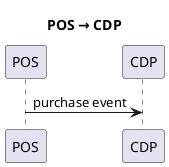
````

Многие редакторы и платформы могут отображать такие диаграммы автоматически или через плагины. Например, так он будет отображен в VS Code с установленными плагинами PlantUML и Markdown plantuml preview.

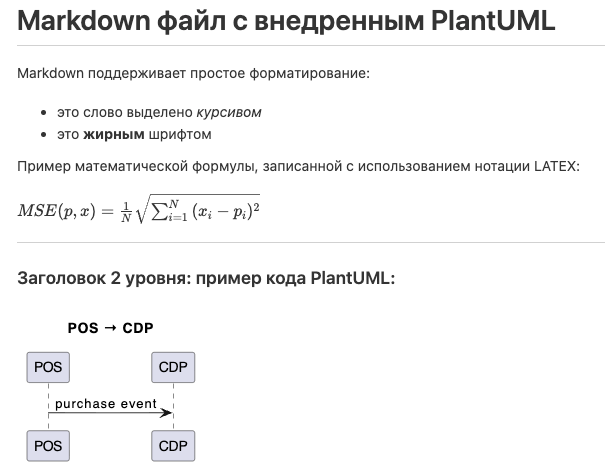

Рис. 7.5. Визуализация md файла с внедренным PlantUML.

## 7.8. Способы запуска PlantUML

PlantUML можно использовать разными способами.

1. Можно использовать PlantUML Online Server: [`https://www.plantuml.com/plantuml/`](https://www.plantuml.com/plantuml/). Этот сценарий подходит для учебных экспериментов, но не рекомендуется для конфиденциальных корпоративных данных, поскольку данные передаются во внешнее приложение.

2. Локальный запуск. Для локального запуска обычно используется Java и файл `plantuml.jar` (можно скачать с сайта [https://www.plantuml.com](https://www.plantuml.com)) Пример команды:

```bash
java -jar plantuml.jar diagram.puml
```

Генерация SVG:

```bash
java -jar plantuml.jar -tsvg diagram.puml
```

3. Использование в VS Code. Популярный вариант для студентов:
1. установить Visual Studio Code;
2. установить расширение PlantUML;
3. установить Java;
4. при необходимости установить Graphviz;
5. открыть `.puml`-файл;
6. использовать preview.

Если необходимо также работать с md файлами надо установить расширение Markdown plantuml preview, либо другое, аналогичное по функционалу.

4. Управление версиями. В профессиональной практике диаграммы можно генерировать автоматически при обновлении кода PlantUML. Пример логики:

```text
commit в Git
↓
CI pipeline запускает PlantUML
↓
генерируются SVG/PNG
↓
обновляется архитектурная документация
```

## 7.9. Подключение библиотек PlantUML

PlantUML поддерживает подключение библиотек через `!include`. Пример:

```plantuml
@startuml
!include <archimate/Archimate>

' Здесь можно использовать ArchiMate-макросы

@enduml
```

В следующей главе мы подробно рассмотрим ArchiMate в PlantUML. Сейчас важно понять, что библиотека расширяет базовый синтаксис PlantUML.

Пример кода PlantUML с ArchiMate-макросом

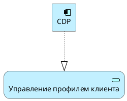

## 7.10. Базовые правила синтаксиса PlantUML

**Идентификаторы.** В PlantUML элементам часто присваивают идентификаторы. По идентификатору можно обращаться к элементу в других фрагментах кода. Их можно рассматривать как аналог переменных в других языках программирования. Пример:

```text
participant "API Gateway" as gateway
```

Здесь:

```text
"API Gateway" — отображаемое имя;
gateway — внутренний идентификатор.
```

Для идентификаторов рекомендуется использовать латиницу, цифры и знак подчеркивания:

**Переносы строк в названиях.** Для переноса строки можно использовать символ **`\n`**:

```text
Application_Component(app_cdp, "Customer Data\nPlatform")
```

Это особенно полезно для длинных русских названий:

```text
Motivation_Requirement(req_single_profile, "Единый профиль\nклиента")
```

**Строки в кавычках** Если текст содержит пробелы или кириллицу, используйте кавычки:

```text
participant "Интернет-магазин" as webshop
```

## 7.11. PlantUML как средство «архитектуры как кода»

**Architecture as code** — это подход, при котором архитектурные описания, диаграммы и решения хранятся в текстовом виде, пригодном для версионирования, автоматической генерации и проверки. PlantUML поддерживает этот подход для диаграмм.

Пример жизненного цикла диаграммы

```text
Архитектор создает application-target.puml
↓
Файл сохраняется в Git
↓
Коллега делает review изменений
↓
PlantUML генерирует SVG
↓
SVG вставляется в документацию
↓
При изменении архитектуры обновляется puml-файл
```

**Таблица 7.2**. Преимущества подхода diagram as code для управления архитектурой

| Возможность | Значение для EA |
|---|---|
| diff изменений | видно, какие элементы архитектуры изменились |
| code review | можно обсуждать архитектуру как pull request |
| шаблоны | можно стандартизировать диаграммы |
| автоматическая генерация | меньше ручной работы |
| интеграция с документацией | архитектура не устаревает так быстро |
| ИИ-генерация | можно получать черновики моделей |

## 7.12. PlantUML и моделирование с ИИ ассистентом

ИИ хорошо работает с текстовыми форматами. Поэтому PlantUML удобен для ИИ-генерации диаграмм.

Пример запроса к ИИ:

```text
На основе описания ниже сгенерируй PlantUML sequence-диаграмму.

Описание:
Клиент совершает покупку в магазине.
POS отправляет событие покупки в API Gateway.
API Gateway публикует событие в Message Broker.
CDP получает событие и обновляет профиль клиента.
```

Возможный результат:

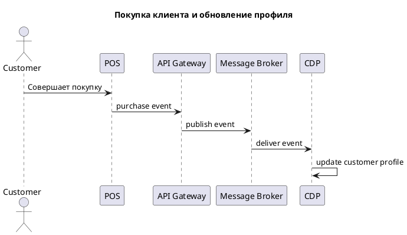

## 7.13. Мини-практикум: первые диаграммы PlantUML

**Задание 1.** Постройте sequence-диаграмму для сценария:

```text
Клиент оформляет заказ в интернет-магазине.
Интернет-магазин передает заказ в CRM.
CRM передает данные клиента в CDP.
CDP обновляет профиль клиента.
```

Пример:

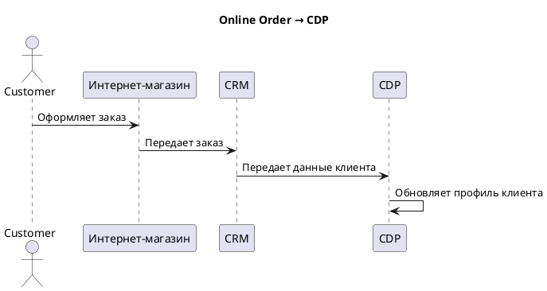

**Задание 2.** Постройте component-диаграмму для приложений:

```text
CRM
POS
Интернет-магазин
CDP
Аналитическая платформа
Система рассылок
```

Пример:

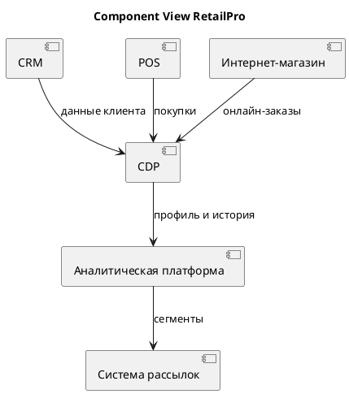

**Задание 3.** Постройте минимальную ArchiMate-диаграмму, включающую не менее 5 элементов. Пример:

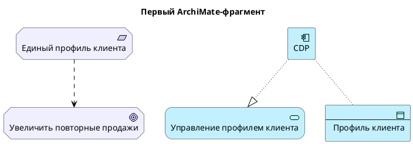

**Задание 4.** Создайте Markdown-файл, включите в него:

- краткое описание проблемы;
- три PlantUML-диаграммы;
- пояснение каждой диаграммы.

## 7.14. Чек-лист проверки PlantUML-диаграммы

Синтаксис

- есть `@startuml` и `@enduml`;
- все элементы имеют корректные идентификаторы;
- строки с пробелами и кириллицей заключены в кавычки;
- библиотека ArchiMate подключена, если используются ArchiMate-макросы;
- все используемые макросы поддерживаются вашей средой;
- отношения используют ранее объявленные элементы.

Читаемость

- Есть заголовок `title`;
- элементы сгруппированы комментариями;
- названия элементов понятны;
- диаграмма не перегружена;
- потоки подписаны.

Архитектурная логика

- диаграмма отвечает на конкретный вопрос;
- показаны ключевые элементы;
- связи имеют смысл;
- не смешаны разные уровни без необходимости;
- диаграмму можно объяснить за 2–3 минуты.

## 7.15. Контрольные вопросы

1. Что такое PlantUML?
2. Что означает подход diagrams as code?
3. Какие преимущества дает текстовое описание диаграмм?
4. Какие типы диаграмм поддерживает PlantUML?
5. Как устроен минимальный PlantUML-файл?
6. Для чего используются `@startuml` и `@enduml`?
7. Как добавлять комментарии в PlantUML?
8. Как добавить заголовок диаграммы?
9. Почему PlantUML удобно использовать с Markdown?
10. Как PlantUML связан с Git?
11. Как PlantUML может использоваться в CI/CD?
12. Зачем нужны идентификаторы элементов?
13. Какие правила именования идентификаторов рекомендуется использовать?
14. Как подключить библиотеку ArchiMate?
15. Почему PlantUML удобен для ИИ-ассистированного моделирования?
16. Какие ограничения есть у ИИ при генерации PlantUML?
17. Какие типичные синтаксические ошибки встречаются в PlantUML?
18. Чем component-диаграмма отличается от ArchiMate-диаграммы?

## 7.16. Краткие выводы главы

1. PlantUML позволяет создавать диаграммы из текстового описания.
2. Подход diagrams as code делает диаграммы версионируемыми, проверяемыми и легко обновляемыми.
3. PlantUML полезен архитектору предприятия для документирования, шаблонизации и автоматической генерации диаграмм.
4. PlantUML хорошо сочетается с Markdown и Git.
5. Текстовый формат PlantUML удобен для ИИ-ассистированной генерации диаграмм.
6. Минимальная PlantUML-диаграмма начинается с `@startuml` и заканчивается `@enduml`.
7. Для ArchiMate-диаграмм нужно подключать библиотеку `!include <archimate/Archimate>`.
8. В PlantUML важно использовать корректные идентификаторы и понятные названия элементов.
9. PlantUML не заменяет ArchiMate как язык архитектурного моделирования, но может использоваться для текстового описания ArchiMate-диаграмм.
10. Качество PlantUML-диаграммы определяется не только синтаксисом, но и архитектурной логикой.

---

[← Предыдущая глава](../06-archimate-relationships/README.md) · [К оглавлению](../README.md) · [Следующая глава →](../08-archimate-in-plantuml/README.md)
