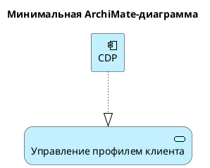
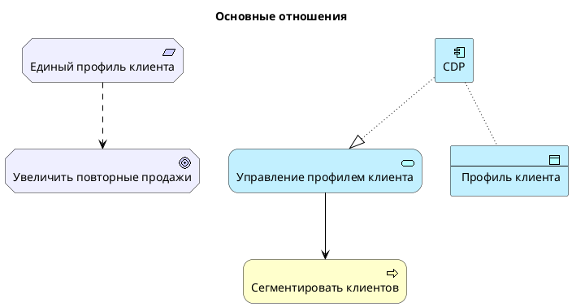
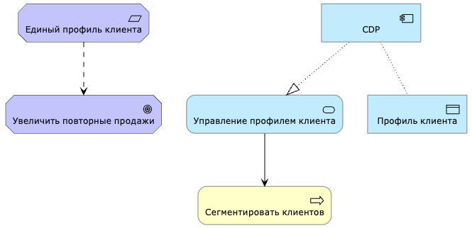
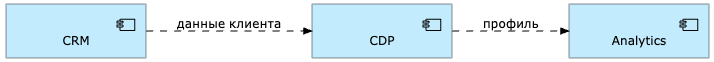
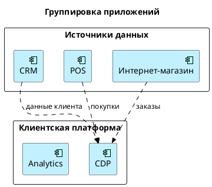
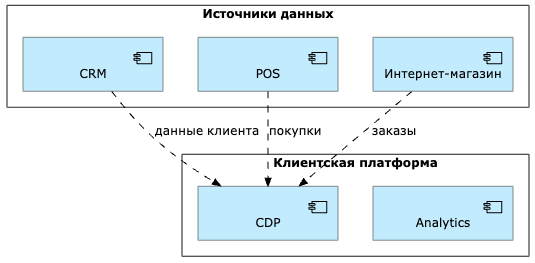

# Глава 8. ArchiMate в PlantUML

[← Предыдущая глава](../07-plantuml-basics/README.md) · [К оглавлению](../README.md) · [Следующая глава →](../09-ai-assisted-modeling/README.md)

**После изучения этой главы студент должен уметь:**

1. объяснять, как PlantUML используется для построения ArchiMate-диаграмм;
2. подключать библиотеку ArchiMate в PlantUML;
3. создавать элементы Motivation, Strategy, Business, Application, Technology и Implementation & Migration;
4. создавать отношения ArchiMate в PlantUML;
5. строить мотивационные, бизнес-, прикладные, технологические и migration-диаграммы;
6. применять шаблоны PlantUML для учебного кейса RetailPro;
7. понимать ограничения PlantUML по сравнению со специализированными EA-инструментами;
8. проверять корректность PlantUML-кода;
9. исправлять типичные ошибки при использовании ArchiMate-макросов;
10. готовить PlantUML-диаграммы для архитектурной документации.

## 8.1. Учебная ситуация: RetailPro хочет хранить ArchiMate-модели как код

Архитектурная команда RetailPro уже умеет строить ArchiMate-модели, Но теперь возникает практический вопрос – как хранить эти модели в текстовом виде, чтобы их можно было версионировать, проверять, генерировать и использовать совместно с ИИ?

Один из вариантов — использовать **PlantUML с библиотекой ArchiMate**.

Например, вместо того чтобы рисовать компонент CDP вручную, архитектор пишет:

```text
Application_Component(app_cdp, "CDP")
```

А вместо того чтобы вручную проводить стрелку «CDP реализует сервис управления профилем клиента», пишет:

```plantuml
Rel_Realization(app_cdp, as_customer_profile)
```

Так архитектурная диаграмма становится текстовым артефактом.

## 8.2. PlantUML и ArchiMate: как они связаны

ArchiMate задает архитектурную семантику, то есть отвечает на вопрос:

*Какие архитектурные элементы и отношения мы используем?*

PlantUML задает текстовый способ описания диаграммы, то есть отвечает на вопрос:

*Как описать элементы и связи в виде кода*

Пример. Архитектурный смысл:

```text
CDP реализует сервис управления профилем клиента.
CDP использует данные профиля клиента.
```

Код PlantUML:

```plantuml
Application_Component(app_cdp, "CDP")
Application_Service(as_customer_profile, "Управление профилем клиента")
Application_DataObject(data_customer_profile, "Профиль клиента")

Rel_Realization(app_cdp, as_customer_profile)
Rel_Access(app_cdp, data_customer_profile)
```

## 8.3. Подключение библиотеки ArchiMate

Для использования ArchiMate-макросов в PlantUML нужно подключить библиотеку:

```plantuml
!include <archimate/Archimate>
```

Минимальный пример:



**Возможная проблема.** В разных средах PlantUML библиотека ArchiMate может быть недоступна или иметь отличия в макросах. Если код не работает, проверьте:

- установлена ли актуальная версия PlantUML;
- доступна ли стандартная библиотека;
- правильно ли написан путь `!include <archimate/Archimate>`;
- поддерживается ли конкретный макрос;
- нет ли опечаток в названии элемента.

## 8.4. Общие правила записи ArchiMate-элементов

Большинство элементов записываются так:

```text
Layer_ElementType(identifier, "Displayed Name")
```

Пример:

```text
Motivation_Stakeholder(stk_cmo, “Директор по маркетингу”)
Strategy_Capability(cap_customer_profile, “Управлять профилем клиентов”)
Business_Process(bp_segment_customers, "Сегментировать клиентов")
Application_DataObject(data_customer_profile, "Профиль клиента")
Technology_Node(node_server, “Сервер приложений”)
Implementation_WorkPackage(wp_customer_profile, “Создать единый профиль клиента”)
```

Идентификатор и отображаемое имя

```text
Application_Component(app_cdp, "CDP")
```

Здесь:

| Часть | Смысл |
|---|---|
| `Application_Component` | тип ArchiMate-элемента |
| `app_cdp` | технический идентификатор |
| `"CDP"` | отображаемое имя |

Для идентификаторов рекомендуется:

```text
использовать латиницу;
не использовать пробелы;
использовать snake_case;
добавлять префикс слоя или типа.
```

Примеры:

```text
goal_repeat_sales
req_single_profile
bp_segment_customers
app_cdp
data_customer_profile
ts_api_management
wp_implement_cdp
gap_no_single_profile
```

## 8.5. Основные отношения ArchiMate в PlantUML

Отношения записываются так:

```plantuml
Rel_Type(source, target)
```

Или с подписью:

```plantuml
Rel_Flow(source, target, "название потока")
```

**Таблица 8.1.** Часто используемые отношения

| Отношение | PlantUML-макрос | Пример |
|---|---|---|
| Association | `Rel_Association(a, b)` | stakeholder связан с goal |
| Influence | `Rel_Influence(a, b)` | requirement влияет на goal |
| Assignment | `Rel_Assignment(a, b)` | actor назначен на role |
| Realization | `Rel_Realization(a, b)` | component реализует service |
| Serving | `Rel_Serving(a, b)` | service обслуживает process |
| Access | `Rel_Access(a, b)` | app использует data |
| Flow | `Rel_Flow(a, b, "data")` | app передает данные |
| Triggering | `Rel_Triggering(a, b)` | event запускает process |
| Composition | `Rel_Composition(a, b)` | node состоит из software |
| Aggregation | `Rel_Aggregation(a, b)` | capability включает capability |
| Specialization | `Rel_Specialization(a, b)` | email offer является offer |

Мини-пример отношений





Рис. 8.1. Пример отношений ArchiMate

## 8.6. Управление компоновкой диаграммы

PlantUML автоматически размещает элементы, но иногда нужно изменить компоновку.

Можно задать направление:

```text
left to right direction
```

По умолчанию используется `top to bottom direction`.

Пример:





```plantuml
@startuml
!include <archimate/Archimate>

left to right direction

Application_Component(app_crm, "CRM")
Application_Component(app_cdp, "CDP")
Application_Component(app_analytics, "Analytics")

Rel_Flow(app_crm, app_cdp, "данные клиента")
Rel_Flow(app_cdp, app_analytics, "профиль")

@enduml
```

Рис. 8.2. Пример размещения элементов по горизонтали

Можно использовать `rectangle` для визуальной группировки, хотя это уже элемент PlantUML, а не ArchiMate-семантика.





Рис. 8.3. Пример визуальной группировки элементов

Группировка в `rectangle` помогает читаемости, но не заменяет ArchiMate-отношения:

```plantuml
Rel_Aggregation(...)
Rel_Composition(...)
```

Если группировка имеет архитектурный смысл, например, представляет отношение Composition, лучше показать его формальным отношением.

## 8.7. Рекомендации по структуре PlantUML-файла

Хороший файл должен быть структурирован. Один из вариантов структуры представлен здесь:


## 8.8. Ограничения PlantUML для ArchiMate

PlantUML удобен, но важно понимать его ограничения.

**Ограничение 1. Это не полноценный EA-репозиторий.** PlantUML-файл — это диаграмма как код, но не всегда полноценная архитектурная база знаний.

Специализированные EA-инструменты позволяют:

- переиспользовать один элемент в разных диаграммах;
- проверять допустимость отношений;
- строить отчеты;
- выполнять impact analysis;
- хранить атрибуты элементов;
- управлять версиями модели;
- строить heatmap и roadmaps.

PlantUML делает это ограниченно или требует дополнительной организации.

**Ограничение 2. Слабая семантическая проверка**

PlantUML может сгенерировать диаграмму даже с архитектурно спорными связями. Например:

```plantuml
Rel_Realization(as_customer_profile, app_cdp)
```

Синтаксически это может быть принято, но семантически направление неверное. Правильное отношение:

```plantuml
Rel_Realization(app_cdp, as_customer_profile)
```

**Ограничение 3. Зависимость от макросов.** Некоторые ArchiMate-элементы могут называться иначе или не поддерживаться в вашей версии библиотеки. Поэтому полезно:

- проверять доступные макросы;
- использовать стандартные элементы;
- иметь учебные шаблоны;
- не усложнять диаграмму без необходимости.

**Ограничение 4. Автоматическая компоновка не всегда идеальна.** PlantUML сам размещает элементы, но крупные диаграммы могут становиться нечитаемыми. Поэтому лучше использовать несколько компактных view, чем одну огромную диаграмму.

## 8.9. Проверка корректности ArchiMate PlantUML-модели

Синтаксический чек-лист

- есть `@startuml` и `@enduml`;
- подключена библиотека `!include <archimate/Archimate>`;
- все идентификаторы уникальны;
- все элементы объявлены до использования;
- все строки с русским текстом заключены в кавычки;
- нет опечаток в макросах;
- диаграмма успешно компилируется.

Семантический чек-лист

- Goal не является приложением;
- Requirement не является названием системы;
- Business Process назван действием;
- Application Component является приложением;
- Application Service является функциональностью;
- Data Object является данными;
- Technology Service не является названием продукта;
- Work Package является работой;
- Gap является разрывом, а не действием;
- Realization имеет правильное направление;
- Serving имеет правильное направление;
- Flow подписан;
- модель отвечает на конкретный архитектурный вопрос.

## 8.10. Практикум

**Кейс EduSmart.** Компания EduSmart хочет снизить отток студентов. Нужно построить три ArchiMate-диаграммы в PlantUML:

1. Motivation View;
2. Application View;
3. Migration View.

**Задание 1. Motivation View EduSmart.** Используйте элементы:

```text
Stakeholder: Руководитель академического блока
Driver: Рост оттока студентов
Assessment: Позднее выявление риска отчисления
Goal: Снизить отток студентов
Outcome: Отток снижен на 10%
Requirement: Единый профиль студента
Requirement: Модель риска отчисления
Principle: Privacy by design
```

**Задание 2. Application View EduSmart.** Используйте элементы:

```text
LMS
CRM
Платежная система
Система вебинаров
Аналитическая платформа
Student Portal
Student API
Профиль студента
Активность в LMS
История платежей
Посещаемость вебинаров
Риск отчисления
```

**Задание 3. Migration View EduSmart.** Используйте элементы:

```text
Baseline: ручное выявление риска
Transition 1: единый профиль студента
Transition 2: интеграция источников
Target: автоматическое выявление риска
Gap: нет единого профиля студента
Gap: нет модели риска
Work Package: создать профиль студента
Work Package: интегрировать источники
Work Package: внедрить модель риска
Deliverable: Student API
Deliverable: Risk Model
```

## 8.11. Контрольные вопросы

1. Как подключить ArchiMate-библиотеку в PlantUML?
2. Как записывается ArchiMate-элемент в PlantUML?
3. Что такое идентификатор элемента?
4. Какие правила именования идентификаторов рекомендуется использовать?
5. Как записывается отношение ArchiMate в PlantUML?
6. Как записать Flow с подписью?
7. Как создать Motivation View?
8. Как создать Business View?
9. Как создать Application View?
10. Как создать Technology View?
11. Как создать Migration View?
12. Что показывает Layered View?
13. Какие ограничения есть у PlantUML по сравнению с EA-инструментами?
14. Почему PlantUML не заменяет архитектурный репозиторий полностью?
15. Как проверить синтаксическую корректность модели?
16. Как проверить семантическую корректность модели?
17. Какие ошибки чаще всего возникают при использовании ArchiMate в PlantUML?

## 8.12. Краткие выводы главы

1. PlantUML можно использовать для текстового описания ArchiMate-диаграмм.
2. Для ArchiMate-макросов нужно подключить библиотеку `!include <archimate/Archimate>`.
3. Элементы записываются в форме `Layer_ElementType(identifier, "Displayed Name")`.
4. Отношения записываются в форме `Rel_Type(source, target)`.
5. Для потоков удобно использовать `Rel_Flow(source, target, "описание потока")`.
6. Идентификаторы должны быть уникальными, понятными и написанными латиницей.
7. PlantUML удобно применять для Motivation, Business, Application, Technology, Layered и Migration views.
8. PlantUML поддерживает подход diagrams as code.
9. PlantUML хорошо подходит для учебных проектов, документации и ИИ-ассистированной генерации.
10. PlantUML не заменяет полностью профессиональный EA-репозиторий.
11. Синтаксически корректная диаграмма не всегда является семантически корректной ArchiMate-моделью.
12. Качество модели зависит от правильного выбора типов элементов, отношений и уровня детализации.

---

[← Предыдущая глава](../07-plantuml-basics/README.md) · [К оглавлению](../README.md) · [Следующая глава →](../09-ai-assisted-modeling/README.md)
