  # PlantUML -код для ArchiMate-диаграммы

Промпт:

```
Ты — эксперт по ArchiMate и PlantUML.

Сгенерируй PlantUML-код для ArchiMate-диаграммы на основе выделенных элементов и отношений.

Требования:
1. Используй библиотеку: !include <archimate/Archimate>
2. Диаграмма должна начинаться с @startuml и заканчиваться @enduml.
3. Используй наименования элементов по шаблону Layer_ElementType(id, displayed_name), пример: Motivation_Stakeholder(stakeholder_director_marketing, “Директор по маркетингу»)
4. Используй идентификаторы латиницей в snake_case.
5. Все отображаемые имена заключай в кавычки.
6. Сгруппируй элементы комментариями по слоям:
   Motivation, Strategy, Business, Application, Technology, Implementation.
7. Сначала объяви все элементы, затем все отношения.
8. Используй только стандартные отношения:
   Rel_Association, Rel_Influence, Rel_Assignment, Rel_Realization,
   Rel_Serving, Rel_Access, Rel_Flow, Rel_Triggering,
   Rel_Aggregation, Rel_Composition.
9. Не добавляй элементы, которых нет в списке.
10. После кода укажи спорные места модели.
```





```plantuml

@startuml
!include <archimate/Archimate>

' ============================================================
' Слой: Motivation
' ============================================================
Motivation_Stakeholder(stakeholder_director_marketing, "Директор по маркетингу")
Motivation_Stakeholder(stakeholder_legal_dept, "Юридический отдел")
Motivation_Driver(driver_increase_repeat_sales, "Увеличение повторных продаж")
Motivation_Assessment(assessment_offers_too_generic, "Предложения слишком общие из-за разрозненности данных")
Motivation_Goal(goal_increase_repeat_sales_personalized, "Увеличить повторные продажи за счёт персональных предложений")
Motivation_Outcome(outcome_personalized_offers, "Персональные предложения для клиентов")
Motivation_Requirement(requirement_consider_client_consent, "Учитывать согласия клиентов")
Motivation_Constraint(constraint_integration_via_api, "Интеграция через API")


' ============================================================
' Слой: Business
' ============================================================
Business_Object(business_object_client_data, "Данные клиентов")

' ============================================================
' Слой: Application
' ============================================================
Application_Component(app_component_crm, "CRM")
Application_Component(app_component_pos, "POS")
Application_Component(app_component_online_store, "Интернет-магазин")
Application_Component(app_component_cdp, "CDP (Customer Data Platform)")
Application_Component(app_component_analytics_platform, "Аналитическая платформа")
Application_Interface(application_interface_api, "API")
Application_DataObject(data_object_unified_client_profile, "Единый профиль клиента")
Application_DataObject(data_object_client_segments, "Клиентские сегменты")
Application_DataObject(data_object_client_consents, "Согласия клиентов")

' ============================================================
' Слой: Implementation
' ============================================================
Implementation_WorkPackage(work_package_cdp_implementation, "Внедрение CDP")
Implementation_Gap(gap_data_fragmentation, "Разрозненность данных клиентов между CRM, POS и интернет-магазином")
' ============================================================
' Отношения
' ============================================================

' --- Stakeholder → Motivation ---
Rel_Influence(stakeholder_director_marketing, driver_increase_repeat_sales)
Rel_Influence(stakeholder_director_marketing, goal_increase_repeat_sales_personalized)
Rel_Assignment(stakeholder_legal_dept, requirement_consider_client_consent)

' --- Goal / Driver / Outcome ---
Rel_Realization(goal_increase_repeat_sales_personalized, driver_increase_repeat_sales)
Rel_Realization(outcome_personalized_offers, goal_increase_repeat_sales_personalized)

' --- Assessment / Gap ---
Rel_Influence(assessment_offers_too_generic, goal_increase_repeat_sales_personalized)
Rel_Influence(assessment_offers_too_generic, gap_data_fragmentation)
Rel_Influence(gap_data_fragmentation, goal_increase_repeat_sales_personalized)

' --- Requirement / Constraint ---
Rel_Influence(requirement_consider_client_consent, goal_increase_repeat_sales_personalized)
Rel_Influence(constraint_integration_via_api, work_package_cdp_implementation)
Rel_Influence(constraint_integration_via_api, requirement_consider_client_consent)

' --- Work Package ---
Rel_Realization(work_package_cdp_implementation, goal_increase_repeat_sales_personalized)
Rel_Realization(work_package_cdp_implementation, app_component_cdp)

' --- Application Component → Data Object (Access) ---
Rel_Access(app_component_cdp, data_object_unified_client_profile)
Rel_Access(app_component_cdp, data_object_client_consents)
Rel_Access(app_component_analytics_platform, data_object_client_segments)
Rel_Access(app_component_analytics_platform, data_object_client_consents)
Rel_Access(app_component_crm, business_object_client_data)
Rel_Access(app_component_pos, business_object_client_data)
Rel_Access(app_component_online_store, business_object_client_data)

' --- Application Interface → Application Component (Assignment) ---
Rel_Assignment(application_interface_api, app_component_cdp)
Rel_Assignment(application_interface_api, app_component_analytics_platform)

' --- Application Component → Application Component (Serving) ---
Rel_Serving(app_component_cdp, app_component_analytics_platform)

' --- Data Object → Data Object (Flow) ---
Rel_Flow(data_object_unified_client_profile, data_object_client_segments)

@enduml
```

---

## Спорные места модели

| № | Место | Проблема | Рекомендация |
|---|---|---|---|
| 1 | `Rel_Influence(constraint_integration_via_api, requirement_consider_client_consent)` | Связь между ограничением (API) и требованием (согласия) косвенная и не следует явно из текста. | Заменить на `Rel_Association` или удалить, если связь не подтвердится при уточнении требований. |
| 2 | `Rel_Access(app_component_cdp, data_object_client_consents)` и `Rel_Access(app_component_analytics_platform, data_object_client_consents)` | Неясно, какой именно компонент хранит и обрабатывает согласия — CDP, аналитическая платформа или отдельная система (Consent Management Platform). | Рассмотреть введение отдельного `Application_Component` для управления согласиями. |
| 3 | `Rel_Assignment(application_interface_api, app_component_analytics_platform)` | В тексте явно не указано, что аналитическая платформа использует API — это логическое допущение. | Уточнить у архитектора: получает ли аналитическая платформа данные напрямую из CDP или через API. |
| 4 | `Rel_Flow(data_object_unified_client_profile, data_object_client_segments)` | В ArchiMate `Flow` обычно применяется между активными элементами (компонентами/сервисами), а не между пассивными структурами данных. | Рассмотреть замену на `Rel_Serving(app_component_cdp, app_component_analytics_platform)` с передачей данных через сервис, либо оставить как концептуальный поток данных. |
| 5 | Отсутствие `Technology Layer` | В тексте не упомянуты технологические элементы (серверы, сети, БД), хотя CDP и аналитическая платформа требуют инфраструктуры. | При детализации архитектуры добавить Technology-слой. |
| 6 | Отсутствие `Business Process` и `Capability` | Процессы персонализации и сегментации, а также бизнес-способности не выделены явно. | При расширении модели добавить Business Process («Персонализация предложений», «Сегментация клиентов») и Capability («Управление клиентскими данными»). |