Промпт:

```
Ты — эксперт по ArchiMate и PlantUML.

Проверь следующий PlantUML-код.

Проверь:
1. Есть ли синтаксические ошибки PlantUML?
2. Подключена ли библиотека ArchiMate?
3. Все ли элементы объявлены до использования?
4. Корректны ли типы ArchiMate-элементов?
5. Корректны ли отношения и их направление?
6. Нет ли смешения бизнес-процессов, приложений, данных и технологий?
7. Есть ли элементы без связей?
8. Есть ли Flow без подписи?
9. Есть ли слишком общие Association, которые можно заменить более точными отношениями?
10. Предложи исправленную верси. 

Код: 

@startuml
!include <archimate/Archimate>

Business_Process(app_cdp, "CDP")
Application_Service(app_crm, "CRM")
Data_Object(bp_segment, "Сегментировать клиентов")

Rel_Realization(app_crm, app_cdp)
Rel_Access(bp_segment, app_crm)

@enduml
```

# Проверка PlantUML-кода

## Результаты проверки

| № | Критерий | Статус | Комментарий |
|---|---|---|---|
| 1 | Синтаксические ошибки PlantUML | ✅ OK | Синтаксис корректен, ошибок нет |
| 2 | Подключена ли библиотека ArchiMate | ✅ OK | `!include <archimate/Archimate>` присутствует |
| 3 | Все ли элементы объявлены до использования | ✅ OK | Все 3 элемента объявлены до отношений |
| 4 | Корректны ли типы ArchiMate-элементов | ❌ **Ошибки** | См. ниже |
| 5 | Корректны ли отношения и их направление | ❌ **Ошибки** | См. ниже |
| 6 | Нет ли смешения слоёв | ❌ **Ошибки** | См. ниже |
| 7 | Есть ли элементы без связей | ✅ OK | Все элементы участвуют в отношениях |
| 8 | Есть ли Flow без подписи | ✅ OK | Flow отсутствует |
| 9 | Есть ли слишком общие Association | ✅ OK | Association не используется |

---

## Детальный разбор ошибок

### Ошибка 1: Некорректный тип `Business_Process(app_cdp, "CDP")`
CDP (Customer Data Platform) — это **приложение**, а не бизнес-процесс. Должен быть `Application_Component`.

### Ошибка 2: Некорректный тип `Application_Service(app_crm, "CRM")`
CRM — это **приложение (компонент)**, а не сервис. Должен быть `Application_Component`.

### Ошибка 3: Некорректный тип `Data_Object(bp_segment, "Сегментировать клиентов")`
«Сегментировать клиентов» — это **действие** (глагол), а не объект данных. Если это процесс — нужен `Business_Process`. Если результат — нужен `Application_DataObject` с именем «Клиентские сегменты».

### Ошибка 4: Неверное направление `Rel_Realization(app_crm, app_cdp)`
CRM не «реализует» CDP. Отношение Realization обычно идёт от Work Package к компоненту, или от компонента к сервису. Смысл связи неясен.

### Ошибка 5: Неверное направление `Rel_Access(bp_segment, app_crm)`
В ArchiMate отношение **Access** идёт от **активного элемента** (компонент/сервис/процесс) к **пассивному** (объект данных). Здесь направление обратное — Data Object «получает доступ» к Service, что неверно.

### Ошибка 6: Смешение слоёв и семантики
- CDP назван бизнес-процессом, но является приложением
- CRM назван сервисом, но является компонентом
- «Сегментировать клиентов» назван объектом данных, но является действием

---

## Исправленная версия кода

```plantuml
@startuml
!include <archimate/Archimate>

' ============================================================
' Слой: Application
' ============================================================
Application_Component(app_cdp, "CDP")
Application_Component(app_crm, "CRM")
Application_DataObject(data_object_client_segments, "Клиентские сегменты")

' ============================================================
' Отношения
' ============================================================

' CDP и CRM — оба приложения, могут быть связаны через интерфейс или сервис
' Если CRM является источником данных для CDP:
Rel_Association(app_crm, app_cdp)

' CDP имеет доступ к объекту данных "Клиентские сегменты"
' (или создаёт его — тогда Access от CDP к Data Object)
Rel_Access(app_cdp, data_object_client_segments)

@enduml
```



### Альтернативная версия (если «Сегментировать клиентов» — это бизнес-процесс):

```plantuml
@startuml
!include <archimate/Archimate>

' ============================================================
' Слой: Business
' ============================================================
Business_Process(bp_segment_clients, "Сегментировать клиентов")

' ============================================================
' Слой: Application
' ============================================================
Application_Component(app_cdp, "CDP")
Application_Component(app_crm, "CRM")

' ============================================================
' Отношения
' ============================================================

' Бизнес-процесс использует приложение CDP
Rel_Serving(app_cdp, bp_segment_clients)

' CRM связан с CDP (например, как источник данных)
Rel_Association(app_crm, app_cdp)

@enduml
```



---

## Сводная таблица исправлений

| Было | Стало | Причина |
|---|---|---|
| `Business_Process(app_cdp, "CDP")` | `Application_Component(app_cdp, "CDP")` | CDP — это приложение, а не процесс |
| `Application_Service(app_crm, "CRM")` | `Application_Component(app_crm, "CRM")` | CRM — это компонент, а не сервис |
| `Data_Object(bp_segment, "Сегментировать клиентов")` | `Application_DataObject(data_object_client_segments, "Клиентские сегменты")` | Объект данных должен называться существительным |
| `Rel_Realization(app_crm, app_cdp)` | `Rel_Association(app_crm, app_cdp)` | Realization не подходит для связи двух компонентов |
| `Rel_Access(bp_segment, app_crm)` | `Rel_Access(app_cdp, data_object_client_segments)` | Access идёт от активного элемента к пассивному |