__Промпт__


```
На основе списка gaps и requirements предложи migration roadmap.

Сделай:
1. Сгруппируй gaps в work packages.
2. Определи зависимости между work packages.
3. Предложи 3–5 transition plateaus.
4. Для каждого plateau укажи бизнес-ценность.
5. Сформируй roadmap по кварталам.
6. Сгенерируй PlantUML-код Migration View с элементами:
   - Plateau
   - Gap
   - Work Package
   - Deliverable
   - Requirement
7. Не добавляй технологий, которых нет в исходных данных, без пометки "предположение".
```

# Migration Roadmap RetailPro

## 1. Группировка gaps в work packages

| Work Package | Связанные gaps | Описание |
|---|---|---|
| **WP-01: Подготовка инфраструктуры и данных** | GAP-02, GAP-04, GAP-05 | Консолидация данных клиентов, подготовка технологической инфраструктуры, внедрение управления согласиями |
| **WP-02: Внедрение CDP и интеграция** | GAP-03 | Внедрение CDP, разработка API, интеграция с CRM/POS/интернет-магазином |
| **WP-03: Аналитика и сегментация** | GAP-03 | Внедрение аналитической платформы, расчёт клиентских сегментов |
| **WP-04: Персонализация предложений** | GAP-01 | Разработка и внедрение процесса персонализации предложений |

---

## 2. Зависимости между work packages

```
WP-01 (Подготовка инфраструктуры и данных)
    ├──► WP-02 (Внедрение CDP и интеграция)
    │       ──► WP-03 (Аналитика и сегментация)
    │               └──► WP-04 (Персонализация предложений)
    └──► WP-04 (Персонализация предложений) [частичная зависимость]
```

**Критический путь:** WP-01 → WP-02 → WP-03 → WP-04

---

## 3. Transition Plateaus

### Plateau 1: Foundation (Q1-Q2 2026)
**Бизнес-ценность:** Снижение юридических рисков, подготовка данных для персонализации
- Завершение WP-01
- Единая модель данных клиентов
- Инфраструктура для CDP готова
- Механизм управления согласиями работает

### Plateau 2: Integration (Q3 2026)
**Бизнес-ценность:** Единое представление о клиенте, готовность к персонализации
- Завершение WP-02
- CDP внедрена и интегрирована с CRM/POS/интернет-магазином
- API для интеграции работает
- Единый профиль клиента формируется автоматически

### Plateau 3: Intelligence (Q4 2026)
**Бизнес-ценность:** Понимание клиентских сегментов, основа для таргетирования
- Завершение WP-03
- Аналитическая платформа работает
- Клиентские сегменты рассчитываются автоматически
- Маркетинг может использовать сегменты для кампаний

### Plateau 4: Personalization (Q1 2027)
**Бизнес-ценность:** Увеличение повторных продаж за счёт персонализации
- Завершение WP-04
- Процесс персонализации работает
- Персональные предложения генерируются автоматически
- Измерение эффективности персонализации

---

## 4. Roadmap по кварталам

| Квартал | Work Package | Deliverables | Requirements |
|---|---|---|---|
| **Q1 2026** | WP-01 | - Единая модель данных клиентов<br>- Инфраструктура для CDP<br>- Система управления согласиями | - Учитывать согласия клиентов<br>- Формировать единый профиль клиента |
| **Q2 2026** | WP-01 (продолжение) | - Миграция данных из CRM/POS/интернет-магазина<br>- Тестирование инфраструктуры | - Формировать единый профиль клиента |
| **Q3 2026** | WP-02 | - Внедрённая CDP<br>- API для интеграции<br>- Интеграция с CRM/POS/интернет-магазином | - Интеграция должна выполняться через API<br>- Формировать единый профиль клиента |
| **Q4 2026** | WP-03 | - Внедрённая аналитическая платформа<br>- Клиентские сегменты<br>- Отчёты по сегментам | - Увеличить повторные продажи за счёт персональных предложений |
| **Q1 2027** | WP-04 | - Процесс персонализации<br>- Автоматическая генерация предложений<br>- Дашборд эффективности | - Увеличить повторные продажи за счёт персональных предложений |

---

## 5. PlantUML-код Migration View

```plantuml
@startuml
!include <archimate/Archimate>

' ============================================================
' Plateaus
' ============================================================
Implementation_Plateau(plateau_foundation, "Plateau 1: Foundation (Q1-Q2 2026)")
Implementation_Plateau(plateau_integration, "Plateau 2: Integration (Q3 2026)")
Implementation_Plateau(plateau_intelligence, "Plateau 3: Intelligence (Q4 2026)")
Implementation_Plateau(plateau_personalization, "Plateau 4: Personalization (Q1 2027)")

' ============================================================
' Work Packages
' ============================================================
Implementation_WorkPackage(wp_01_infrastructure_data, "WP-01: Подготовка инфраструктуры и данных")
Implementation_WorkPackage(wp_02_cdp_integration, "WP-02: Внедрение CDP и интеграция")
Implementation_WorkPackage(wp_03_analytics_segmentation, "WP-03: Аналитика и сегментация")
Implementation_WorkPackage(wp_04_personalization, "WP-04: Персонализация предложений")

' ============================================================
' Gaps
' ============================================================
Implementation_Gap(gap_data_fragmentation, "GAP-02: Разрозненность данных клиентов")
Implementation_Gap(gap_no_infrastructure, "GAP-04: Отсутствие инфраструктуры")
Implementation_Gap(gap_no_consent_management, "GAP-05: Отсутствие управления согласиями")
Implementation_Gap(gap_no_cdp, "GAP-03: Отсутствие CDP и аналитической платформы")
Implementation_Gap(gap_no_personalization_process, "GAP-01: Отсутствие процесса персонализации")

' ============================================================
' Deliverables
' ============================================================
Implementation_Deliverable(deliverable_unified_data_model, "Единая модель данных клиентов")
Implementation_Deliverable(deliverable_cdp_infrastructure, "Инфраструктура для CDP")
Implementation_Deliverable(deliverable_consent_management, "Система управления согласиями")
Implementation_Deliverable(deliverable_cdp_deployed, "Внедрённая CDP")
Implementation_Deliverable(deliverable_api, "API для интеграции")
Implementation_Deliverable(deliverable_unified_profile, "Единый профиль клиента")
Implementation_Deliverable(deliverable_analytics_platform, "Внедрённая аналитическая платформа")
Implementation_Deliverable(deliverable_client_segments, "Клиентские сегменты")
Implementation_Deliverable(deliverable_personalization_process, "Процесс персонализации")
Implementation_Deliverable(deliverable_personalized_offers, "Автоматическая генерация предложений")

' ============================================================
' Requirements
' ============================================================
Motivation_Requirement(req_consent, "Учитывать согласия клиентов")
Motivation_Requirement(req_unified_profile, "Формировать единый профиль клиента")
Motivation_Requirement(req_api_integration, "Интеграция через API")
Motivation_Requirement(req_increase_sales, "Увеличить повторные продажи за счёт персональных предложений")

' ============================================================
' Отношения: Plateau → Work Package
' ============================================================
Rel_Composition(plateau_foundation, wp_01_infrastructure_data)
Rel_Composition(plateau_integration, wp_02_cdp_integration)
Rel_Composition(plateau_intelligence, wp_03_analytics_segmentation)
Rel_Composition(plateau_personalization, wp_04_personalization)

' ============================================================
' Отношения: Work Package → Gap (реализация)
' ============================================================
Rel_Realization(wp_01_infrastructure_data, gap_data_fragmentation)
Rel_Realization(wp_01_infrastructure_data, gap_no_infrastructure)
Rel_Realization(wp_01_infrastructure_data, gap_no_consent_management)
Rel_Realization(wp_02_cdp_integration, gap_no_cdp)
Rel_Realization(wp_03_analytics_segmentation, gap_no_cdp)
Rel_Realization(wp_04_personalization, gap_no_personalization_process)

' ============================================================
' Отношения: Work Package → Deliverable
' ============================================================
Rel_Realization(wp_01_infrastructure_data, deliverable_unified_data_model)
Rel_Realization(wp_01_infrastructure_data, deliverable_cdp_infrastructure)
Rel_Realization(wp_01_infrastructure_data, deliverable_consent_management)
Rel_Realization(wp_02_cdp_integration, deliverable_cdp_deployed)
Rel_Realization(wp_02_cdp_integration, deliverable_api)
Rel_Realization(wp_02_cdp_integration, deliverable_unified_profile)
Rel_Realization(wp_03_analytics_segmentation, deliverable_analytics_platform)
Rel_Realization(wp_03_analytics_segmentation, deliverable_client_segments)
Rel_Realization(wp_04_personalization, deliverable_personalization_process)
Rel_Realization(wp_04_personalization, deliverable_personalized_offers)

' ============================================================
' Отношения: Deliverable → Requirement
' ============================================================
Rel_Realization(deliverable_consent_management, req_consent)
Rel_Realization(deliverable_unified_profile, req_unified_profile)
Rel_Realization(deliverable_api, req_api_integration)
Rel_Realization(deliverable_personalized_offers, req_increase_sales)

' ============================================================
' Отношения: Work Package зависимости (Triggering)
' ============================================================
Rel_Triggering(wp_01_infrastructure_data, wp_02_cdp_integration)
Rel_Triggering(wp_02_cdp_integration, wp_03_analytics_segmentation)
Rel_Triggering(wp_03_analytics_segmentation, wp_04_personalization)

@enduml
```



---

## 6. Сводная таблица roadmap

| Quarter | Plateau | Work Package | Key Deliverables | Business Value |
|---|---|---|---|---|
| Q1-Q2 2026 | Foundation | WP-01 | Единая модель данных, инфраструктура, consent management | Снижение юридических рисков, готовность данных |
| Q3 2026 | Integration | WP-02 | CDP, API, единый профиль клиента | Единое представление о клиенте |
| Q4 2026 | Intelligence | WP-03 | Аналитическая платформа, клиентские сегменты | Основа для таргетирования |
| Q1 2027 | Personalization | WP-04 | Процесс персонализации, автоматические предложения | Увеличение повторных продаж |

**Общая продолжительность:** 12 месяцев (Q1 2026 - Q1 2027)

**Критический путь:** WP-01 → WP-02 → WP-03 → WP-04

**Риски:**
- Задержка WP-01 блокирует все последующие work packages
- Интеграция с legacy-системами (CRM, POS) может занять больше времени
- Юридические требования могут измениться в процессе реализации