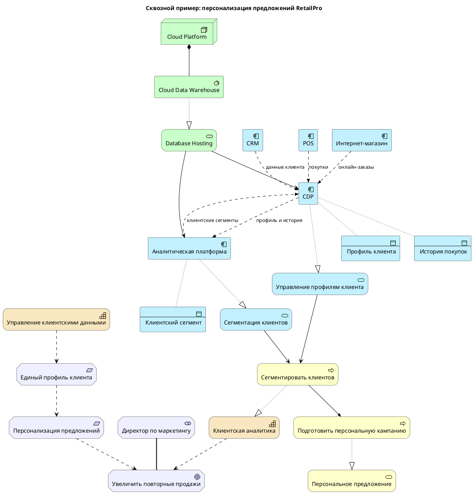

Промпт:



# Объяснение ArchiMate-диаграммы для топ-менеджмента

## Бизнес-цель и ценность

**Главная цель:** Увеличить повторные продажи за счёт персонализированных предложений для клиентов.

**Бизнес-ценность:**
- Рост лояльности клиентов через релевантные предложения
- Увеличение конверсии маркетинговых кампаний
- Снижение затрат на маркетинг за счёт таргетирования
- Конкурентное преимущество на рынке

---

## Как это работает (упрощённо)

### Текущая ситуация (проблема)
Сейчас данные о клиентах разрознены:
- **CRM** хранит историю взаимодействий
- **POS** (кассовые системы) фиксируют покупки в магазинах
- **Интернет-магазин** собирает данные об онлайн-заказах

Результат: мы не видим полную картину о клиенте и делаем общие предложения всем.

### Целевое состояние (решение)

**Шаг 1: Единый профиль клиента**
Все данные из CRM, POS и интернет-магазина стекаются в **CDP (Customer Data Platform)** — единую систему, которая формирует полный профиль каждого клиента.

**Шаг 2: Сегментация**
**Аналитическая платформа** анализирует профили и автоматически выделяет клиентские сегменты (например, "постоянные покупатели", "спящие клиенты", "любители скидок").

**Шаг 3: Персонализация**
Маркетинг использует сегменты для подготовки таргетированных кампаний с персональными предложениями.

---

## Ключевые компоненты решения

| Компонент | Бизнес-роль |
|---|---|
| **CDP** | Единое хранилище данных о клиентах |
| **Аналитическая платформа** | Автоматическая сегментация клиентов |
| **CRM, POS, интернет-магазин** | Источники данных о клиентах |
| **Облачная инфраструктура** | Технологическая основа для новых систем |

---

## Риски и ограничения

### Высокие риски
1. **Юридические риски** — необходимо учитывать согласия клиентов на обработку данных (требование юридического отдела)
2. **Интеграционные риски** — сложность подключения legacy-систем (CRM, POS) через API
3. **Риск данных** — качество и полнота данных из разных источников могут быть низкими

### Средние риски
4. **Организационные риски** — необходимость обучения маркетинга работе с новыми инструментами
5. **Технологические риски** — зависимость от облачного провайдера

---

## Этапы перехода (Roadmap)

### Этап 1: Foundation (3-4 месяца)
**Что делаем:**
- Готовим облачную инфраструктуру
- Разрабатываем единую модель данных клиента
- Внедряем систему управления согласиями клиентов

**Результат:** Готовая техническая основа, юридическая безопасность

**Бизнес-ценность:** Снижение рисков, готовность к внедрению CDP

---

### Этап 2: Integration (2-3 месяца)
**Что делаем:**
- Внедряем CDP
- Интегрируем CRM, POS и интернет-магазин через API
- Настраиваем автоматическое формирование единого профиля клиента

**Результат:** Единое представление о каждом клиенте

**Бизнес-ценность:** Видимость полной картины клиента, основа для персонализации

---

### Этап 3: Intelligence (2-3 месяца)
**Что делаем:**
- Внедряем аналитическую платформу
- Настраиваем автоматическую сегментацию клиентов
- Обучаем маркетинг работе с сегментами

**Результат:** Автоматические клиентские сегменты

**Бизнес-ценность:** Возможность таргетирования маркетинговых кампаний

---

### Этап 4: Personalization (2-3 месяца)
**Что делаем:**
- Разрабатываем процесс персонализации предложений
- Запускаем автоматическую генерацию персонализированных кампаний
- Внедряем измерение эффективности

**Результат:** Работающая система персонализации

**Бизнес-ценность:** Увеличение повторных продаж, рост ROI маркетинга

---

## Итоговая бизнес-ценность

**Через 10-12 месяцев после старта:**
- ✅ Единое представление о каждом клиенте
- ✅ Автоматическая сегментация и таргетирование
- ✅ Персонализированные предложения
- ✅ Юридическая безопасность обработки данных
- ✅ Измеримый рост повторных продаж

**Ключевой показатель успеха:** Увеличение повторных продаж на X% (целевое значение определяется директором по маркетингу).

---

## Что нужно от топ-менеджмента

1. **Финансирование** — бюджет на внедрение CDP, аналитической платформы и облачной инфраструктуры
2. **Приоритизация** — проект должен быть в топ-3 приоритетов компании
3. **Координация** — вовлечение IT, маркетинга, юридического отдела и операционного блока
4. **Терпение** — полный цикл реализации займёт 10-12 месяцев, первые результаты видны на этапе 3


---

---

# Объяснение для ИТ

__Промпт__

```
Объясни эту же ArchiMate-диаграмму для ИТ-команды.
Фокусируйся на приложениях, данных, интеграциях, API, технологических сервисах и зависимостях.
```

# Техническое объяснение ArchiMate-диаграммы для ИТ-команды

## Архитектура решения

### Прикладной слой (Application Layer)

**Существующие системы (Legacy):**
- **CRM** — система управления взаимоотношениями с клиентами
- **POS** — кассовые системы в физических магазинах
- **Интернет-магазин** — платформа онлайн-продаж

**Новые компоненты (Target Architecture):**
- **CDP (Customer Data Platform)** — центральная система консолидации данных о клиентах
- **Аналитическая платформа** — система для расчёта клиентских сегментов

---

## Сервисы приложений

| Сервис | Реализующий компонент | Назначение |
|---|---|---|
| **Управление профилем клиента** | CDP | Создание, чтение, обновление единого профиля клиента |
| **Сегментация клиентов** | Аналитическая платформа | Автоматический расчёт клиентских сегментов на основе данных |

---

## Модель данных

### Объекты данных

| Объект | Владелец | Описание |
|---|---|---|
| **Профиль клиента** | CDP | Единое представление клиента: демография, контакты, предпочтения |
| **История покупок** | CDP | Агрегированные данные о транзакциях из всех каналов |
| **Клиентский сегмент** | Аналитическая платформа | Результат сегментации: принадлежность клиента к сегменту |

### Потоки данных (Data Flow)

```
┌─────────┐    данные клиента     ┌─────┐
│   CRM   │ ────────────────────► │     │
 ─────────┘                       │     │
                                  │     │
┌─────────      покупки           │  CDP│
│   POS   │ ─────────────────────►│     │
└─────────┘                       │     │
                                  │     │
┌───────────┐   онлайн-заказы     │     │
│Интернет-  │ ───────────────────►│     │
│ магазин   │                     └──┬──┘
└───────────┘                        │
                                     │ профиль и история
                                     ▼
                               ┌───────────-───┐
                               │  Аналитическая│
                               │   платформа   │
                               └──────┬─────-──┘
                                      │
                                      │ клиентские сегменты
                                      ▼
                                   ┌─────┐
                                   │  CDP│
                                   └─────┘
```

---

## Интеграции и API

### Точки интеграции

**1. CRM → CDP**
- **Протокол:** API (REST/SOAP)
- **Данные:** Профили клиентов, история взаимодействий
- **Частота:** Near real-time или batch ( nightly)
- **Требование:** Интеграция должна выполняться через API

**2. POS → CDP**
- **Протокол:** API или ETL
- **Данные:** Транзакции, чеки, покупки
- **Частота:** Batch (ежечасно/ежедневно)

**3. Интернет-магазин → CDP**
- **Протокол:** API (REST)
- **Данные:** Онлайн-заказы, поведение на сайте, корзина
- **Частота:** Near real-time (event-driven)

**4. CDP ↔ Аналитическая платформа**
- **Протокол:** API (REST)
- **Направление 1:** CDP → Аналитика (профили и история для сегментации)
- **Направление 2:** Аналитика → CDP (готовые сегменты для активации)
- **Частота:** Batch (ежедневно) или по запросу

---

## Технологический слой (Technology Layer)

### Инфраструктура

```
┌─────────────────────────────────────┐
│         Cloud Platform              │
│  ┌───────────────────────────────┐  │
│  │   Cloud Data Warehouse        │  │
│  │  ┌─────────────────────────┐  │  │
│  │  │  Database Hosting       │  │  │
│  │  └─────────────────────────┘  │  │
│  └───────────────────────────────┘  │
└─────────────────────────────────────┘
         │                    │
         ▼                    ▼
    ┌─────────┐         ┌──────────────┐
    │   CDP   │         │  Аналитическая│
    │         │         │   платформа   │
    └─────────┘         └──────────────┘
```

**Компоненты:**
- **Cloud Platform** — облачная инфраструктура (AWS/Azure/GCP)
- **Cloud Data Warehouse** — облачное хранилище данных (Snowflake/BigQuery/Redshift)
- **Database Hosting** — сервис хостинга баз данных

**Зависимости:**
- Cloud Platform **содержит** Cloud Data Warehouse
- Cloud Data Warehouse **реализует** Database Hosting
- Database Hosting **обслуживает** CDP и Аналитическую платформу

---

## Зависимости между компонентами

### Критический путь развёртывания

```
1. Cloud Platform + Database Hosting
         ↓
2. CDP (требует Database Hosting)
         ↓
3. Интеграции CRM/POS/Интернет-магазин → CDP
         ↓
4. Аналитическая платформа (требует Database Hosting + данные из CDP)
         ↓
5. Двусторонняя интеграция CDP ↔ Аналитика
```

### Зависимости сервисов

| Сервис | Зависит от | Предоставляет |
|---|---|---|
| Управление профилем клиента | CDP, Database Hosting | Бизнес-процессу сегментации |
| Сегментация клиентов | Аналитическая платформа, Database Hosting | Бизнес-процессу сегментации |

---

## Технические требования

### Интеграционный слой
- **API Gateway** для управления всеми интеграциями
- **Authentication/Authorization** (OAuth 2.0, API keys)
- **Rate limiting** и мониторинг API
- **Data validation** на входе в CDP

### Данные
- **Data Quality:** валидация и очистка данных из legacy-систем
- **Data Governance:** управление согласиями клиентов (consent management)
- **Data Lineage:** отслеживание происхождения данных
- **Master Data Management:** разрешение дубликатов клиентов

### Безопасность
- **Encryption at rest** (Cloud Data Warehouse)
- **Encryption in transit** (TLS для всех API)
- **Access control** (RBAC для CDP и аналитики)
- **Audit logging** для всех операций с данными клиентов

### Масштабируемость
- **Horizontal scaling** для CDP и аналитической платформы
- **Auto-scaling** в Cloud Platform
- **Data partitioning** в Cloud Data Warehouse

---

## Риски для ИТ-команды

### Высокие риски
1. **Качество данных в legacy-системах** — CRM, POS и интернет-магазин могут иметь разные форматы и стандарты данных
2. **Производительность интеграций** — real-time синхронизация может создать нагрузку на legacy-системы
3. **Data consistency** — обеспечение консистентности данных между системами

### Средние риски
4. **API stability** — стабильность API legacy-систем (CRM, POS)
5. **Cloud vendor lock-in** — зависимость от конкретного облачного провайдера
6. **Data volume** — объём данных может превысить ожидания

---

## Рекомендуемый стек технологий (предположение)

| Компонент | Технология (пример) |
|---|---|
| CDP | Segment, Tealium, или кастомное решение |
| Аналитическая платформа | Python/Spark + ML модели |
| Cloud Data Warehouse | Snowflake / BigQuery / Redshift |
| API Gateway | Kong / Apigee / AWS API Gateway |
| Data Integration | Apache Kafka / MuleSoft / custom ETL |
| Consent Management | OneTrust / кастомное решение |

---

## Чек-лист для ИТ-команды

- [ ] Определить API контракты для всех интеграций
- [ ] Разработать схему данных единого профиля клиента
- [ ] Настроить Cloud Platform и Database Hosting
- [ ] Реализовать data pipeline из CRM/POS/интернет-магазина в CDP
- [ ] Настроить двустороннюю интеграцию CDP ↔ Аналитика
- [ ] Реализовать consent management
- [ ] Настроить мониторинг и алертинг
- [ ] Провести нагрузочное тестирование
- [ ] Документировать архитектуру и API