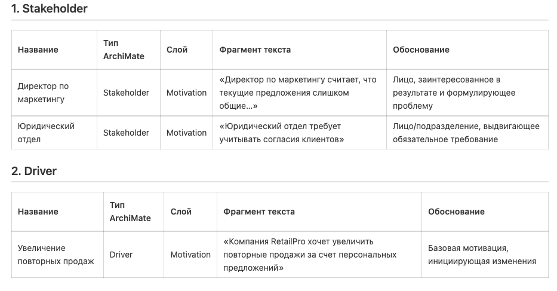
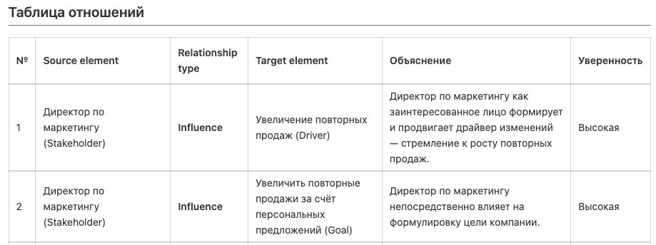
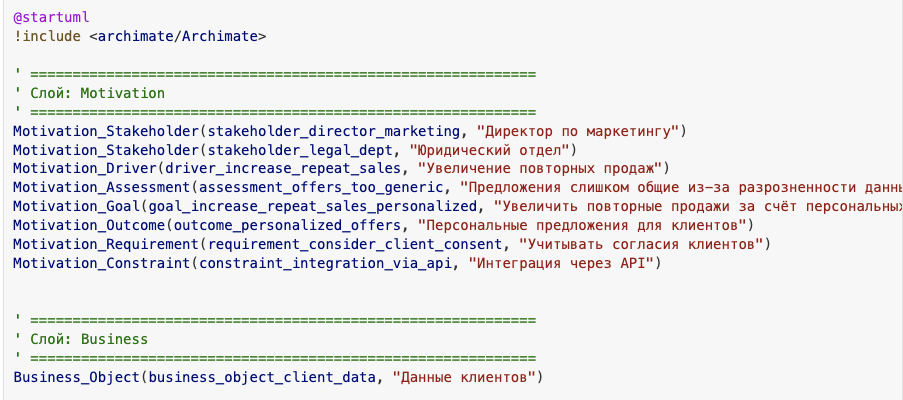
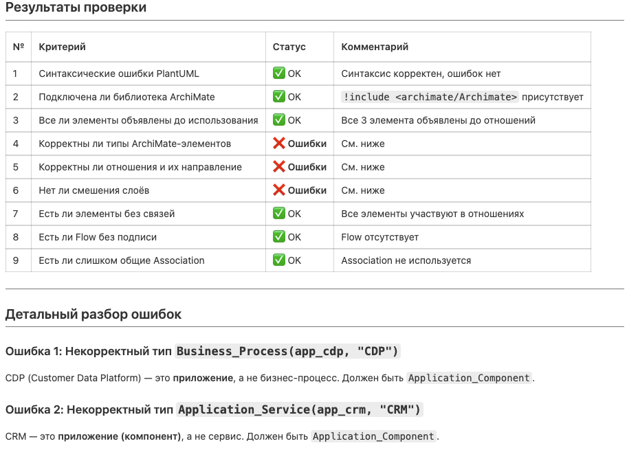
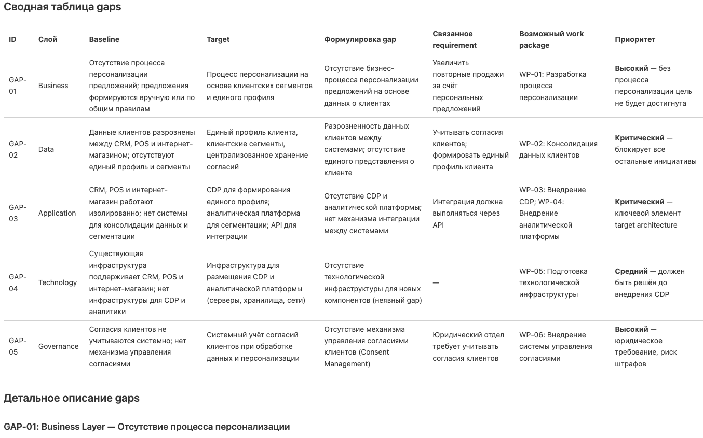
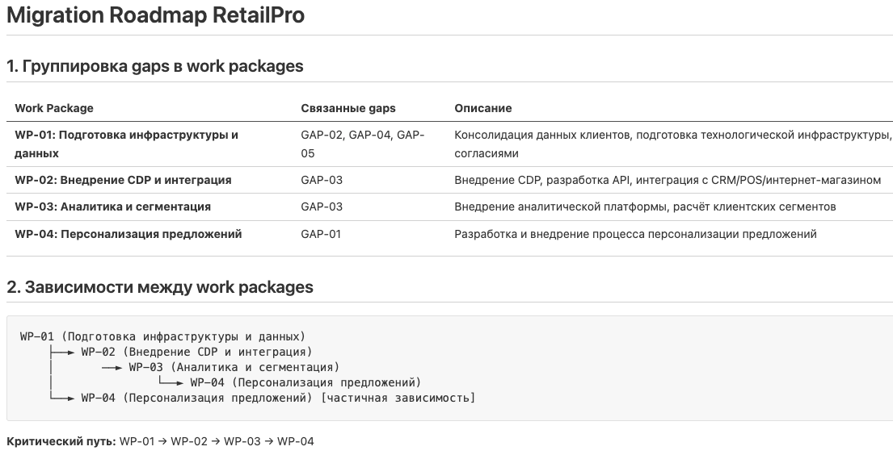
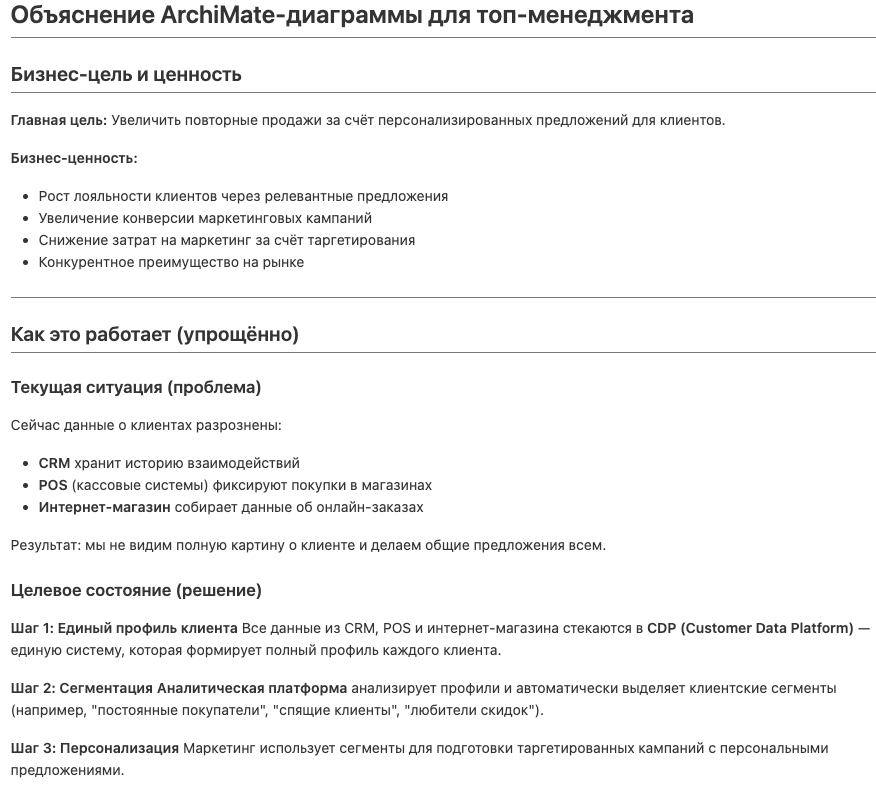
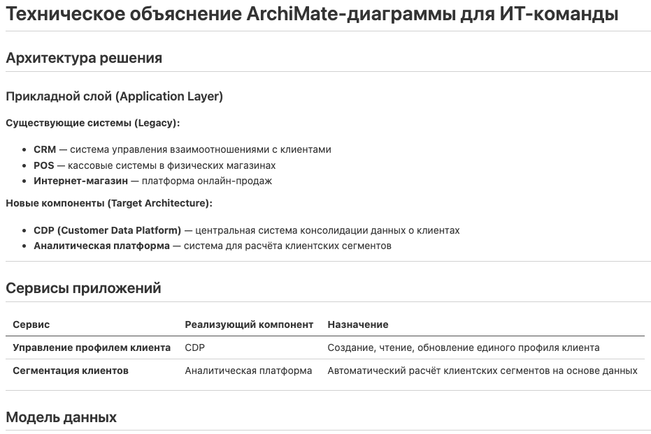
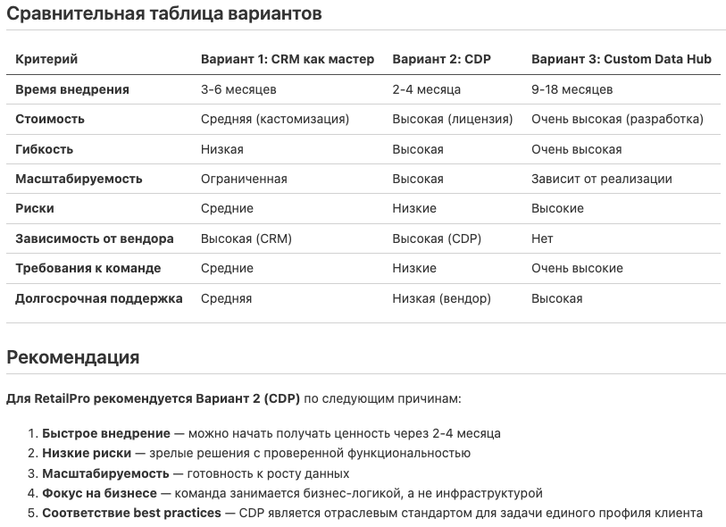

# Глава 9. Моделирование архитектуры предприятия с ИИ-ассистентом

[← Предыдущая глава](../08-archimate-in-plantuml/README.md) · [К оглавлению](../README.md) · [Следующая глава →](../10-ai-agent-opencode/README.md)

**После изучения этой главы студент должен уметь:**

1. объяснять, как ИИ может помогать архитектору предприятия;
2. применять ИИ для извлечения архитектурных элементов из текстового описания;
3. формулировать промпты для генерации ArchiMate-моделей;
4. использовать ИИ для генерации PlantUML-кода;
5. проверять ИИ-сгенерированные диаграммы на синтаксическую и семантическую корректность;
6. выявлять типичные ошибки ИИ при работе с ArchiMate;
7. использовать ИИ для gap-анализа и migration roadmap;
8. понимать ограничения ИИ и риски галлюцинаций;
9. организовывать человеко-машинный процесс моделирования;
10. документировать, как ИИ использовался в архитектурной работе.

## 9.1. Учебная ситуация: RetailPro хочет ускорить архитектурное моделирование

Архитектор RetailPro получил от руководства описание инициативы:

```text
Компания RetailPro хочет увеличить повторные продажи за счет персональных предложений.
Сейчас данные о клиентах хранятся в CRM, POS и интернет-магазине.
Согласия клиентов не синхронизированы.
Маркетологи формируют сегменты вручную в Excel.
Компания планирует внедрить CDP, создать Customer API, интегрировать POS и интернет-магазин, а также использовать аналитическую платформу для автоматической сегментации клиентов.
```

Согласно описанной выше процедуре архитектор должен:

- выделить stakeholders, goals, requirements;
- описать бизнес-процессы;
- определить приложения и данные;
- построить ArchiMate-диаграммы;
- выполнить gap-анализ;
- подготовить migration roadmap;
- сгенерировать PlantUML-код;
- объяснить модель разным аудиториям.

Вручную это занимает время. ИИ может помочь быстрее подготовить черновик. Но если принять результат ИИ без проверки, можно получить архитектурно неверную модель. Поэтому важно научиться использовать ИИ как **ассистента**, а не как замену архитектора.

## 9.2. Как ИИ может помогать архитектору предприятия

ИИ особенно полезен там, где архитектурная работа начинается с текста:

- интервью;
- описания проблемы;
- протоколы совещаний;
- презентации;
- пользовательские истории;
- технические задания;
- стратегии;
- проектные заявки.

**Таблица 9.1.** Основные сценарии использования ИИ

| Сценарий | Что делает ИИ | Что проверяет архитектор |
|---|---|---|
| Извлечение элементов | выделяет goals, processes, apps, data и другие элементы | корректность типов |
| Генерация диаграммы | создает PlantUML-код | синтаксис и отношения |
| Объяснение модели | описывает диаграмму словами | точность интерпретации |
| Gap-анализ | сравнивает baseline и target | полноту и реалистичность |
| Roadmap | предлагает work packages | зависимости и приоритеты |
| Проверка модели | ищет ошибки | экспертно подтверждает |
| Адаптация под аудиторию | пишет объяснение для бизнеса или ИТ | стиль и смысл |
| Генерация альтернатив | предлагает варианты target architecture | реализуемость и риски |

ИИ хорошо справляется со структурированием текста, первичной классификацией элементов, генерацией чернового PlantUML и объяснением диаграмм. Но ИИ также может:

- выдумывать элементы, которых нет в описании;
- путать бизнес-процессы и приложения;
- путать requirement и solution;
- использовать неверные отношения ArchiMate;
- создавать неподдерживаемые PlantUML-макросы;
- пропускать важные ограничения;
- не учитывать организационный контекст;
- делать слишком общие выводы;
- создавать убедительно звучащие, но ложные объяснения.

Следует помнить, что ИИ не несет ответственности за архитектурное решение. Ответственность остается у человека. Поэтому архитектор должен проверять:

- соответствие модели реальному контексту;
- корректность терминов ArchiMate;
- корректность отношений;
- полноту требований;
- отсутствие галлюцинаций;
- реализуемость target architecture;
- риски;
- соответствие архитектурным принципам;
- пригодность модели для аудитории.

**Пример.** ИИ может сгенерировать:

```text
Business_Process(app_cdp, "CDP")
```

Это ошибка, потому что CDP — не бизнес-процесс, а приложение. Правильно:

```text
Application_Component(app_cdp, "CDP")
```

## 9.3. Общий процесс ИИ-ассистированного моделирования

**Рекомендуемый процесс:**

```text
1. Подготовить исходные документы.
2. Попросить ИИ выделить элементы.
3. Проверить классификацию элементов.
4. Попросить ИИ построить связи.
5. Проверить отношения ArchiMate.
6. Попросить ИИ сгенерировать PlantUML.
7. Скомпилировать PlantUML.
8. Исправить синтаксис.
9. Проверить архитектурную логику.
10. Документировать изменения и решения.
```

Почему не стоит сразу просить «нарисуй диаграмму». Плохой промпт:

```text
Нарисуй ArchiMate-диаграмму для RetailPro на основе приложенных документов
```

Лучше разделить задачу на этапы:

```text
Сначала выдели элементы.
Затем классифицируй их.
Затем предложи связи.
Затем сгенерируй PlantUML.
Затем проверь модель.
Проведи gap-анализ.
Построй дорожную карту миграции на новую архитектуру.
```

Ниже приводится набор промптов, реализующих эти этапы. Примеры их выполнения с помощью модели Qwen-3.7Plus приведены в файлах md, сопровождающих этот учебник.

## 9.4. Промпт 1: извлечение архитектурных элементов из текста

Этот промпт используется, чтобы из текстового описания получить список элементов ArchiMate.

**Шаблон промпта**

```text
Ты — архитектор предприятия и эксперт по ArchiMate.

На основе описания ниже выдели архитектурные элементы. Раздели их по категориям:
1. Stakeholder
2. Driver
3. Assessment
4. Goal
5. Outcome
6. Requirement
7. Constraint
8. Principle
9. Capability
10. Business Process
11. Business Object
12. Application Component
13. Application Service
14. Application Interface
15. Data Object
16. Technology Element
17. Gap
18. Work Package

Для каждого элемента укажи:
- название;
- тип ArchiMate;
- слой;
- фрагмент текста, из которого он извлечен;
- краткое обоснование.

Не добавляй элементы, которых нет в описании, если они явно не следуют из текста.

Описание:
[ВСТАВЬТЕ ОПИСАНИЕ]
```

Пример исходного текста

```text
Компания RetailPro хочет увеличить повторные продажи за счет персональных предложений.
Директор по маркетингу считает, что текущие предложения слишком общие,
потому что данные клиентов разрознены между CRM, POS и интернет-магазином.
Компания планирует внедрить CDP, которая будет формировать единый профиль клиента.
Аналитическая платформа будет рассчитывать клиентские сегменты.
Интеграция должна выполняться через API.
Юридический отдел требует учитывать согласия клиентов.
```

Фрагмент ожидаемого ответа:



Детали см. в файле 01_Elements.md

## 9.5. Промпт 2: построение отношений между элементами

После выделения элементов нужно определить связи.

Шаблон промпта

```text
Ты — эксперт по ArchiMate.

На основе списка элементов ниже предложи отношения ArchiMate.
Для каждого отношения укажи:
- source element;
- relationship type;
- target element;
- объяснение на естественном языке;
- уверенность: высокая / средняя / низкая.

Используй только отношения:
Association, Influence, Assignment, Realization, Serving, Access, Flow, Triggering, Aggregation, Composition.

Не используй Association, если можно выбрать более точное отношение.
Если отношение спорное, пометь его как "требует проверки архитектором".

Список элементов:
[ВСТАВЬТЕ СПИСОК]
```

**Примечание:** если этот промпт используется в рамках единой сессии с предыдущим, можно сослаться на результаты, полученные на первом этапе, тогда их повторно вводить не нужно.

Фрагмент ожидаемого ответа:



Детали см в файле 02_Relationships.md

## 9.6. Промпт 3: генерация PlantUML-кода ArchiMate

Этот промпт используется после того, как элементы и отношения уже определены.

**Шаблон**

```plantuml
Ты — эксперт по ArchiMate и PlantUML.

Сгенерируй PlantUML-код для ArchiMate-диаграммы на основе элементов и отношений ниже.

Требования:
1. Используй библиотеку: !include <archimate/Archimate>
2. Диаграмма должна начинаться с @startuml и заканчиваться @enduml.
3. Используй наименования элементов по шаблону Layer_ElementType(id, displayed_name), пример: Motivation_Stakeholder(stakeholder_director_marketing, “Директор по маркетингу»)за исключением имен для Business_Object, Business_Service, Business_Function,Busness_Event, Application_Service, Application_interface, Application_Service, Application_Function, Application_Process.
4. Используй идентификаторы латиницей в snake_case.
5. Все отображаемые имена заключай в кавычки.
6. Сгруппируй элементы комментариями по слоям:
   Motivation, Strategy, Business, Application, Technology, Implementation.
7. Сначала объяви все элементы, затем все отношения.
8. Используй только стандартные отношения:
   Rel_Association, Rel_Influence, Rel_Assignment, Rel_Realization,
   Rel_Serving, Rel_Access, Rel_Flow, Rel_Triggering,
   Rel_Aggregation, Rel_Composition.
9. Не добавляй элементы, которых нет в списке.
10. После кода укажи спорные места модели.

Элементы:
[ВСТАВЬТЕ ЭЛЕМЕНТЫ]

Отношения:
[ВСТАВЬТЕ ОТНОШЕНИЯ]
```

**Примечание:** LLM часто путают названия элементов ArchiMate в PlantUML. Пункт 3 данного промпта частично решает эту проблему, но лучше передавать модели более полные и строгие правила именования элементов.

Фрагмент ожидаемого ответа:



Детали см в файле 03_PlantUML.md

## 9.7. Промпт 4: проверка PlantUML-кода

ИИ можно использовать как ревьюера PlantUML-кода.

**Шаблон промпта**

```text
Ты — эксперт по ArchiMate и PlantUML.

Проверь следующий PlantUML-код.

Проверь:
1. Есть ли синтаксические ошибки PlantUML?
2. Подключена ли библиотека ArchiMate?
3. Все ли элементы объявлены до использования?
4. Корректны ли типы ArchiMate-элементов?
5. Корректны ли отношения и их направление?
6. Нет ли смешения бизнес-процессов, приложений, данных и технологий?
7. Есть ли элементы без связей?
8. Есть ли Flow без подписи?
9. Есть ли слишком общие Association, которые можно заменить более точными отношениями?
10. Предложи исправленную версию кода.

Код:
[ВСТАВЬТЕ КОД]
```

Пример ошибки для проверки

```plantuml
@startuml
!include <archimate/Archimate>

Business_Process(app_cdp, "CDP")
Application_Service(app_crm, "CRM")
Data_Object(bp_segment, "Сегментировать клиентов")

Rel_Realization(app_crm, app_cdp)
Rel_Access(bp_segment, app_crm)

@enduml
```

Фрагмент ожидаемого ответа:



Детали см. в файле 04_ErrorsCorrection.md

## 9.8. Промпт 5: ИИ для gap-анализа

ИИ может помочь сравнить baseline и target description и предложить gaps.

**Шаблон промпта**

```text
Ты — архитектор предприятия.

Сравни baseline architecture и target architecture.
Выяви архитектурные gaps по слоям:
1. Business
2. Data
3. Application
4. Technology
5. Governance

Для каждого gap укажи:
- ID;
- слой;
- baseline;
- target;
- формулировку gap;
- связанное requirement, если можно определить;
- возможный work package;
- комментарий по приоритету.

Baseline:
[ВСТАВЬТЕ BASELINE]

Target:
[ВСТАВЬТЕ TARGET]
```

Фрагмент ожидаемого ответа:



Детали представлены в файле 05_GapAnalysis.md

## 9.9. Промпт 6: ИИ для migration roadmap

После gap-анализа ИИ может предложить work packages и roadmap.

**Шаблон промпта**

```text
Ты — архитектор предприятия.

На основе списка gaps и requirements предложи migration roadmap.

Сделай:
1. Сгруппируй gaps в work packages.
2. Определи зависимости между work packages.
3. Предложи 3–5 transition plateaus.
4. Для каждого plateau укажи бизнес-ценность.
5. Сформируй roadmap по кварталам.
6. Сгенерируй PlantUML-код Migration View с элементами:
   - Plateau
   - Gap
   - Work Package
   - Deliverable
   - Requirement
7. Не добавляй технологий, которых нет в исходных данных, без пометки "предположение".

Gaps and requirements:
[ВСТАВЬТЕ СПИСОК]
text
```

Фрагмент ожидаемого ответа:



Детали в файле 06_MigrationRoadmap.md

## 9.10. Промпт 7: ИИ для объяснения диаграммы разным аудиториям

Одна и та же диаграмма может быть объяснена по-разному.

**Промпт для объяснения топ-менеджменту**

```text
Объясни следующую ArchiMate-диаграмму для топ-менеджмента.
Фокусируйся на бизнес-ценности, целях, рисках и этапах перехода.
Не используй технические детали без необходимости.

PlantUML-код:
[ВСТАВЬТЕ КОД]
```

Фрагмент ожидаемого ответа:



**Промпт для объяснения ИТ-команде**

```text
Объясни следующую ArchiMate-диаграмму для ИТ-команды.
Фокусируйся на приложениях, данных, интеграциях, API, технологических сервисах и зависимостях.

PlantUML-код:
[ВСТАВЬТЕ КОД]
```

Фрагмент ожидаемого ответа:



Детали см. в файле 07_Explanation.md

## 9.11. ИИ для генерации альтернативных архитектурных вариантов

ИИ можно использовать для первичной генерации вариантов решения. Но еще раз напомним, что выбор остается за архитектором.

**Пример промпта**

```text
Ты — архитектор предприятия.

Для требования "единый профиль клиента" предложи 3 архитектурных варианта:
1. развивать CRM как мастер-систему;
2. внедрить CDP;
3. построить собственное хранилище клиентских данных.

Для каждого варианта укажи:
- описание;
- преимущества;
- недостатки;
- риски;
- зависимость от текущей архитектуры;
- какие ArchiMate-элементы появятся;
- какие work packages потребуются.
```

Фрагмент ожидаемого ответа:



Подробности в файле 08_AlternativesComparison.md

## 9.12. Как проверять ИИ-сгенерированную ArchiMate-модель

**Таблица 9.2.** Чек-лист проверки

| Проверка | Вопрос |
|---|---|
| Контекст | соответствует ли модель исходному описанию? |
| Галлюцинации | нет ли выдуманных систем и требований? |
| Типы элементов | корректно ли классифицированы элементы? |
| Отношения | корректны ли типы и направления отношений? |
| Слои | не смешаны ли бизнес, приложения и технологии? |
| Данные | представлены ли ключевые Data Objects? |
| Требования | связаны ли requirements с goals? |
| Gaps | являются ли gaps разрывами, а не работами? |
| Work packages | закрывают ли work packages конкретные gaps? |
| PlantUML | компилируется ли код? |
| Читаемость | можно ли объяснить диаграмму за 2–3 минуты? |

Проверка отношений естественным языком. Для каждого отношения сформулируйте фразу:

```text
CDP реализует сервис управления профилем клиента.
Сервис сегментации обслуживает процесс сегментации клиентов.
POS передает покупки в CDP.
```

Если фраза звучит странно, отношение требует исправления.

## 9.13. Документирование использования ИИ

В учебном проекте важно не только использовать ИИ, но и показать, как именно он применялся.

**Таблица 9.3.** Что нужно документировать

| Что фиксировать | Пример |
|---|---|
| исходный промпт | запрос на выделение элементов |
| ответ ИИ | таблица элементов |
| исправления студента | CRM перенесена из Business Process в Application Component |
| причины исправлений | CRM является приложением |
| итоговая модель | исправленный PlantUML |
| ограничения | часть связей требует экспертной проверки |

Пример записи в отчете

```text
ИИ использовался для первичного выделения ArchiMate-элементов из описания кейса.
В ответе ИИ ошибочно классифицировал CDP как Business Process.
Ошибка была исправлена: CDP смоделирована как Application Component.
Также были уточнены отношения: связь POS → CDP заменена с Association на Flow, так как речь идет о передаче данных о покупках.
```

## 9.14. Рекомендуемый workflow для студентов

Последовательность работы

```text
1. Самостоятельно прочитать кейс.
2. Сформулировать цель модели.
3. Попросить ИИ выделить элементы.
4. Проверить и исправить элементы.
5. Попросить ИИ предложить отношения.
6. Проверить отношения.
7. Попросить ИИ сгенерировать PlantUML.
8. Скомпилировать диаграмму.
9. Исправить ошибки.
10. Написать объяснение модели.
11. Зафиксировать, какие исправления были внесены человеком.
```

**Минимальное требование к учебной работе. Студент должен показать:**

```text
исходный промпт;
черновой ответ ИИ;
выявленные ошибки;
исправленную модель;
итоговый PlantUML-код;
объяснение диаграммы.
```

## 9.15. Практикум

**Задание 1. Сформулируйте промпт.** Для кейса EduSmart сформулируйте промпт на выделение элементов ArchiMate.

```text
EduSmart хочет снизить отток студентов.
Данные студентов хранятся в LMS, CRM, платежной системе и системе вебинаров.
Кураторы поздно узнают о студентах с риском отчисления.
Компания планирует создать единый профиль студента, интегрировать источники данных через Student API и использовать аналитическую платформу для расчета риска отчисления.
CRM должна получать список студентов с высоким риском, а Student Portal должен показывать рекомендации студенту.
```

**Задание 2. Получите ответ ИИ и проверьте его.** Проверьте:

```text
не перепутаны ли приложения и процессы;
не названа ли LMS бизнес-ролью;
не назван ли риск отчисления приложением;
не добавлены ли лишние системы;
есть ли Data Objects;
есть ли Requirements;
```

**Задание 3. Сгенерируйте PlantUML.** Попросите ИИ сгенерировать PlantUML-код.

**Задание 4. Исправьте ошибки.** Формат отчета:

| Ошибка ИИ | Исправление | Обоснование |
|---|---|---|
| | | |

**Задание 5. Подготовьте сквозную диаграмму.** Она должна включать:

- Goal;
- Assessment;
- Requirement;
- Business Process;
- Application Components;
- Application Services;
- Data Objects;
- Technology Element;
- корректные Flow, Access, Realization, Serving.

## 9.16. Контрольные вопросы

1. Как ИИ может помогать архитектору предприятия?
2. Почему ИИ не заменяет архитектора?
3. Какие задачи ИИ выполняет хорошо?
4. Какие ошибки ИИ часто допускает в ArchiMate?
5. Почему важно сначала выделять элементы, а не сразу генерировать диаграмму?
6. Какой промпт использовать для извлечения элементов из текста?
7. Какой промпт использовать для построения отношений?
8. Какой промпт использовать для генерации PlantUML?
9. Какой промпт использовать для проверки PlantUML?
10. Как проверить ИИ-сгенерированную модель?
11. Что такое галлюцинация ИИ в архитектурном моделировании?
12. Почему нужно проверять направление Realization и Serving?
13. Как ИИ может помочь в gap-анализе?
14. Как ИИ может помочь в migration roadmap?
15. Как документировать использование ИИ в учебном проекте?
16. Какие минимальные материалы нужно показать, если студент использовал ИИ?

## 9.17. Краткие выводы главы

1. ИИ может существенно ускорить архитектурное моделирование, но не заменяет архитектора.
2. Лучше использовать ИИ поэтапно: элементы → отношения → PlantUML → проверка.
3. Хороший промпт должен задавать роль, задачу, формат ответа, ограничения и критерии проверки.
4. ИИ полезен для извлечения элементов, генерации диаграмм, gap-анализа, roadmap и объяснения моделей.
5. ИИ часто ошибается в типах ArchiMate-элементов и отношениях.
6. PlantUML удобен для ИИ-ассистированного моделирования, потому что является текстовым форматом.
7. Любая ИИ-сгенерированная модель должна проходить синтаксическую и семантическую проверку.
8. В учебной работе нужно документировать, как использовался ИИ и какие исправления внес человек.
9. Ответственность за итоговую архитектурную модель несет студент или архитектор, а не ИИ.
10. Главная ценность ИИ — не автоматическая замена мышления, а ускорение черновой работы и повышение качества проверки при грамотном использовании.

---

[← Предыдущая глава](../08-archimate-in-plantuml/README.md) · [К оглавлению](../README.md) · [Следующая глава →](../10-ai-agent-opencode/README.md)
